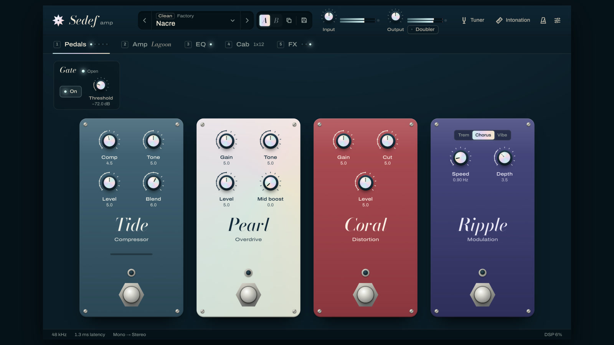
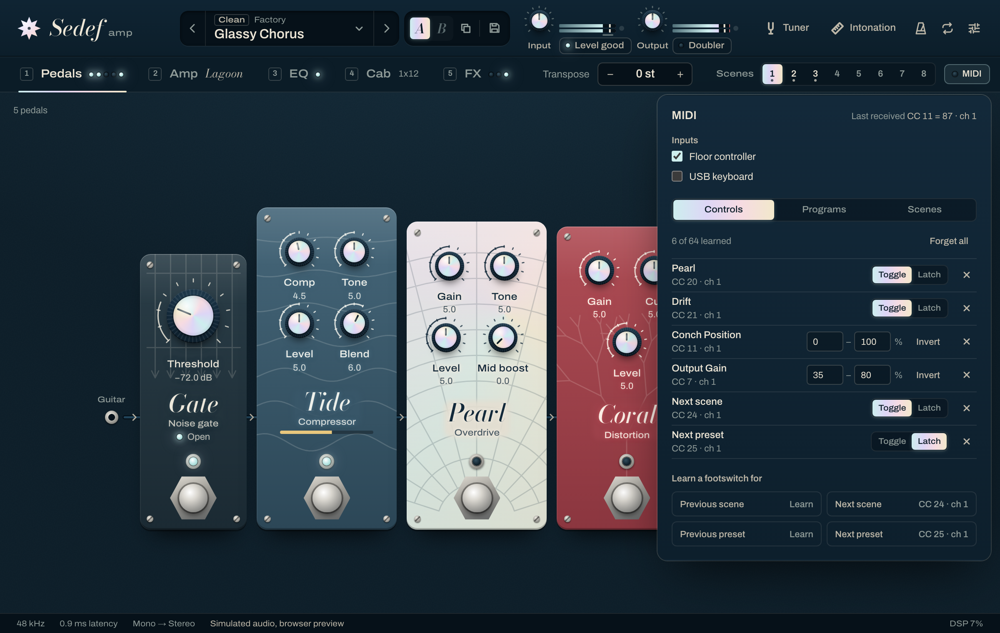
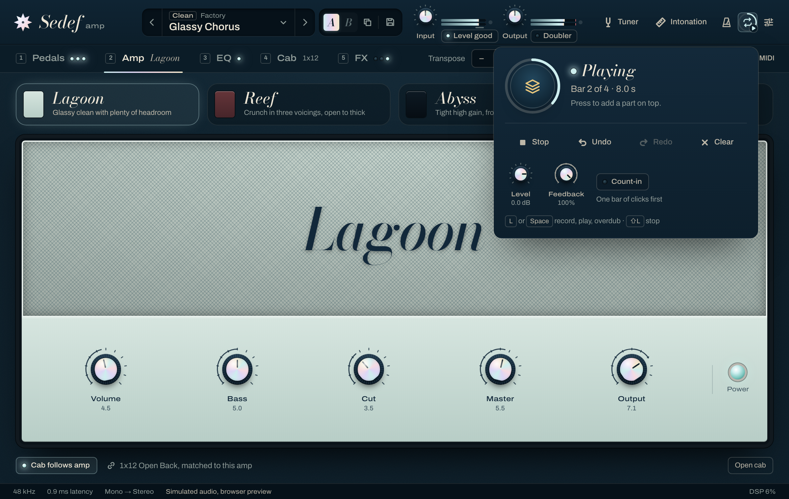
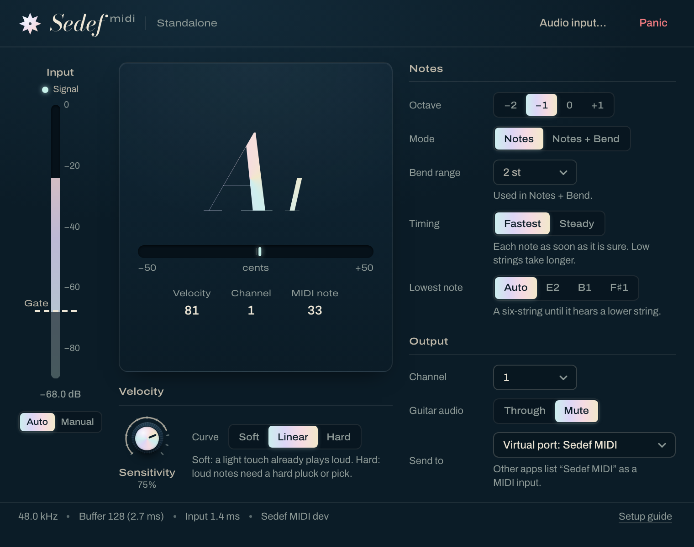

<div align="center">

# Sedef Amp

**An open-source guitar amp and effects suite, with a tuner that teaches your guitar to play in tune.**

VST3 · AU · CLAP · Standalone — macOS, Windows, Linux

[](https://github.com/mr-kaynak/sedef-amp/actions/workflows/ci.yml)
[](LICENSE)

<a href="docs/media/sedef-trailer.mp4"></a>

**[▶ Watch the 48-second trailer](docs/media/sedef-trailer.mp4)** · [how it was made](docs/trailer.md)

</div>

*Sedef* (seh-DEF) is Turkish for mother-of-pearl: the shimmering inlay on fine instruments, and
the sound we're after. Glassy cleans, warm crunch, singing leads, and time effects that melt
around them.

## What's inside

| | |
|---|---|
| **Pedals** | A pedalboard: add the pedals you want, drag them into any order, saved with the session and presets · **Gate** noise gate · **Trench** octave down (one and two octaves; Mono, analog style, or Poly, for chords) · **Anemone** envelope filter · **Conch** inductor wah with Auto mode · **Remora** two-transistor fuzz (germanium / silicon, bias, cleans up with the guitar's volume) · **Tide** compressor (3:1, tilt EQ, parallel blend) · **Urchin** octave-up fuzz · **Sargasso** sustain fuzz with a mid-scoop tone · **Pearl** transparent overdrive with mid boost · **Kelp** classic mid-hump overdrive, also a tight boost · **Coral** distortion · **Beacon** photocell vibe · **Gyre** 4- or 6-stage phaser · **Jetty** flanger with ± feedback · **Ripple** tremolo / chorus / vibrato · **Breaker** treble booster (Treble / Full range) |
| **Amps** | **Lagoon** — glassy, wide clean · **Reef** — British crunch with three voicings · **Abyss** — tight, saturated lead with bright and mid-shift switches |
| **Captures** | load any Neural Amp Modeler (`.nam`) capture of a real amp or full rig in place of the amps, levelled to match them |
| **Cabs** | 1x12 open, 2x12 open, 4x12 closed · two mics per cab from ten mic models, placed anywhere over the cone, backed off and turned off axis · room mics · load your own IRs |
| **EQ** | 9-band graphic EQ with low/high cut, one bank per amp |
| **Sedef MIDI** | a companion that plays MIDI instruments from your guitar, one note at a time ([below](#sedef-midi)) |
| **Post** | **Drift** multi-head tape echo with wow, flutter and tape saturation · **Fathom** plate and hall reverbs · **Doubler**, a second take that differs from note to note, switched on from the header |
| **Tools** | **Transpose**: play up to an octave lower or higher without retuning, chords included (3 ms of latency down, 10 ms up, none at 0) · **input level guide**: the input meter shows where the presets want your level and says in words whether it is right, too quiet or too hot · precision tuner · **intonation workbench** · **drums** to play along with (standalone): thirteen original grooves from straight rock to 12/8, with fills and one intensity control, on a kit synthesised from drum physics ([docs/drums.md](docs/drums.md)) · metronome with odd meters (standalone) · **looper** with overdub and undo, free or locked to the click's bars (standalone) |
| **Presets** | browser with categories, tags and search · click to audition, Esc to go back · A/B compare · Undo when a load or delete would lose work |
| **Live** | **MIDI learn** on any control: right-click, then move a pedal or press a footswitch · program changes load presets · **8 scenes** per preset (pedals on/off plus knobs you pick), switched by footswitch without a gap ([below](#playing-live)) |


 

## Presets

Click a preset and it plays at once, while the browser stays open; the arrow keys walk the list
the same way. Enter keeps it. Esc puts back exactly what you had when you opened the browser,
unsaved tweaks included. The list is grouped from clean to ambient, and every row is one line:
a name that says the sound, the amp and the chain that's switched on, with a line about the
sound and its tags as you point at it, so you can read a rig before you hear it. Compare two versions with A/B,
save your own with a category, tags and a note, and never lose edits: loads and deletes come with
Undo. See [docs/ui/presets.md](docs/ui/presets.md) for the design.


## Playing live

Right-click any knob, switch or scene and choose **Learn MIDI**, then press a footswitch or move
an expression pedal: that is the binding. Sedef tells a momentary footswitch from a latching one
by itself, and a pedal can sweep a knob's whole travel or just part of it, turned either way.
Program changes load presets in library order, or the preset or scene you assign. Each preset
has 8 scenes, which pedals and blocks are on plus up to 16 knobs you choose; switching is instant
and gapless, and a scene remembers what you change while it plays. Bindings belong to your
controller, so they are the same in every session; scenes are saved with the preset and the
session. The VST3 version receives controllers but no program changes, and Logic Pro sends no MIDI
to effects (assign Logic's controllers to the Scene parameter instead). See
[docs/live.md](docs/live.md).



## Captures

Pick **Capture** next to the three amps and load a Neural Amp Modeler file, or drop one on the
panel. Sedef levels it to sit with the built-in amps, shows what it is (the gear, who captured it,
the model), and turns its own cab off when the file says it's a full rig. Input and output trims
set how hard you hit it; if the capture records its interface level, set yours once in the panel
and it responds as the real amp did. Sessions keep the capture itself, so a project opens with the
same sound on another computer; presets keep a reference to the file. Sedef ships no captures:
find thousands on [TONE3000](https://www.tone3000.com). See [docs/dsp/nam.md](docs/dsp/nam.md).


## Looper

In the standalone app, the looper button next to the metronome opens a looper for practice and
writing. One button (or the `L` key, so a hand stays on the guitar) records, closes the loop and
plays it, then adds parts on top. With the click running the loop snaps to whole bars, starting
exactly on the "1", with an optional bar of count-in, and the click stays locked to it however
long you play. Undo takes back the last part, Clear has an Undo too, and Feedback sets how much
of the old take stays under a new one. It records the sound you hear, effects included, so you can
change presets and solo over your rhythm part. Every start, stop and seam is crossfaded: no
clicks. See [docs/looper.md](docs/looper.md) for the design, the timing to the sample and the
memory it uses.



## The intonation workbench

A guitar can be perfectly tuned and still play out of tune higher up the neck. The fix is moving
each string's saddle, and Sedef tells you exactly which way and how far:

1. Pick your instrument and scale length (6/7-string guitar, 4/5-string bass, or custom).
2. Tune the open string. Within 5 cents is plenty: Sedef measures the string as it actually
   plays, so it doesn't have to be spot on.
3. Play the 12th fret. Sedef skips the pick attack, averages one second of the sustained note
   (the open string is read the same way), and reports the octave error to a tenth of a cent.
4. Get a clear answer: *"+3.8 cents sharp: move the saddle about 1.4 mm away from the neck."*


The estimate uses `Δs ≈ L · (2^(c/1200) − 1)` for scale length `L` and octave error `c` cents.
See [docs/intonation.md](docs/intonation.md) for the method and its limits.

## Sedef MIDI

Sedef MIDI plays MIDI instruments from your guitar: play a bass line on the guitar, hear it on a
bass instrument, and record it as MIDI to edit afterwards. It comes with Sedef Amp's installer on
every OS.

- **One note at a time:** melodies and bass lines, not chords. An octave switch (−1 by default, a
  bass's register), velocity from how hard you pluck or pick, and note-offs that follow your
  muting.
- **Any input level, fingers or a pick:** the gate follows your interface's own noise and velocity
  follows your playing, so it works with every setting at its default.
- **Standalone app** with its own MIDI port, "Sedef MIDI", which other programs list as a MIDI
  input (on Windows it sends to a MIDI output you pick), and a **plug-in** (VST3, CLAP, AU) for
  the guitar track.
- **In Logic:** load **Sedef MIDI (Instrument)** on an instrument track with the guitar track as its
  side chain, then record on a second instrument track that takes **MIDI From** it.
- **Fastest** timing (22 ms on the low E, 13 ms on the G string, 9 to 12 ms above) or **Steady**
  (every note 38 ms after you play it, for one fixed track delay).



[docs/midi.md](docs/midi.md) covers setup in Logic and other hosts and playing tips;
[the design](docs/design/guitar-to-midi.md) covers how it works and what was measured.

## Install

### [Download for macOS](https://github.com/mr-kaynak/sedef-amp/releases/latest/download/Sedef-Amp-macOS.dmg)

macOS 11 or later, Apple silicon and Intel. Open the disk image and double-click
**Install Sedef Amp**. The installer isn't notarized yet, so the first time macOS stops it: open
**System Settings → Privacy & Security** and click **Open Anyway**.

### [Download for Windows](https://github.com/mr-kaynak/sedef-amp/releases/latest/download/Sedef-Amp-Windows-Setup.exe)

Windows 10 or 11, x64. Run the installer. If SmartScreen says *Windows protected your PC*, click
**More info**, then **Run anyway** (the installer isn't code-signed yet).

### [Download for Linux](https://github.com/mr-kaynak/sedef-amp/releases/latest/download/Sedef-Amp-Linux-x86_64.tar.gz)

x86_64 with WebKitGTK 4.1. Unpack the archive and run `./install.sh` (add `--system` to install
for every user).

Each installer lets you pick VST3, CLAP and the standalone app, plus AU on macOS, and Sedef MIDI
(selected by default; untick it, or `./install.sh --no-midi` on Linux, to leave it out). Rescan
plugins in your DAW afterwards; Sedef shows up as **Sedef Amp** and **Sedef MIDI** by **Sedef**. Install paths, uninstalling and
manual installs are in [docs/install.md](docs/install.md); older versions are on the
[releases page](https://github.com/mr-kaynak/sedef-amp/releases).

## Build from source

```sh
git clone https://github.com/mr-kaynak/sedef-amp.git && cd sedef-amp
cmake --preset release
cmake --build --preset release
```

Requirements: CMake ≥ 3.25, Ninja, a C++20 compiler, Node 22+ and pnpm (for the UI). JUCE and the
other dependencies are fetched automatically (set `CPM_SOURCE_CACHE=~/.cache/CPM` to share the
downloads between build folders). Linux needs the usual JUCE packages plus
`libwebkit2gtk-4.1-dev` (see [.github/workflows/ci.yml](.github/workflows/ci.yml)).

DSP-only builds skip JUCE entirely and run the test suite in seconds:

```sh
cmake --preset engine && cmake --build --preset engine && ctest --preset engine
```

Render any preset offline without a DAW:

```sh
build/engine/tools/sedef-render --preset presets/factory/nacre.sedefpreset --out nacre.wav
build/engine/tools/sedef-render --in my-di.wav --set ampModel=2 --set abyssGain=0.8 --out lead.wav
```

## How it's built

```
ui/       React + TypeScript, runs inside the plugin's WebView (and in a browser with a mock backend)
plugin/   JUCE 9 shell: parameters, presets, IRs, bridge to the UI
engine/   Pure C++20 DSP library with no JUCE dependency, unit-tested on every OS
```

- One parameter schema drives the DSP, host automation, presets and UI
  ([ADR-0004](docs/adr/0004-single-parameter-schema.md)).
- Hard real-time rules: the audio thread never allocates, locks or waits; a test proves it
  ([ADR-0005](docs/adr/0005-real-time-safety.md)).
- Nonlinear stages run oversampled through minimum-phase filters: the whole rig is 0.85 ms of
  latency at 48 kHz, and Settings > Latency > Linear phase keeps every frequency in time for
  mixing. Bypasses are latency-aligned, so switching pedals never shifts your timing
  ([ADR-0008](docs/adr/0008-oversampling.md), [ADR-0009](docs/adr/0009-minimum-phase-oversampling.md),
  [docs/dsp/oversampling.md](docs/dsp/oversampling.md)).
- Every DSP module documents the public research it's based on in [docs/dsp/](docs/dsp/).

Start with [docs/architecture.md](docs/architecture.md).

## Quality

- 202 engine tests run on macOS, Windows and Linux on every push, with Clang, GCC and MSVC
  treating warnings as errors, plus AddressSanitizer, UBSan and ThreadSanitizer builds.
- Every plugin build is checked with [pluginval](https://github.com/Tracktion/pluginval)
  (strictness 8), [clap-validator](https://github.com/free-audio/clap-validator) and, on macOS,
  `auval`. A smoke test loads the VST3 in a minimal host, opens the editor in the real WebView and
  fails unless the UI renders.
- Factory presets are balanced to -16 LUFS and checked on every platform
  ([presets/README.md](presets/README.md)).

## Updates & privacy

Sedef checks GitHub for a new release at most once a day, when you open its window. **Update now**
downloads it, verifies it (SHA-256) and installs it through your OS's own installer after your
password or permission prompt; then you restart your DAW. The check is a single HTTPS request
that carries only the Sedef version and your OS family, no identifiers. Switch it off in Settings
→ Updates, with `SEDEF_DISABLE_UPDATE_CHECK=1`, or at build time with `-DSEDEF_UPDATE_CHECK=OFF`.
How it works and what it protects against: [docs/updates.md](docs/updates.md).

## Contributing

Issues and pull requests are welcome. Please read [CONTRIBUTING.md](CONTRIBUTING.md) first,
especially the clean-room policy: Sedef is built from public research and our own measurements,
never from other products' code or data.

## License

[AGPL-3.0-or-later](LICENSE). Sedef Amp uses JUCE under its AGPLv3 option. See
[THIRD_PARTY_NOTICES.md](THIRD_PARTY_NOTICES.md).
