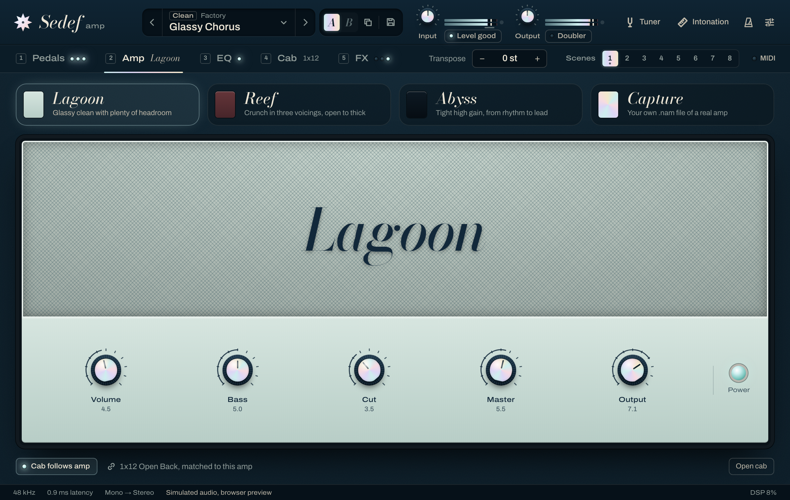
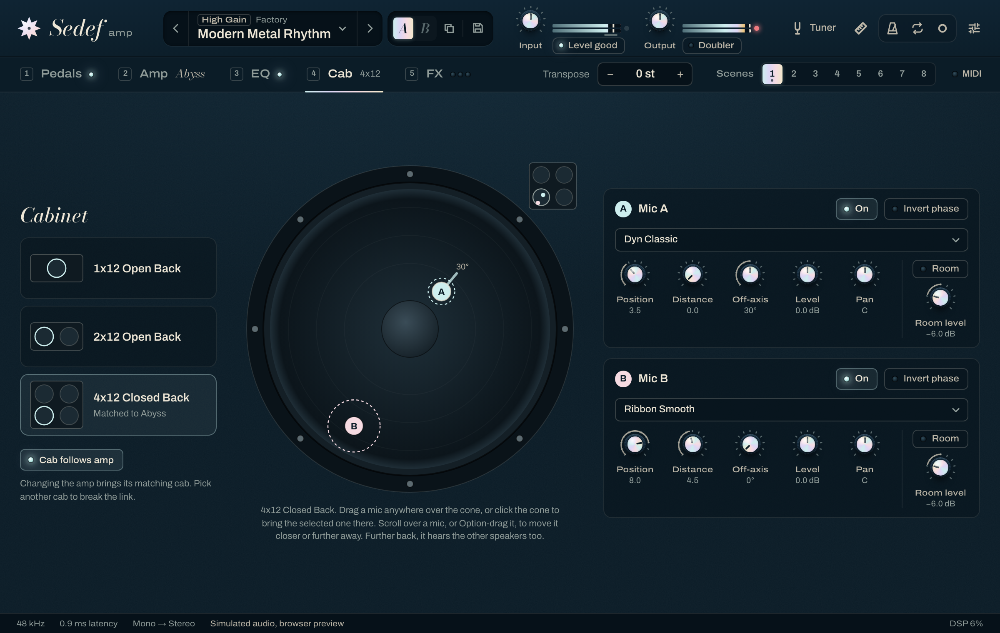
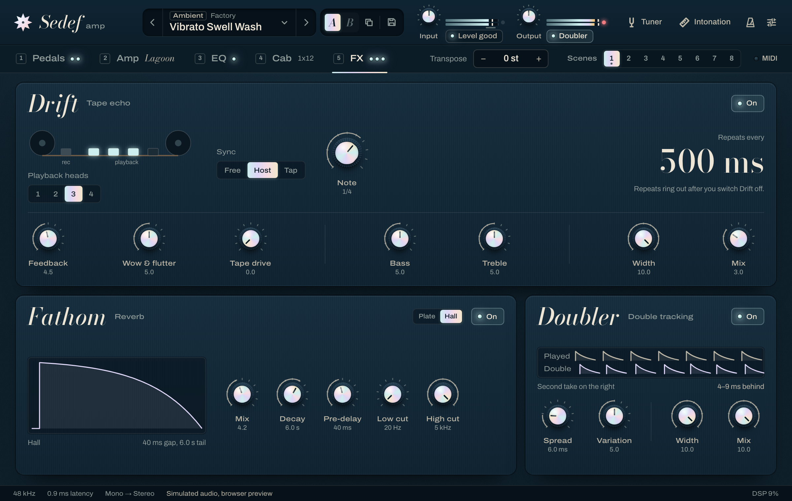
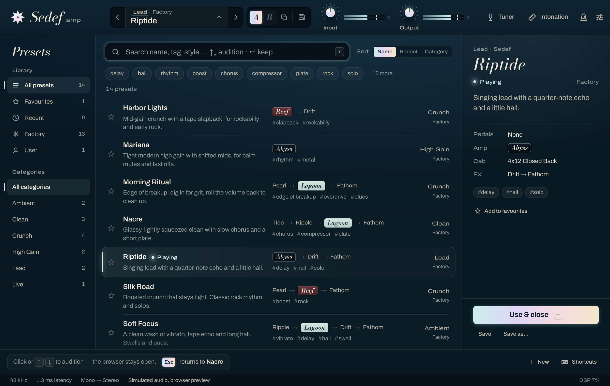
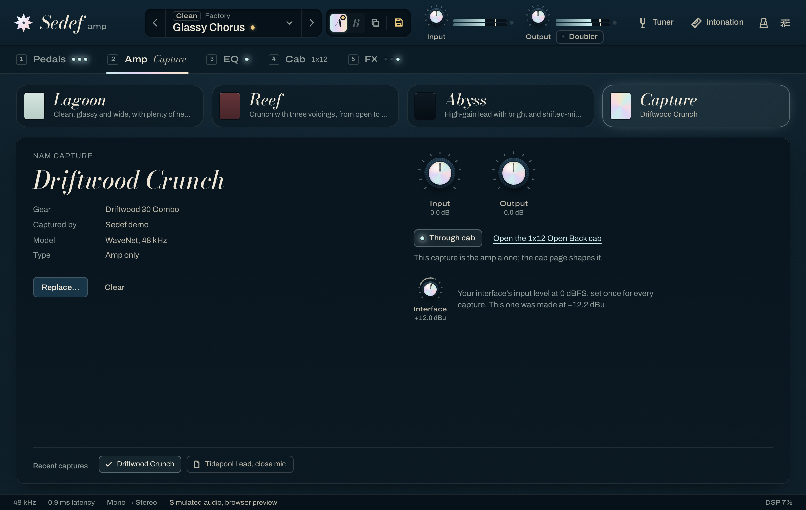
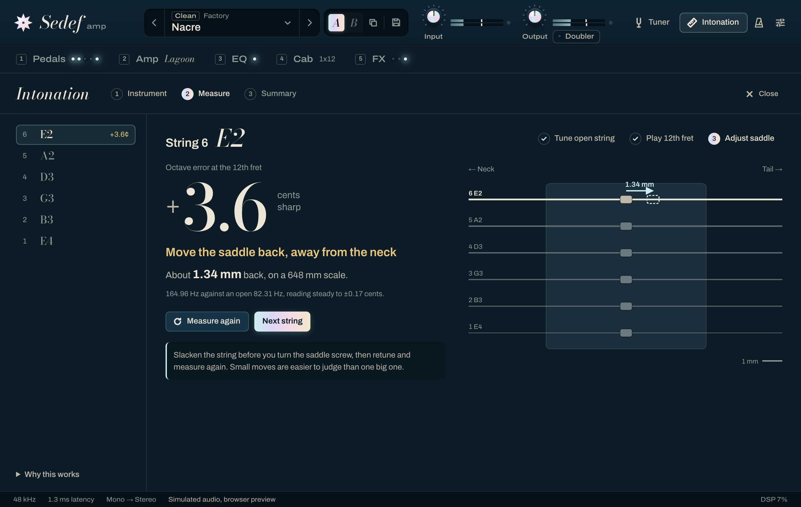

<div align="center">

# Sedef Amp

**An open-source guitar amp and effects suite, with a tuner that teaches your guitar to play in tune.**

VST3 · AU · CLAP · Standalone — macOS, Windows, Linux

[](https://github.com/mr-kaynak/sedef-amp/actions/workflows/ci.yml)
[](LICENSE)

<a href="docs/media/sedef-trailer.mp4"></a>

**[▶ Watch the 48-second trailer](docs/media/sedef-trailer.mp4)** · [how it was made](docs/trailer.md)

</div>

*Sedef* (seh-DEF) is Turkish for mother-of-pearl: the shimmering inlay on fine instruments, and
the sound we're after. Glassy cleans, warm crunch, singing leads, and time effects that melt
around them.

## What's inside

| | |
|---|---|
| **Pedals** | **Trench** octave down (one and two octaves, analog style) · **Anemone** envelope filter · **Conch** inductor wah with Auto mode · **Tide** compressor (3:1, tilt EQ, parallel blend) · **Urchin** octave-up fuzz · **Pearl** transparent overdrive with mid boost · **Kelp** classic mid-hump overdrive, also a tight boost · **Coral** distortion · **Beacon** photocell vibe · **Gyre** 4- or 6-stage phaser · **Jetty** flanger with ± feedback · **Ripple** tremolo / chorus / vibrato · noise gate |
| **Amps** | **Lagoon** — glassy, wide clean · **Reef** — British crunch with three voicings · **Abyss** — tight, saturated lead with bright and mid-shift switches |
| **Captures** | load any Neural Amp Modeler (`.nam`) capture of a real amp or full rig in place of the amps, levelled to match them |
| **Cabs** | 1x12 open, 2x12 open, 4x12 closed · two mics per cab from ten mic models, placed anywhere over the cone, backed off and turned off axis · room mics · load your own IRs |
| **EQ** | 9-band graphic EQ with low/high cut, one bank per amp |
| **Post** | **Drift** multi-head tape echo with wow, flutter and tape saturation · **Fathom** plate and hall reverbs · **Doubler**, a second take that differs from note to note, switched on from the header |
| **Tools** | precision tuner · **intonation workbench** · metronome with odd meters (standalone) |
| **Presets** | browser with categories, tags and search · click to audition, Esc to go back · A/B compare · Undo when a load or delete would lose work |



 

## Presets

Click a preset and it plays at once, while the browser stays open; the arrow keys walk the list
the same way. Enter keeps it. Esc puts back exactly what you had when you opened the browser,
unsaved tweaks included. Every row tells you the amp, the chain that's switched on, a line about
the sound and its tags, so you can read a rig before you hear it. Compare two versions with A/B,
save your own with a category, tags and a note, and never lose edits: loads and deletes come with
Undo. See [docs/ui/presets.md](docs/ui/presets.md) for the design.



## Captures

Pick **Capture** next to the three amps and load a Neural Amp Modeler file, or drop one on the
panel. Sedef levels it to sit with the built-in amps, shows what it is (the gear, who captured it,
the model), and turns its own cab off when the file says it's a full rig. Input and output trims
set how hard you hit it; if the capture records its interface level, set yours once in the panel
and it responds as the real amp did. Sessions keep the capture itself, so a project opens with the
same sound on another computer; presets keep a reference to the file. Sedef ships no captures:
find thousands on [TONE3000](https://www.tone3000.com). See [docs/dsp/nam.md](docs/dsp/nam.md).



## The intonation workbench

A guitar can be perfectly tuned and still play out of tune higher up the neck. The fix is moving
each string's saddle, and Sedef tells you exactly which way and how far:

1. Pick your instrument and scale length (6/7-string guitar, 4/5-string bass, or custom).
2. Tune the open string. Within 5 cents is plenty: Sedef measures the string as it actually
   plays, so it doesn't have to be spot on.
3. Play the 12th fret. Sedef skips the pick attack, averages one second of the sustained note
   (the open string is read the same way), and reports the octave error to a tenth of a cent.
4. Get a clear answer: *"+3.8 cents sharp: move the saddle about 1.4 mm away from the neck."*



The estimate uses `Δs ≈ L · (2^(c/1200) − 1)` for scale length `L` and octave error `c` cents.
See [docs/intonation.md](docs/intonation.md) for the method and its limits.

## Install

### [Download for macOS](https://github.com/mr-kaynak/sedef-amp/releases/latest/download/Sedef-Amp-macOS.dmg)

macOS 11 or later, Apple silicon and Intel. Open the disk image and double-click
**Install Sedef Amp**. The installer isn't notarized yet, so the first time macOS stops it: open
**System Settings → Privacy & Security** and click **Open Anyway**.

### [Download for Windows](https://github.com/mr-kaynak/sedef-amp/releases/latest/download/Sedef-Amp-Windows-Setup.exe)

Windows 10 or 11, x64. Run the installer. If SmartScreen says *Windows protected your PC*, click
**More info**, then **Run anyway** (the installer isn't code-signed yet).

### [Download for Linux](https://github.com/mr-kaynak/sedef-amp/releases/latest/download/Sedef-Amp-Linux-x86_64.tar.gz)

x86_64 with WebKitGTK 4.1. Unpack the archive and run `./install.sh` (add `--system` to install
for every user).

Each installer lets you pick VST3, CLAP and the standalone app, plus AU on macOS. Rescan plugins in
your DAW afterwards; Sedef shows up as **Sedef Amp** by **Sedef**. Install paths, uninstalling and
manual installs are in [docs/install.md](docs/install.md); older versions are on the
[releases page](https://github.com/mr-kaynak/sedef-amp/releases).

## Build from source

```sh
git clone https://github.com/mr-kaynak/sedef-amp.git && cd sedef-amp
cmake --preset release
cmake --build --preset release
```

Requirements: CMake ≥ 3.25, Ninja, a C++20 compiler, Node 22+ and pnpm (for the UI). JUCE and the
other dependencies are fetched automatically (set `CPM_SOURCE_CACHE=~/.cache/CPM` to share the
downloads between build folders). Linux needs the usual JUCE packages plus
`libwebkit2gtk-4.1-dev` (see [.github/workflows/ci.yml](.github/workflows/ci.yml)).

DSP-only builds skip JUCE entirely and run the test suite in seconds:

```sh
cmake --preset engine && cmake --build --preset engine && ctest --preset engine
```

Render any preset offline without a DAW:

```sh
build/engine/tools/sedef-render --preset presets/factory/nacre.sedefpreset --out nacre.wav
build/engine/tools/sedef-render --in my-di.wav --set ampModel=2 --set abyssGain=0.8 --out lead.wav
```

## How it's built

```
ui/       React + TypeScript, runs inside the plugin's WebView (and in a browser with a mock backend)
plugin/   JUCE 9 shell: parameters, presets, IRs, bridge to the UI
engine/   Pure C++20 DSP library with no JUCE dependency, unit-tested on every OS
```

- One parameter schema drives the DSP, host automation, presets and UI
  ([ADR-0004](docs/adr/0004-single-parameter-schema.md)).
- Hard real-time rules: the audio thread never allocates, locks or waits; a test proves it
  ([ADR-0005](docs/adr/0005-real-time-safety.md)).
- Nonlinear stages run oversampled with latency-aligned bypasses, so switching pedals never
  shifts your timing ([ADR-0008](docs/adr/0008-oversampling.md)).
- Every DSP module documents the public research it's based on in [docs/dsp/](docs/dsp/).

Start with [docs/architecture.md](docs/architecture.md).

## Quality

- 202 engine tests run on macOS, Windows and Linux on every push, with Clang, GCC and MSVC
  treating warnings as errors, plus AddressSanitizer, UBSan and ThreadSanitizer builds.
- Every plugin build is checked with [pluginval](https://github.com/Tracktion/pluginval)
  (strictness 8), [clap-validator](https://github.com/free-audio/clap-validator) and, on macOS,
  `auval`. A smoke test loads the VST3 in a minimal host, opens the editor in the real WebView and
  fails unless the UI renders.
- Factory presets are balanced to -16 LUFS and checked on every platform
  ([presets/README.md](presets/README.md)).

## Updates & privacy

Sedef checks GitHub for a new release at most once a day, when you open its window, and can
download, verify (SHA-256) and open the installer for you. The check is a single HTTPS request
that carries only the Sedef version and your OS family, no identifiers. Switch it off in Settings
→ Updates, with `SEDEF_DISABLE_UPDATE_CHECK=1`, or at build time with `-DSEDEF_UPDATE_CHECK=OFF`.
How it works and what it protects against: [docs/updates.md](docs/updates.md).

## Contributing

Issues and pull requests are welcome. Please read [CONTRIBUTING.md](CONTRIBUTING.md) first,
especially the clean-room policy: Sedef is built from public research and our own measurements,
never from other products' code or data.

## License

[AGPL-3.0-or-later](LICENSE). Sedef Amp uses JUCE under its AGPLv3 option. See
[THIRD_PARTY_NOTICES.md](THIRD_PARTY_NOTICES.md).
