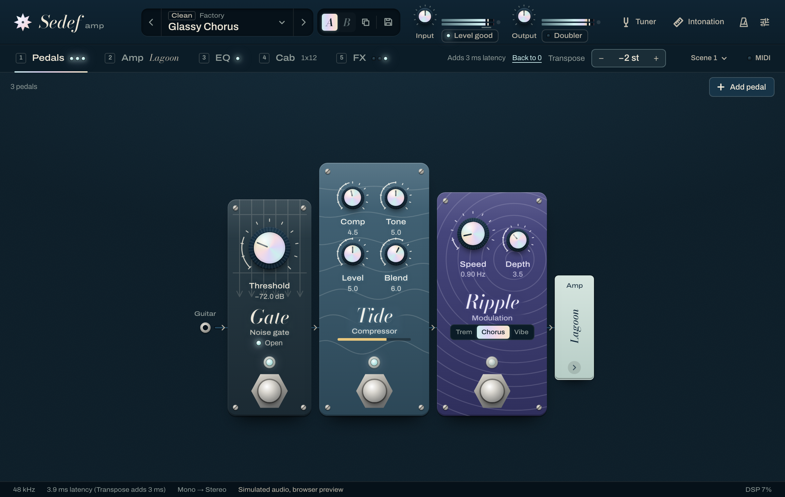

# Transpose: polyphonic pitch shifter

Source: `engine/src/dsp/PitchShifter.cpp`. Interface: `engine/include/sedef/dsp/PitchShifter.h`.
Tests: `engine/tests/reverb/PitchShifterTests.cpp`, `engine/tests/engine/EngineTests.cpp`.
Bench: `tools/transpose-bench`.

> **History.** 0.2.0 shipped a time-domain shifter. 0.3.0 removed it: a player found it far
> worse than other amp sims, and no design measured then cleared the quality bars at a playable
> latency (Appendix A and B keep that evaluation). 0.9.0 brings Transpose back with the design
> below, measured against the same bars. It clears most of them; section 10 lists the ones it
> does not, with the numbers.

## 1. What it does

Transpose plays the whole rig −12 to +12 semitones away from the strings: drop the guitar a half
step, a whole step or more without retuning, or play an octave up or down. It is polyphonic:
chords keep every note.

It sits at the start of the chain, right after Input Gain and before the pedalboard, so the
pedals, the amp and the cab hear the shifted string as they would hear a retuned guitar. The
tuner still listens to the strings themselves (it is for tuning the guitar).

At 0 semitones it is off: the audio is not touched (bit-exact) and it adds no latency. Shifting
down adds 3 ms, shifting up 10 ms.

## 2. Requirements

The 0.3.0 quality bars (Appendix A) are the yardstick, unchanged: they were written before
anything was measured, for two jobs, alternate tunings (−1 to −5 st, played live) and octaves
(±12 st). The ones that drive the design:

- **Latency (B1–B3).** At most 10 ms added, the same at every attack, and exactly what the
  plug-in reports. The player hears it live: a 64-sample interface round trip is 4–6 ms, and
  10 ms more is about standing 3.4 m further from the amp. Lower is better, so the design takes
  as little as each direction needs (section 5).
- **Chords (B4–B7).** A sustained open chord keeps its partials clean (−35 dB off-partial
  energy for tunings, −30 dB for octaves) and steady (no level warble).
- **Attacks (B8–B10).** No pre-echo, no doubled attack (flam), attack level and rise like a
  retuned string.
- **Pitch (B11).** Median within 2 cents, 95th percentile within 10 cents, bends included.
- **CPU (B13)** within 2 % of one core at 48 kHz; **0 st (B14)** bit-exact with no latency;
  **changes (B15)** click-free.

## 3. Method choice

### Why it failed before

The 0.3.0 evaluation (Appendix B) found two families, each failing on the other's strength:

- **Time-domain splicing** (resampling read heads, crossfaded when they drift too far) keeps
  attacks and pitch exact and can run at a few ms, but each splice can only keep the strongest
  partials in phase. On a chord the rest jump: purity stopped at −28 to −33 dB at best, and the
  0.2.0 shifter, with its attacks landing anywhere in a 40 ms fade, wandered by 34–40 ms of
  attack latency and doubled attacks (flam 8–28 dB).
- **Frequency-domain methods** (phase vocoders) keep chords clean, but only with 85–170 ms
  windows (−36.9 dB at 170 ms), which smear attacks (pre-echo −12 to −24 dB) and cost that much
  latency. With an 8 ms synthesis window they fell apart (−7 to −18 dB). A third-party library
  (Signalsmith Stretch) came out up to 19 cents sharp on low strings, with 120 ms of latency.

Appendix B's conclusion: what could clear the bars is a model that estimates each partial over
a long window and resynthesises it in the present. Repeating either family would repeat its
numbers, so this design does neither alone.

### What is new

**Splices only hurt what is spliced.** The design subtracts a model of the sustained partials
from the input, splices only the remainder, and resynthesises the model shifted, continuously,
without splices. Between splices the output is exactly a resampled input (section 4.3), so
attacks and pitch keep everything time-domain shifting gets right, while the chord's steady
partials never pass through a splice. And every attack gets its own grain, started so that the
attack comes out exactly the latency later: the attack latency no longer wanders.

The model alone is not enough, and neither are the grains alone. The same grains without the
model (every partial in the remainder) reach only −0.6 to −8.7 dB purity, because they splice
every 20–90 ms; with it, −21 to −33 dB (section 9).

## 4. Method

### 4.1 Signal flow

```
x ─┬─────────────► analysis (Hann N, every H) ─► peak tracks: f, A, φ, decay
   │                                               │
   │                       ┌───── U: predicted partials at the input's pitch, now
   │                       ▼                       │
   └──► (−) ─► residual e = x − U ─► history       │ parameter history (per hop)
                      │                │           ▼
                      ▼                ▼        S: the same partials × r, read where
               onset detector ─► grains: resample e at rate r      the newest grain reads
                                       │                           │
                                       └───────────── (+) ◄────────┘ ─► y
```

`r = 2^(st/12)` is the pitch ratio. Everything runs per sample; the analysis runs at fixed
sample indices, and a setting change starts at a fixed sample (section 6), so the output does not
depend on the host's block size.

### 4.2 Grains

A grain `g` reads the residual history at `p_g(τ) = a_g + r (τ − τ_g)`: at output sample `τ_g` it
reads input sample `a_g` (its anchor) and then moves at `r` input samples per output sample,
which scales every frequency by exactly `r`. Its delay `d_g(τ) = τ − p_g(τ)` changes by `1 − r`
per sample: it grows for downward shifts and shrinks for upward ones. When it leaves its range a
new grain takes over through a crossfade (a splice). The time-domain output is
`TD[e](τ) = Σ_g w_g(τ) (h_r ∗ e)(p_g(τ))` with fade gains `w_g`.

`h_r` is a Kaiser-windowed sinc. Downward it has 16 taps (β = 8) at full band and passes every
sample at an integer position unchanged, which the latency test relies on. Upward, reading
faster folds content above `fs / 2r` back into the band, so the kernel is stretched by `r`
(24 r taps, β = 7) and its cut-off set to 0.8 of the output's Nyquist divided by `r`
(band-limited resampling): aliasing at +12 st measures −75 dB. Both run from tables of 257
fractional positions, linearly interpolated.

### 4.3 The identity that makes it work

The output is

```
y = TD[x − U] + S
```

where `U` is the model of the sustained partials at the input's pitch and `S` is the same
partials shifted. TD is linear, so if `S = TD[U]`, then `y = TD[x]`: the output is exactly the
resampled input, whatever the model got wrong. `S` is built to equal `TD[U]` for every partial as
long as the newest grain runs: it reads the model's parameter history at that grain's position
`p(τ)`, with the phase it had there. At a splice, `S` keeps its phase running instead of
jumping with the grains. So:

- Between splices, `y = TD[x]`. Attacks, bends, vibrato and single notes come out as a
  resampled string: exact pitch, no smearing.
- At a splice, only `e = x − U` is crossfaded. On a sustained chord the model explains most of
  the signal, so the splice touches only the small remainder, while `S` carries the chord's
  partials on through, continuously.
- A wrong model costs nothing between splices; at a splice it costs what a plain time-domain
  splice of the unexplained part would.

### 4.4 The partial model U

Every `H` input samples, a frame of the last `N` samples is windowed (Hann, zero-phase) and
transformed (`N` is the power of two nearest 85 ms: 4096 at 44.1 and 48 kHz, 8192 at 88.2 and
96 kHz; `H = N/16`).

- **Peaks.** Local maxima of the magnitude above −70 dB under the frame's strongest peak, above
  an absolute floor (−100 dBFS), between 40 Hz and 8 kHz. Parabolic interpolation of the log
  magnitude gives frequency and amplitude. A Hann window's side lobes are local maxima too
  (−31.5 dB at 2.5 bins, falling 18 dB per octave), so a peak is kept only above the side-lobe
  envelope of every stronger peak, plus 6 dB, and at least 1.5 bins from it. At most 96 peaks.
- **Peak tracks.** A track stays on one FFT bin. Each frame it reads that bin's complex value,
  after taking out what its neighbours within 6 bins are predicted to leak into it (the Hann
  transform of each neighbour's predicted partials): close partials would otherwise disturb each
  other's fits. A new peak within 1.5 bins of a track's bin belongs to that track; a peak that
  has moved 0.75 bins re-centres it. A track without a peak coasts for up to 8 frames, so two
  beating partials survive their beat's nulls.
- **One or two partials per track.** Two partials closer than the window resolves (a string's
  own close pair, or two strings in unison) share one peak, and their bin value is a sum of two
  rotating, decaying phasors. Over the track's last 12 frames (64 ms; at least 6), a first- and
  a second-order linear prediction are fitted by least squares (Prony's method). The
  second-order fit is taken when it leaves under a quarter of the first-order error (and the
  first leaves at least −40 dB): its two roots give the two partials' frequencies and decays,
  and a second least-squares fit gives their amplitudes and phases now. A component more than
  1.5 bins from the bin, or weaker than 3 % of the other, is not a partial. A young track takes
  its frequency from the phase advance over up to 8 frames instead.
- **Decay.** Never a predicted growth (a growing peak is a note arriving, which the residual
  carries), and at most 1/(5 ms) (a damped string).
- **Prediction.** For the hop `[t, t + H)`, `U` synthesises each partial as an oscillator whose
  phase reaches the predicted phase at the end of the hop (continuously, by choosing the hop's
  frequency), corrected by a quarter of the phase error it showed at the last frame, and whose
  amplitude ramps to the predicted one. That is a prediction `N/2 + H` samples past the window
  centre.
- **Confidence.** A model that predicts a string the player has just damped, or a pitch that has
  moved, would make `e` larger than `x`. Each hop, `U` is scaled by its least-squares gain onto
  `x` over the previous two hops, `g = clamp(Σ x U / Σ U², 0, 1)` (ramped). Each track is also
  weighted by `1 / (1 + ε)`, where `ε` is its smoothed relative prediction error: a partial the
  model keeps getting wrong drops out of `U` and stays in `e`.
- **Band.** Upward, only partials whose shifted frequency lies within 0.6 of the output's Nyquist
  are modelled, so `S` stays inside the interpolator's pass band; the rest stay in `e`.

`U` runs as up to 128 complex oscillators (one multiply per partial per sample, in SIMD lanes).

### 4.5 The shifted model S

`S` evaluates `U`'s parameter history (per hop: phase at the hop start, frequency, start and end
amplitude, the confidence ramp) at the newest grain's read position `p(τ)`, with every frequency
times `r`, plus a per-partial phase offset `θ`. A partial enters `S` with `θ = 0` when `p(τ)`
reaches the hop where it was born, so it starts exactly in phase with what the grains subtracted.
At a sustain splice, `θ` absorbs the jump so every partial of `S` continues without a break, and
the amplitude difference between the two read positions is ramped out over the crossfade.

At an attack, the new grain reads a different part of the history (section 4.6), and `S` must
follow it exactly, or `y = TD[x]` would not hold at the attack. So `S` has two banks: the old one
stays on the old grain, the new one starts on the new grain's position, in phase, and the two
crossfade with the grains' own gains. Within a stretch where `p(τ)` stays inside one hop, phase
and amplitude are linear in `τ`, so each bank runs as complex oscillators.

### 4.6 Attacks

An attack must come out exactly `L` after it went in, every time (B1–B3), and no grain may play
it twice (B9) or early (B8).

- **Detector.** On the residual, which has the sustained partials removed, so a pick over a
  ringing chord still stands out: the energy of the first difference (a +6 dB/octave tilt that
  favours the broadband pick over tonal changes), smoothed over 0.2 ms, against its own floor
  over 40 ms. An onset is a rise of 12 dB over the floor while the input's own energy also rises
  by 3 dB (so a damped string, which makes the residual jump while the input falls, is not one).
  Re-armed after 30 ms.
- **Anchor.** The onset's first sample: going back from the detection (up to 3 ms), the last
  sample where the fast energy was still under twice the floor. For a click this is the click
  itself.
- **Grain.** A new grain is anchored so that it reads the anchor `a` at output sample `a + L`. It
  starts at once and fades in over `F_on = 1 ms` (equal power) while every older grain fades out.
  It reads the residual before the attack during the fade, so nothing of the attack sounds early.
  For this to work, the fade must end before the old grain reaches `a`: a grain never gets closer
  than `d_min = δ + r F_on + reach` to the input (`δ` = 1.5 ms detection budget, `reach` = the
  interpolator's half length), and `L ≥ δ + F_on`.
- **Protection and hold.** For 5 ms of input after an anchor, no later grain may start reading
  inside it, so an upward splice cannot replay the pick. Downward, no sustain splice lands in the
  50 ms after an attack (past the flam metric's 40 ms window): the attack's grain keeps going,
  up to `d_max` plus that hold.

### 4.7 Sustain splices

When the newest grain's delay leaves its range (downward: past `d_max = L + 16 + 5 ms`; upward:
closer than `d_min` plus what the fade needs), a new grain starts at a delay in the search span
`[L, L + 16 ms]` (inside the protection rule), at the offset where the residual around the two
read positions correlates best: normalised, over 10 ms segments ending 2 ms ahead (WSOLA,
Verhelst and Roelands 1993), every second offset, then the best one's neighbours. Of the
offsets within 10 % of the best correlation, the one that keeps the new grain in range longest
wins (the shortest delay downward, the longest upward), so splices come less often. The
crossfade is 10 ms (upward, at most half the grain's life), with correlation-aware gains: equal
gain for a perfect match, moving to equal power as the match drops.

On a well-modelled chord the residual is small and these splices are inaudible. Where the model
does not explain the input (a bend, vibrato, a new note: the residual within 10 dB of the input
over 20 ms), the grains carry it alone, so their delay is kept short: half the search span and
2 ms of margin, so a bend does not come out late.

### 4.8 Constants

| Constant | Value (48 kHz) | Serves | Why this value |
|---|---|---|---|
| Analysis window `N` | 4096 (85 ms), the power of two nearest 85 ms at any rate | B4–B7 | Hann resolves partials 2 bins = 23 Hz apart, under the 41 Hz grid of an open E chord and the 82 Hz of a low E's harmonics; closer pairs go to the order-2 fit |
| Hop `H` | `N/16` = 256 (5.3 ms) | B4, B6 | The model follows a decaying chord in steps short against its decay |
| Peaks, tracks | 96 peaks, 128 oscillator slots | B13 | Six strings with their strong partials; slots outnumber peaks because a track can hold two partials |
| Peak floor | −70 dB under the strongest, −100 dBFS absolute | B4 | What is left in `e` is at most −70 dB per partial |
| Side-lobe mask | Hann envelope 0.415/k³ + 6 dB, 1.5 bins minimum | B4 | A side lobe is not a partial |
| Leakage taken out | neighbours within 6 bins | B4 | Hann leakage is under −60 dB beyond |
| LP fit | 12 frames (64 ms), at least 6; order 2 if under ¼ of order 1's error | B4, B6 | Long enough to separate a 2.5 Hz pair's two roots, short against a chord's decay |
| Coasting | 8 frames (43 ms) | B6 | A beat null of a pair 3 Hz apart lasts less |
| Phase correction | ¼ of the error per hop | B4 | Pulls a drifting partial back without jumping it |
| Decay clamp | `[0, 1/5 ms]` | B6, B7 | No growth predicted; a damped string decays in about 5 ms |
| Interpolator | Kaiser sinc, 16 taps down, 24 r taps up at 0.8 of Nyquist / r | B5, B12 | Flat pass band; upward, −75 dB aliasing at +12 |
| Onset fade `F_on` | 1 ms | B8–B10 | Over before the attack arrives; spread under 2 kHz |
| Detection budget `δ` | 1.5 ms | B2 | A pick's broadband rise crosses +12 dB within 0.1–0.5 ms |
| Latency down `L` | 3 ms | B1 | `δ + F_on` plus the interpolator's half length, rounded up |
| Latency up `L` | 10 ms | B1, B9 | Reading `r` times faster, the attack grain lasts `(L − d_min)/(r − 1)`: about 6 ms at +12, 20 ms at +5; 10 ms is the B1 ceiling |
| Search span | 16 ms | B4, B11 | One period of 62.5 Hz (a seven-string's low B) |
| `d_max` (down) | `L + 16 + 5 ms` = 24 ms | B4 | Each sustain grain lasts at least `5 ms / (1 − r)`: 89 ms at −1, 20 ms at −5 |
| Splice fade | 10 ms | B4 | Long enough for a small residual, short against the grain |
| Correlation segment | 10 ms, 2 ms ahead | B11 | About one period of a low E |
| Protection | 5 ms | B9 | A pick's high-frequency burst |
| Attack hold (down) | 50 ms | B9 | Past the 40 ms in which a re-attack counts as flam |
| Loose mode | residual within 10 dB of the input over 20 ms: half span, 2 ms margin | B11 | Bends and new notes are not delayed by long grains |
| Setting-change fade | 20 ms, equal power | B15 | The two pitches don't add coherently |

## 5. Latency and the host

Transpose adds `L` = 3 ms when it shifts down and 10 ms when it shifts up (rounded to whole
samples at the session rate: 132/144/265/288 samples down, 441/480/882/960 up at
44.1/48/88.2/96 kHz), and nothing at 0. The plug-in reports it with the rest of its latency
(the status bar shows the total and Transpose's share):

- Steps that keep the direction (−1 to −12, or +1 to +12) never change the reported latency.
- Turning Transpose on or off, or changing direction, does. The engine updates its latency at
  once; the plug-in checks it on its message-thread timer (20 times a second) and tells the host,
  which re-aligns its tracks. Some hosts only do that when playback stops. Hosts dislike latency
  that changes, which is why it changes only on those steps. A fixed latency whenever the
  parameter could be non-zero was considered and rejected: it would cost the 10 ms of an
  upward shift on every session that never transposes.
- When a session loads with Transpose already set, the plug-in reports its latency before the
  first block (`Engine::expectTranspose`).

"Latency" is exact in the time-domain sense: an attack anchored at input sample `a` is read at
output sample `a + L` (the tests check clicks to the sample at every step). Between attacks the
grains' delay moves within `[d_min, d_max]`, which only shifts when a held note's remainder is
read, never when a note starts.

## 6. Changing the setting

A change starts a new shifter state (the grains and `S`'s phases; the model and the residual are
shared, they don't depend on `r`) and crossfades to it over 20 ms with equal-power gains. A
change that arrives during that fade starts the sample the fade ends. Moving to 0 crossfades to
the untouched input; when the fade ends, processing stops and the output is bit-exact again.
From 0, the new state starts from an empty model, so the first `N/2` are plain time-domain
shifting while the model fills in. The input history is kept current while off, so switching on
needs no warm-up.

## 7. In the engine

- `Chain::process`: input gain → **Transpose** → the pedalboard → amp → cab. Each chain has its
  own (Dual mode runs two).
- The gate's sidechain (the DI before input gain) is delayed by Transpose's latency, so the gate
  stays aligned with what it gates. The Doubler, which times its double from that sidechain, is
  told the sidechain's lead without Transpose's share (`Chain::latency()` leaves it out).
- `Engine::latencySamples()` adds Transpose's latency for the active direction, updated by the
  audio thread every block. The plug-in reports a change to the host from its message-thread
  timer, as described in section 5.
- The parameter keeps its id `transpose` (ADR-0004: ids are the contract). Its display name goes
  back to "Transpose" and it is automatable again. Hosts save parameters by id (each plug-in
  format keys a parameter by a hash of its id string), never by name; the name only labels
  automation lanes, so sessions and automation saved under "Transpose (Unused)" load unchanged.
  Presets do not store it (`PresetManager.cpp`), so factory presets are unchanged.
- The UI puts it in the section tab row, under the header, after the tabs and before the scene
  bar ([live.md](../live.md#61-how-many)), so it is on every page and a click away: "Transpose" and a −/+ stepper that reads "−2 st". While it shifts, the
  stepper takes the "on" colour, and "Adds 3 ms latency" and Back to 0 appear to its left (so the
  buttons never move under the pointer); the status bar names Transpose's share of the latency.
  The header's label row under the meters already holds the input level chip and the Doubler
  switch.



## 8. Tests

`[transpose]` in `PitchShifterTests.cpp`, plus the engine's. All signals are synthesised or
seeded; none depends on time. `[long]` ones run in the release build (the sanitizer builds skip
them).

- **Latency.** `latencySamples()` is 0, `round(3 ms · fs)` or `round(10 ms · fs)` at every step
  and rate. Clicks after near-silence and over a ringing note come out at exactly `a + L`, to
  the sample, at ±1, 2, 3, 5, 7 and 12 st.
- **0 st.** Bit-exact and zero latency from the start, and again from the end of the fade once
  a shift has faded back to 0 (block sizes 1, 64, 333).
- **Block size.** A chord with attacks and four setting changes (one during a fade) gives the
  same output, bit for bit, for blocks of 1, 7, 64, 333 and 4096.
- **Changes.** A ringing chord while the setting jumps every 40 ms (seeded): finite, and no
  sample step steeper than the shifted chord's own allows.
- **Pitch, every step [long].** For −12..+12, three sustained strings (E2, G3, E4) and the open
  E chord: each of the 8 strongest partials of the output against `r` times the same partial of
  the input, measured the same way, within 2 cents. A subset (−5, +7) runs in every build.
- **Bars [long].** The Appendix A harness at −1, −2, −3, −5, −12 and +12 st. Latency, timbre,
  warble, pitch median and aliasing must clear their bars; the bars this design misses
  (section 10) are held at what it measures, so they cannot get worse unnoticed.
- **Rates [long].** At 44.1, 88.2 and 96 kHz (−2 and +12 st): latency in ms, purity, pitch and
  envelope warble as at 48 kHz, and the partial pitch within 2 cents.
- **Engine.** The reported latency follows the direction and is right before the first block;
  the gate closes Transpose's latency later than at 0, within 30 % (without the delay it would
  close that much early); `Engine::process` never allocates while Transpose changes direction, turns
  off and on.
- **Factory presets** render byte-identical to 0.8.0 at 0 st (all 49, on the synthetic DI and
  on a recorded one), checked with `sedef-render` built from both.

## 9. Results

48 kHz, 64-sample blocks, `sedef-transpose-bench --candidates engine`. Latency columns in ms
(mean over 40 attacks, their range, reported); purity, flam and attack in dB; rise in ms; pitch
in cents. CPU is one core of an Apple M2, best of three runs, with the usual background load
of a desktop (load average about 3); quieter runs measured 0.05–0.3 % less.

| st | latency | range | reported | purity | flam | attack | rise | pitch med / p95 | CPU % |
|---:|---:|---:|---:|---:|---:|---:|---:|---:|---:|
| −12 | 3.29 | 3.54 | 3.00 | −27.4 | 9.4 | 4.1 | 0.9 | 1.9 / 22.2 | 1.88 |
| −11 | 3.17 | 3.31 | 3.00 | −27.0 | 8.1 | 3.4 | 1.8 | 1.8 / 21.4 | 1.86 |
| −10 | 3.14 | 3.22 | 3.00 | −27.5 | 8.7 | 3.4 | 4.3 | 1.4 / 18.0 | 1.85 |
| −9 | 2.95 | 6.12 | 3.00 | −27.7 | 8.1 | 4.0 | 4.0 | 1.3 / 17.2 | 1.84 |
| −8 | 3.03 | 2.23 | 3.00 | −27.9 | 7.0 | 2.5 | 3.8 | 1.6 / 17.3 | 1.82 |
| −7 | 2.91 | 4.39 | 3.00 | −27.3 | 7.1 | 4.5 | 4.0 | 1.6 / 14.7 | 1.81 |
| −6 | 2.90 | 3.83 | 3.00 | −27.7 | 5.0 | 4.5 | 4.6 | 1.7 / 14.0 | 1.80 |
| −5 | 3.00 | 0.28 | 3.00 | −28.1 | 5.5 | 1.8 | 4.2 | 1.4 / 12.9 | 1.79 |
| −4 | 2.93 | 3.48 | 3.00 | −28.1 | 4.1 | 4.9 | 0.3 | 1.2 / 12.3 | 1.77 |
| −3 | 3.02 | 0.60 | 3.00 | −29.5 | 3.8 | 1.6 | 0.3 | 0.7 / 11.7 | 1.75 |
| −2 | 3.01 | 0.35 | 3.00 | −29.5 | 2.6 | 1.5 | 0.5 | 0.2 / 9.3 | 1.74 |
| −1 | 3.00 | 0.14 | 3.00 | −32.1 | 1.3 | 0.6 | 1.9 | 0.0 / 6.9 | 1.72 |
| +1 | 10.00 | 0.21 | 10.00 | −32.8 | 0.4 | 0.5 | 0.2 | 0.0 / 6.2 | 1.75 |
| +2 | 10.00 | 0.20 | 10.00 | −28.1 | 0.8 | 0.7 | 1.5 | 0.6 / 9.3 | 1.77 |
| +3 | 9.99 | 0.25 | 10.00 | −27.7 | 4.1 | 0.7 | 1.5 | 0.5 / 9.8 | 1.80 |
| +4 | 9.98 | 0.55 | 10.00 | −27.2 | 2.3 | 0.9 | 1.2 | 0.7 / 9.6 | 1.83 |
| +5 | 9.91 | 3.18 | 10.00 | −27.0 | 5.8 | 1.2 | 1.6 | 0.5 / 11.0 | 1.87 |
| +6 | 9.88 | 2.98 | 10.00 | −26.5 | 5.3 | 0.9 | 2.0 | 0.7 / 12.1 | 1.90 |
| +7 | 9.87 | 2.83 | 10.00 | −26.3 | 5.8 | 1.8 | 2.5 | 0.6 / 12.7 | 1.92 |
| +8 | 9.85 | 2.74 | 10.00 | −26.0 | 5.8 | 1.5 | 1.3 | 0.7 / 14.6 | 1.99 |
| +9 | 9.85 | 2.59 | 10.00 | −25.4 | 6.5 | 1.6 | 1.1 | 1.0 / 13.8 | 2.16 |
| +10 | 9.83 | 2.45 | 10.00 | −24.6 | 7.8 | 1.7 | 1.2 | 1.2 / 14.1 | 2.28 |
| +11 | 9.83 | 2.33 | 10.00 | −23.5 | 5.0 | 1.9 | 1.1 | 1.3 / 18.1 | 2.43 |
| +12 | 9.85 | 2.21 | 10.00 | −20.8 | 6.6 | 2.4 | 0.7 | 0.8 / 17.0 | 2.38 |

Every step clears timbre (≤ 0.06 dB), the pitch median (≤ 1.9 cents) and, at +12, aliasing
(−75 dB). Both warbles clear their bars except the envelope warble at −11 and −10 (0.40 and
0.43 dB, bar 0.25); pre-echo clears except at −12 (−29.9 dB, bar −30). Sustained partials come
out within 2 cents of `r` times the input's at every step (the `[long]` test). At 44.1, 88.2
and 96 kHz (−2, −5, +12) latency is the same within 0.02 ms, purity within 1 dB (+12 is about
3 dB better than at 48 kHz) and the pitch median within 1 cent (all under 2); flam at +12
rises to 9.0–9.2 dB at 88.2–96 kHz.

Against the 0.3.0 candidates at the same shifts (Appendix B): attack latency was 34–40 ms of
wander for 0.2.0 and is now at most 0.6 ms at −1 to −5 except −4 (below); flam 8–28 dB is now
1.3–5.5 dB at −1 to −5; purity −17 to −31 dB for 0.2.0 and −28 to −33 for the best retuned
splicer, now −28.1 to −32.1 at −1 to −5 and −27.4 / −20.8 at ±12. The 85 ms phase vocoder
reached −29.6 dB at −5 with pre-echo of −12 to −24 dB and 85 ms of latency.

**Recorded DI** (the public-domain piezo DI set, and two DI takes of a player; not in the
repository): `sedef-transpose-bench --di FILE,...` measures what needs no reference. Attacks:
the output's 50 % crossing against the input's, after the reported latency. Shift: per 186 ms
frame, the lag that best matches the output's log-frequency spectrum to the input's (it works
for chords), minus the setting. Against the 0.2.0 shifter on the same files, attack placement
improved at 19 of 20 file and shift pairs on four of the files (median 1.2–3.7 ms against
2.1–4.7 ms; within 1 ms for 15–45 % of the attacks against 8–30 %). On the fifth, which neither
places within 1 ms, they are level. The spectral shift median stays within 0.2–2.8 cents at −1 and −2 st
(0.3–1.5 for 0.2.0), but its 95th percentile is worse than 0.2.0's on two piezo recordings and
the chord take: at −2 st 9.7–36.6 cents against 4.9–15.4. See section 10.

## 10. Known limitations

- **Chord purity (B4) is short of the bar** at every step: −28 to −33 dB for tunings (bar −35)
  and −27.4 / −20.8 dB at −12 / +12 (bar −30). What is left is in the model: clusters of three or
  more partials within a bin or two, and close pairs of very unequal level, which the
  second-order fit cannot separate. The splices then carry them, and each splice disturbs them.
- **Flam and attack level (B9, B10) miss at larger downward shifts, and the attack latency
  range (B2) at −4 and −6 to −12.** This is inherent to shifting attacks in time: a resampled
  attack's envelope is stretched by `1/r`, and the beating of the three strings of a power chord
  moves with it. An oracle (each attack resampled from its exact onset, no splices, no model)
  measures the same: at −4 st flam 4.2 / attack 4.9 dB / latency range 3.50 ms against this
  design's 4.1 / 4.9 / 3.48; at −9 st 8.3 / 4.0 / 6.11 against 8.1 / 4.0 / 6.12. The "range" is
  one attack in 40 whose stretched envelope peaks lower, which moves its 50 % crossing; the
  attack itself starts at exactly `L` (the click test).
- **Upward shifts above +4** have flam 5–8 dB and a latency range of 2–3 ms: reading `r` times
  faster, the attack's grain lives only `(L − d_min)/(r − 1)` (about 6 ms at +12) before a splice,
  inside the 40 ms flam window. A longer latency would fix it, past B1's 10 ms.
- **Pitch p95 (B11)** misses beyond ±2: the bend in the test line comes out up to 22 cents off
  at its fastest point, because the grains carry it while the model drops it (section 4.7).
- **CPU (B13)** clears the 2 % bar up to +8 and misses it from +9 to +12 (2.2–2.4 %): upward,
  sustain splices come every 6–60 ms, and each searches 16 ms of offsets. At 88.2–96 kHz it
  is 2.3–3.5 %, because the analysis window doubles. Dual mode runs one shifter per chain.
- **Recorded DI** shows the 95th percentile of the frame-by-frame shift worse than 0.2.0's on
  two piezo recordings and a chord take (section 9). Not traced yet; the likeliest cause is the
  model being wrong for a few hops at note changes, where splices then carry its error.

## 11. References

For the evaluation:

- J. Laroche and M. Dolson, "New Phase-Vocoder Techniques for Pitch-Shifting, Harmonizing and
  Other Exotic Effects", *Proc. IEEE WASPAA*, 1999. Shifting peak regions in the frequency
  domain.
- J. Laroche and M. Dolson, "Improved Phase Vocoder Time-Scale Modification of Audio", *IEEE
  Trans. Speech and Audio Processing* 7(3), 1999. Identity phase locking.
- A. Röbel, "A New Approach to Transient Processing in the Phase Vocoder", *Proc. DAFx*, 2003.
  Energy centre of gravity per bin to find attacks.
- D. Mauler and R. Martin, "A Low Delay, Variable Resolution, Perfect Reconstruction Spectral
  Analysis-Synthesis System for Speech Enhancement", *Proc. EUSIPCO*, 2007. Asymmetric
  analysis and synthesis windows.
- A. Kohlrausch, R. Fassel and T. Dau, "The Influence of Carrier Level and Frequency on
  Modulation and Beat-Detection Thresholds for Sinusoidal Carriers", *J. Acoust. Soc. Am.*
  108(2), 2000. Amplitude-modulation thresholds behind B6 and B7.
- Signalsmith Stretch 1.4.0 (MIT), https://github.com/Signalsmith-Audio/signalsmith-stretch.
  Measured as a third-party candidate only.

For the 0.2.0 shifter:

- W. Verhelst and M. Roelands, "An Overlap-Add Technique Based on Waveform Similarity (WSOLA)
  for High Quality Time-Scale Modification of Speech", *Proc. IEEE ICASSP*, 1993. Splice
  positions chosen by waveform similarity.
- J. Dattorro, "Effect Design, Part 2: Delay-Line Modulation and Chorus", *J. Audio Eng. Soc.*
  45(10), 1997. Moving delay taps, interpolation.
- U. Zölzer (ed.), *DAFX: Digital Audio Effects*, 2nd ed., Wiley, 2011, chapter "Time-segment
  processing". Delay-line pitch shifting and SOLA-family methods.


## Appendix A. Quality bars (v0.3.0)

A player compared 0.2.0's transpose with commercial amp sims and found it far worse. These bars
say, in numbers, what "very good" means for its two jobs. They were written before any
candidate was measured, and a design ships only if it clears every bar for its job.

- **Alternate tunings:** −1 to −5 st on chords, single notes and palm-muted riffs, played live.
- **Octave effects:** ±12 st.

### Test material and reference

The test signals are synthetic guitar DI made of additive plucked-string notes (sharp 0.5 ms
attack, per-partial decay, pluck-position spectrum, optional bend). Because each note is a sum
of known partials, the ideal output is synthesised directly: every partial frequency times
`2^(st/12)`, with the same amplitudes and the same envelopes in time. Partials that would land
above 0.47 fs are left out of the reference, so aliasing counts as error.

- **Chord:** an open E major strum (six strings, 10 ms apart, equal temperament, stiff
  strings), for purity. An open D major (D3 A3 D4 F♯4) is used for warble, because its partials
  sit on a coarser grid and more of them can be measured one by one.
- **Single low E** sustained, for timbre.
- **Palm-muted hits:** an E5 power chord (E2 B2 E3, all strings at once) decaying in about
  40 ms. Isolated hits come 400 ms apart, and a riff of sixteenth notes runs at 150 bpm.
- **Single notes:** an E3–E5 line of 300 ms notes, then a whole-step bend and release.

### Metrics

- **Latency:** at each attack, the time where the output envelope (1 ms RMS) first rises
  through half its attack peak, minus the same time in the reference. Reported as the mean,
  the range (max − min) and the difference from what the module reports to the host.
- **Purity:** on the sustained E chord (0.35–2.35 s after the strum), the share of energy
  farther than ±4 Hz from every reference partial, 40 Hz–10 kHz, from a Welch spectrum
  (0.68 s Hann windows). This is the shifter's "THD + N". It counts modulation sidebands, wrong
  frequencies, smear and aliasing.
- **Timbre:** the third-octave band levels (63 Hz–5 kHz) of the sustained low E versus the
  reference, as an energy-weighted RMS in dB.
- **Partial warble:** on the D chord, each partial with no other partial within 3.5
  demodulation bandwidths is demodulated at its target frequency (zero-phase 4th-order
  low-pass, 12 Hz, or the partial grid / 3.5 when the shift packs the partials closer). The
  output-to-reference level ratio in dB, with its slow trend (a cubic over 2 s) removed, is
  the warble of that partial. The bar is on their RMS, weighted by energy.
- **Envelope warble:** the same for the total power of those partials, which is the
  loudness modulation all of them share.
- **Pre-echo:** on the isolated hits, the energy 3–20 ms before each attack crossing, relative
  to the attack peak.
- **Flam:** after the attack peak, the largest rise of the envelope above 2 kHz (dB, within
  40 ms, floored 30 dB below the peak) above its running minimum, minus the same in the
  reference. A second attack shows up as a rise. Above 2 kHz the palm-muted strings die within
  a few ms, so the beating of the chord's partials does not count.
- **Attack:** the attack peak level versus the reference, and the 10–90 % rise time versus the
  reference.
- **Pitch:** on the single-note line and bend, MPM pitch tracks of output and reference
  (`analysis::PitchDetector`, 2048-sample frames), compared outside the first 30 ms of each
  note.
- **Aliasing:** at +12 st, the output energy for 12 kHz and 15 kHz input sines, whose shifted
  frequencies do not exist at 48 kHz.
- **CPU:** mono, 48 kHz, 64-sample blocks, on the development Mac (Apple M-series).

**Changes made while validating the harness.** Checked against ideal outputs and outputs with
known faults (`TransposeEvalTests.cpp`), four of the first definitions measured the test signal
rather than the shifter. They were changed. The bars were not.

- **Warble chord.** The first warble chord was in just intonation, so it was exactly periodic
  (41.2 Hz). A periodic chord lets a time-domain shifter splice seamlessly, which a real guitar
  never allows. The stiff equal-tempered D chord replaced it.
- **Envelope warble.** It was first a broadband 10 ms RMS. Between two ideal outputs that
  differ only in the phases of their partials, that read 0.26–0.63 dB RMS: it measured where
  near-coincident partials of different strings were in their beat cycle. Any shifter is free
  to choose those phases. The total power of the isolated partials reads 0.000 dB for the same
  pair.
- **Timbre.** It was first the level of each partial of the chord. Partials of different
  strings 0.3–1 Hz apart beat slowly, so their joint level over 2 s depends on the beat phase.
  Two ideal outputs differed by up to 7 dB in one band. A single note has no such pairs.
- **Attacks.** The hit's three strings first started 2 ms apart, so the reference itself showed
  a "pre-echo" (the first string) and a "flam" (the later ones). They now start together, and
  flam is read above 2 kHz.

### Bars

| # | Metric | Alternate tunings (−1…−5) | Octaves (±12) |
|---|---|---|---|
| B1 | Added latency, mean | ≤ 10 ms | ≤ 10 ms |
| B2 | Latency range over attacks | ≤ 0.5 ms (constant) | ≤ 0.5 ms |
| B3 | Measured − reported latency | ≤ 0.25 ms | ≤ 0.25 ms |
| B4 | Purity, sustained chord | ≤ −35 dB | ≤ −30 dB |
| B5 | Timbre, band level error | ≤ 1.0 dB | ≤ 1.5 dB |
| B6 | Partial warble | ≤ 0.5 dB RMS | ≤ 0.75 dB RMS |
| B7 | Envelope warble | ≤ 0.25 dB RMS | ≤ 0.5 dB RMS |
| B8 | Pre-echo, isolated hits | ≤ −30 dB | ≤ −30 dB |
| B9 | Flam over the reference | ≤ 1 dB | ≤ 1 dB |
| B10 | Attack peak / rise time vs reference | ±1.5 dB / ≤ +1 ms | ±2 dB / ≤ +1 ms |
| B11 | Pitch error, median / 95th percentile | ≤ 2 / ≤ 10 cents | ≤ 2 / ≤ 10 cents |
| B12 | Aliasing at +12 st | — | ≤ −60 dB |
| B13 | CPU | ≤ 2 % of one core | ≤ 2 % of one core |
| B14 | 0 st | bit-exact, no latency | bit-exact, no latency |
| B15 | Semitone changes | click-free | click-free |

Why these numbers:

- **B1.** A typical interface round trip at 64-sample buffers is 4–6 ms. Adding 10 ms gives a
  total of about 15 ms, which is roughly standing 5 m from the amp. More than that starts to
  feel late under the pick.
- **B2.** A delay that wanders by milliseconds from note to note makes a tight riff sound
  sloppy, and a host can only compensate a constant latency.
- **B6 and B7.** Amplitude modulation of a tone at 4 Hz is detectable from a modulation index of
  roughly 0.02–0.05 (Kohlrausch et al. 2000). Index m gives about 6.1·m dB RMS, so 0.25 dB RMS is
  m ≈ 0.04 on the whole envelope, and 0.5 dB RMS is m ≈ 0.08 on one partial among many.
- **B4.** −35 dB is a modulation sideband pair of index ≈ 0.036 on every partial, the same
  threshold seen from the spectral side.

A second "Studio" mode with more latency is allowed only if no design clears the bars at
≤ 10 ms. It must keep its latency constant and report it to the host. It may relax B1 to
≤ 100 ms, but nothing else, and must reach B4 ≤ −40 dB.

## Appendix B. Evaluation of the 0.3.0 candidates

### Harness

- `engine/tests/reverb/TransposeEval.h` holds the signals, the ideal reference, every metric
  above and the bars as code (`barsFor`, `missedBars`).
- `engine/tests/reverb/TransposeEvalTests.cpp` checks the harness itself. The metrics read no
  error for the ideal output. They read the right size for faults of known size: a 6 Hz
  amplitude modulation of index 0.05 (0.31 dB RMS, sidebands at −29 dB), a constant 5 ms
  delay, an attack doubled 15 ms late, a −20 dB copy 10 ms early, and a line 10 cents sharp.
  The warble metrics also read under 0.02 dB between two ideal outputs whose partial phases
  differ.
- `tools/transpose-bench` builds `sedef-transpose-bench`. It runs the candidates through every
  metric and prints one row per shift, with the bars each row misses. `--listen DIR` writes DI
  files of musical material: the input, the ideal shifted version and each candidate, all
  aligned to the input.

```sh
cmake --preset engine -DSEDEF_TRANSPOSE_BENCH_STRETCH=ON   # the option fetches Signalsmith Stretch
cmake --build --preset engine --target sedef-transpose-bench
build/engine/tools/sedef-transpose-bench --candidates wsola,pv:sym=1:a=85:o=8:nb=1,stretch-120-30
```

### Candidates

Each family was tuned before it was compared. The table shows the best setting found for
each.

| Candidate | Design | Latency |
|---|---|---|
| `wsola` | the 0.2.0 shifter (`tools/transpose-bench/LegacyWsola.cpp`), unchanged | 3–50 ms, varying |
| `wsola:fade=80:jump=20` | the same, retuned. It had the best purity in a sweep of jump 8–80 ms, fade 10–80 ms and search 16–30 ms | varying |
| `pv:a=85:s=8:nb=1` / `a=170` | Live phase vocoder: an asymmetric 85 or 170 ms analysis window, an 8 ms synthesis window | 8 ms, fixed |
| `pv:sym=1:a=85:o=8:nb=1` / `a=170` | Studio phase vocoder: symmetric Hann windows, 4096 or 8192 points, hop 1/8 | 85 or 170 ms, fixed |
| `stretch-120-30` / `60-15` | Signalsmith Stretch 1.4.0 (MIT), at its default 120 ms block and at 60 ms | 120 or 60 ms, fixed |

Both phase vocoders (`tools/transpose-bench/SpectralShifter.cpp`) shift each spectral peak
with its region of influence (Laroche & Dolson 1999). The shift is rounded to whole bins, and
the phase follows the measured frequency, so the pitch is exact. Every bin of a region gets the
peak's phase rotation (identity phase locking). A region whose energy centre lies ahead of the
phase origin and has grown is a new attack. It is rotated so that it stays coherent at its own
time instead of inheriting the bins' old phases (after Röbel 2003). Where a downward shift
packs regions closer, they are clipped so they don't overlap. The peak rule was tuned too:
a peak only has to exceed its nearest neighbours. Requiring the two nearest on each side merged
more close partials and cost 3–4 dB of purity.

### Results (48 kHz, 64-sample blocks)

The worst value over each job's shifts: −1, −2, −3 and −5 for alternate tunings, and −12 and
+12 for octaves. The CPU figures were taken while other builds ran on the machine, so treat
them as rough (the 0.2.0 shifter's 0.1 % matches §5).

| Candidate | Job | Latency mean (ms) | Latency range (ms) | Purity (dB) | Timbre (dB) | Partial warble (dB) | Pre-echo (dB) | Flam (dB) | Attack (dB) | Pitch p95 (cents) | CPU (%) |
|---|---|---|---|---|---|---|---|---|---|---|---|
| **Bar** | tunings / octaves | ≤ 10 | ≤ 0.5 | ≤ −35 / −30 | ≤ 1.0 / 1.5 | ≤ 0.5 / 0.75 | ≤ −30 | ≤ 1 | ≤ 1.5 / 2 | ≤ 10 | ≤ 2 |
| wsola | −1…−5 | 17–23 | 39.9 | −25.3 | 0.26 | 0.11 | −12 | 21.6 | 14.3 | 10.6 | 0.1 |
| wsola | ±12 | 15–31 | 39.6 | −16.6 | 0.10 | 0.53 | −13 | 28.3 | 17.5 | 19.1 | 0.1 |
| wsola:fade=80:jump=20 | −1…−5 | 28–37 | 56.0 | −27.9 | 0.20 | 0.38 | −12 | 30.7 | 13.2 | 18.9 | 0.1 |
| wsola:fade=80:jump=20 | ±12 | 20–35 | 73.7 | −6.8 | 0.17 | 0.18 | −14 | 47.1 | 18.5 | 13.0 | 0.1 |
| pv:a=85:s=8:nb=1 | −1…−5 | 9–10 | 16.5 | −10.9 | 1.16 | 1.77 | −14 | 22.9 | 9.2 | 9.0 | 8.6 |
| pv:a=85:s=8:nb=1 | ±12 | 9–10 | 9.8 | −7.4 | 1.10 | 4.50 | −44 | 31.3 | 12.2 | 288.2 | 4.3 |
| pv:a=170:s=8:nb=1 | −1…−5 | 10–12 | 12.3 | −11.4 | 1.13 | 1.54 | −42 | 23.5 | 9.5 | 19.0 | 12.7 |
| pv:a=170:s=8:nb=1 | ±12 | 11–12 | 22.2 | −9.3 | 0.94 | 5.35 | −44 | 31.9 | 12.0 | 197.7 | 9.3 |
| pv:sym=1:a=85:o=8:nb=1 | −1…−5 | 85 | 12.9 | −29.6 | 0.45 | 0.01 | −19 | 7.2 | 7.7 | 3.6 | 0.7 |
| pv:sym=1:a=85:o=8:nb=1 | ±12 | 84–85 | 14.5 | −22.0 | 0.65 | 0.12 | −14 | 8.4 | 11.5 | 16.1 | 0.5 |
| pv:sym=1:a=170:o=8:nb=1 | −1…−5 | 170–171 | 13.2 | −36.9 | 0.59 | 0.00 | −17 | 8.3 | 9.3 | 6.2 | 1.0 |
| pv:sym=1:a=170:o=8:nb=1 | ±12 | 169 | 22.0 | −23.4 | 0.14 | 0.00 | −12 | 10.3 | 13.3 | 16.9 | 1.3 |
| stretch-120-30 | −1…−5 | 119–120 | 8.1 | −9.8 | 2.05 | 0.01 | −22 | 8.7 | 5.2 | 22.5 | 2.6 |
| stretch-120-30 | ±12 | 119–121 | 11.9 | −21.0 | 1.45 | 0.06 | −17 | 6.9 | 7.9 | 9.9 | 4.0 |
| stretch-60-15 | −1…−5 | 59–60 | 4.7 | −5.7 | 38.27 | 2.63 | −24 | 7.4 | 4.2 | 21.0 | 2.6 |
| stretch-60-15 | ±12 | 58–61 | 20.7 | −6.3 | 1.38 | 3.52 | −11 | 7.6 | 9.7 | 15.7 | 3.5 |

<details>
<summary>Every shift</summary>

| Candidate | st | Latency mean / range (ms) | Purity (dB) | Timbre (dB) | Warble partial / env (dB) | Pre-echo (dB) | Flam (dB) | Attack (dB) / rise (ms) | Pitch med / p95 (cents) | Alias (dB) | CPU (%) | Misses |
|---|---|---|---|---|---|---|---|---|---|---|---|---|
| wsola | −1 | 17.0 / 35.5 | −30.5 | 0.02 | 0.06 / 0.02 | −120 | 21.6 | 8.6 / 5.4 | 0.0 / 5.2 |  | 0.05 | B1 B2 B3 B4 B9 B10 |
| wsola | −2 | 19.0 / 39.9 | −28.1 | 0.04 | 0.07 / 0.01 | −23 | 13.6 | 14.3 / 2.8 | 0.1 / 10.6 |  | 0.06 | B1 B2 B3 B4 B8 B9 B10 B11 |
| wsola | −3 | 19.2 / 33.9 | −27.2 | 0.26 | 0.11 / 0.01 | −120 | 13.2 | 12.3 / 7.0 | 0.3 / 4.6 |  | 0.09 | B1 B2 B3 B4 B9 B10 |
| wsola | −5 | 23.4 / 36.2 | −25.3 | 0.05 | 0.01 / 0.00 | −12 | 7.8 | 10.4 / 8.8 | 0.6 / 8.0 |  | 0.07 | B1 B2 B3 B4 B8 B9 B10 |
| wsola | −12 | 31.2 / 39.6 | −24.2 | 0.09 | 0.45 / 0.45 | −13 | 16.5 | 17.5 / 9.8 | 0.9 / 19.1 |  | 0.09 | B1 B2 B3 B4 B8 B9 B10 B11 |
| wsola | +12 | 14.9 / 13.6 | −16.6 | 0.10 | 0.53 / 0.01 | −18 | 28.3 | 6.7 / 1.0 | 1.0 / 3.4 | 2 | 0.09 | B1 B2 B3 B4 B8 B9 B10 B12 |
| wsola:fade=80:jump=20 | −1 | 27.6 / 44.9 | −33.0 | 0.04 | 0.27 / 0.04 | −48 | 1.3 | 4.9 / 11.8 | 0.0 / 14.7 |  | 0.07 | B1 B2 B3 B4 B9 B10 B11 |
| wsola:fade=80:jump=20 | −2 | 28.7 / 46.0 | −29.9 | 0.05 | 0.34 / 0.03 | −120 | 21.9 | 11.3 / 4.9 | 0.1 / 5.8 |  | 0.06 | B1 B2 B3 B4 B9 B10 |
| wsola:fade=80:jump=20 | −3 | 31.8 / 56.0 | −29.3 | 0.20 | 0.38 / 0.03 | −12 | 30.7 | 6.7 / 4.7 | 0.3 / 8.1 |  | 0.07 | B1 B2 B3 B4 B8 B9 B10 |
| wsola:fade=80:jump=20 | −5 | 36.5 / 55.2 | −27.9 | 0.13 | 0.06 / 0.03 | −14 | 5.4 | 13.2 / 6.3 | 0.6 / 18.9 |  | 0.08 | B1 B2 B3 B4 B8 B9 B10 B11 |
| wsola:fade=80:jump=20 | −12 | 35.0 / 73.7 | −8.9 | 0.15 | 0.13 / 0.13 | −14 | 47.1 | 18.5 / 10.0 | 0.5 / 13.0 |  | 0.07 | B1 B2 B3 B4 B8 B9 B10 B11 |
| wsola:fade=80:jump=20 | +12 | 20.4 / 39.4 | −6.8 | 0.17 | 0.18 / 0.01 | −16 | 27.2 | 5.7 / 19.3 | 0.8 / 11.2 | −3 | 0.09 | B1 B2 B3 B4 B8 B9 B10 B11 B12 |
| pv:a=85:s=8:nb=1 | −1 | 9.2 / 9.3 | −15.7 | 0.81 | 1.77 / 1.02 | −41 | 18.5 | 6.7 / 6.8 | 0.3 / 2.2 |  | 5.17 | B2 B3 B4 B6 B7 B9 B10 B13 |
| pv:a=85:s=8:nb=1 | −2 | 9.5 / 16.5 | −11.3 | 0.95 | 1.46 / 0.83 | −14 | 20.4 | 9.2 / 5.8 | 0.4 / 3.7 |  | 8.60 | B2 B3 B4 B6 B7 B8 B9 B10 B13 |
| pv:a=85:s=8:nb=1 | −3 | 9.4 / 5.6 | −10.9 | 1.02 | 0.94 / 0.48 | −51 | 22.6 | 7.6 / 8.9 | 0.2 / 8.6 |  | 2.94 | B2 B3 B4 B5 B6 B7 B9 B10 B13 |
| pv:a=85:s=8:nb=1 | −5 | 9.1 / 11.5 | −10.9 | 1.16 | 0.39 / 0.09 | −52 | 22.9 | 9.2 / 9.9 | 0.3 / 9.0 |  | 4.13 | B2 B3 B4 B5 B9 B10 B13 |
| pv:a=85:s=8:nb=1 | −12 | 9.8 / 9.8 | −14.9 | 1.10 | 4.50 / 4.50 | −44 | 31.3 | 12.2 / 11.1 | 0.7 / 288.2 |  | 3.66 | B2 B3 B4 B6 B7 B9 B10 B11 B13 |
| pv:a=85:s=8:nb=1 | +12 | 8.9 / 6.7 | −7.4 | 1.06 | 0.27 / 0.10 | −50 | 8.3 | 6.8 / 6.5 | 0.1 / 15.0 | −7 | 4.31 | B2 B3 B4 B9 B10 B11 B12 B13 |
| pv:a=170:s=8:nb=1 | −1 | 10.3 / 8.2 | −17.5 | 0.79 | 1.54 / 1.00 | −42 | 18.2 | 4.7 / 8.7 | 0.7 / 7.9 |  | 8.13 | B2 B3 B4 B6 B7 B9 B10 B13 |
| pv:a=170:s=8:nb=1 | −2 | 10.7 / 8.5 | −12.0 | 0.96 | 1.31 / 0.70 | −50 | 17.8 | 6.2 / 11.7 | 0.7 / 8.5 |  | 12.66 | B2 B3 B4 B6 B7 B9 B10 B13 |
| pv:a=170:s=8:nb=1 | −3 | 10.9 / 11.2 | −11.4 | 0.98 | 0.87 / 0.48 | −50 | 21.2 | 7.4 / 11.1 | 0.8 / 10.6 |  | 10.41 | B2 B3 B4 B6 B7 B9 B10 B11 B13 |
| pv:a=170:s=8:nb=1 | −5 | 11.5 / 12.3 | −12.0 | 1.13 | 0.38 / 0.10 | −51 | 23.5 | 9.5 / 9.8 | 0.8 / 19.0 |  | 8.97 | B1 B2 B3 B4 B5 B9 B10 B11 B13 |
| pv:a=170:s=8:nb=1 | −12 | 12.5 / 22.2 | −18.1 | 0.94 | 5.35 / 5.35 | −44 | 31.9 | 9.3 / 9.4 | 0.7 / 197.7 |  | 9.28 | B1 B2 B3 B4 B6 B7 B9 B10 B11 B13 |
| pv:a=170:s=8:nb=1 | +12 | 11.1 / 14.1 | −9.3 | 0.92 | 0.21 / 0.05 | −51 | 11.5 | 12.0 / 14.8 | 0.3 / 16.9 | −5 | 7.01 | B1 B2 B3 B4 B9 B10 B11 B12 B13 |
| pv:sym=1:a=85:o=8:nb=1 | −1 | 85.5 / 10.4 | −34.3 | 0.40 | 0.00 / 0.00 | −20 | 6.3 | 4.1 / 5.5 | 0.0 / 0.6 |  | 0.69 | B1 B2 B4 B8 B9 B10 |
| pv:sym=1:a=85:o=8:nb=1 | −2 | 85.2 / 3.8 | −33.1 | 0.44 | 0.00 / 0.00 | −24 | 6.0 | 4.4 / 10.2 | 0.0 / 1.5 |  | 0.65 | B1 B2 B4 B8 B9 B10 |
| pv:sym=1:a=85:o=8:nb=1 | −3 | 85.4 / 12.9 | −31.9 | 0.27 | 0.00 / 0.00 | −22 | 7.2 | 7.7 / 12.8 | 0.0 / 2.4 |  | 0.58 | B1 B2 B4 B8 B9 B10 |
| pv:sym=1:a=85:o=8:nb=1 | −5 | 85.5 / 4.6 | −29.6 | 0.45 | 0.01 / 0.00 | −19 | 5.8 | 5.8 / 12.9 | 0.0 / 3.6 |  | 0.50 | B1 B2 B4 B8 B9 B10 |
| pv:sym=1:a=85:o=8:nb=1 | −12 | 84.6 / 14.5 | −26.5 | 0.65 | 0.12 / 0.12 | −16 | 8.4 | 11.5 / 8.1 | 0.2 / 16.1 |  | 0.48 | B1 B2 B3 B4 B8 B9 B10 B11 |
| pv:sym=1:a=85:o=8:nb=1 | +12 | 84.5 / 7.1 | −22.0 | 0.12 | 0.00 / 0.00 | −14 | 6.8 | 7.8 / 12.2 | 0.0 / 4.0 | −16 | 0.49 | B1 B2 B3 B4 B8 B9 B10 B12 |
| pv:sym=1:a=170:o=8:nb=1 | −1 | 171.1 / 12.1 | −40.2 | 0.40 | 0.00 / 0.00 | −22 | 7.9 | 6.4 / 16.5 | 0.1 / 4.6 |  | 0.65 | B1 B2 B8 B9 B10 |
| pv:sym=1:a=170:o=8:nb=1 | −2 | 170.4 / 13.0 | −39.3 | 0.54 | 0.00 / 0.00 | −22 | 6.2 | 8.4 / 10.9 | 0.1 / 3.6 |  | 0.99 | B1 B2 B8 B9 B10 |
| pv:sym=1:a=170:o=8:nb=1 | −3 | 170.2 / 11.2 | −39.2 | 0.46 | 0.00 / 0.00 | −20 | 6.9 | 8.6 / 13.1 | 0.1 / 6.2 |  | 0.79 | B1 B2 B3 B8 B9 B10 |
| pv:sym=1:a=170:o=8:nb=1 | −5 | 170.0 / 13.2 | −36.9 | 0.59 | 0.00 / 0.00 | −17 | 8.3 | 9.3 / 11.5 | 0.1 / 5.0 |  | 0.69 | B1 B2 B3 B8 B9 B10 |
| pv:sym=1:a=170:o=8:nb=1 | −12 | 168.9 / 22.0 | −28.8 | 0.14 | 0.00 / 0.00 | −12 | 10.3 | 13.3 / 11.3 | 0.2 / 8.6 |  | 0.89 | B1 B2 B3 B4 B8 B9 B10 |
| pv:sym=1:a=170:o=8:nb=1 | +12 | 168.5 / 13.6 | −23.4 | 0.13 | 0.00 / 0.00 | −13 | 10.1 | 12.0 / 12.0 | 0.1 / 16.9 | −23 | 1.26 | B1 B2 B3 B4 B8 B9 B10 B11 B12 |
| stretch-120-30 | −1 | 120.0 / 4.2 | −11.7 | 0.18 | 0.00 / 0.00 | −26 | 8.7 | 3.1 / 7.8 | 1.8 / 10.8 |  | 2.07 | B1 B2 B4 B8 B9 B10 B11 B13 |
| stretch-120-30 | −2 | 119.9 / 5.5 | −10.0 | 0.14 | 0.01 / 0.00 | −22 | 7.0 | 5.2 / 10.4 | 3.7 / 22.5 |  | 2.01 | B1 B2 B4 B8 B9 B10 B11 B13 |
| stretch-120-30 | −3 | 119.6 / 8.1 | −9.8 | 2.05 | 0.01 / 0.00 | −23 | 6.5 | 5.2 / 6.6 | 1.5 / 9.9 |  | 1.58 | B1 B2 B3 B4 B5 B8 B9 B10 |
| stretch-120-30 | −5 | 119.1 / 6.0 | −11.1 | 0.18 | 0.00 / 0.00 | −23 | 7.0 | 4.5 / 10.3 | 2.3 / 8.9 |  | 2.61 | B1 B2 B3 B4 B8 B9 B10 B11 B13 |
| stretch-120-30 | −12 | 118.5 / 11.9 | −26.2 | 1.45 | 0.06 / 0.06 | −17 | 6.9 | 7.9 / 8.4 | 1.7 / 7.1 |  | 2.03 | B1 B2 B3 B4 B8 B9 B10 B13 |
| stretch-120-30 | +12 | 120.9 / 7.7 | −21.0 | 0.29 | 0.04 / 0.02 | −20 | 6.5 | 4.1 / 10.7 | 2.5 / 9.9 | −7 | 3.95 | B1 B2 B3 B4 B8 B9 B10 B11 B12 B13 |
| stretch-60-15 | −1 | 59.8 / 3.4 | −9.2 | 0.82 | 0.19 / 0.05 | −34 | 2.0 | 3.4 / 7.7 | 2.6 / 11.7 |  | 2.58 | B1 B2 B4 B9 B10 B11 B13 |
| stretch-60-15 | −2 | 59.7 / 4.3 | −5.9 | 22.10 | 0.37 / 0.06 | −30 | 4.5 | 3.1 / 6.9 | 3.7 / 15.1 |  | 1.77 | B1 B2 B3 B4 B5 B8 B9 B10 B11 |
| stretch-60-15 | −3 | 59.6 / 3.7 | −5.7 | 38.27 | 0.44 / 0.09 | −26 | 7.4 | 3.8 / 5.2 | 3.9 / 21.0 |  | 1.91 | B1 B2 B3 B4 B5 B8 B9 B10 B11 |
| stretch-60-15 | −5 | 59.3 / 4.7 | −6.0 | 21.90 | 2.63 / 0.71 | −24 | 5.2 | 4.2 / 8.0 | 5.3 / 17.3 |  | 1.75 | B1 B2 B3 B4 B5 B6 B7 B8 B9 B10 B11 |
| stretch-60-15 | −12 | 58.5 / 20.7 | −10.3 | 1.38 | 3.52 / 3.52 | −11 | 7.6 | 9.7 / 9.2 | 6.1 / 12.8 |  | 3.45 | B1 B2 B3 B4 B6 B7 B8 B9 B10 B11 B13 |
| stretch-60-15 | +12 | 60.8 / 3.4 | −6.3 | 0.39 | 0.37 / 0.02 | −24 | 6.2 | 4.1 / 10.0 | 9.1 / 15.7 | −9 | 1.72 | B1 B2 B3 B4 B8 B9 B10 B11 B12 |

</details>

### Findings

- **The 0.2.0 shifter misses 6–8 bars at every shift.** From note to note,
  its attack latency wanders over 34–40 ms for downward shifts and 14 ms at +12 (B2). Every
  attack that lands in a 40 ms splice fade is doubled (flam 8–28 dB, attack level off by
  7–18 dB). Sustained chords reach only −17 to −31 dB purity. Timbre and per-partial level
  modulation pass. The median pitch is exact, but the 95th percentile misses at −2 and −12 st,
  because the bend lags behind the wandering delay. This matches what the player heard.
- **Time-domain splicing can't make chords clean.** Each splice keeps the strongest partials in
  phase and lets the rest jump. Shorter grains make the jumps more frequent. Longer grains turn
  the envelope into a sawtooth, because the head replays older, louder parts of a decaying chord.
  In a sweep at −2 and −5 st (jump 8–80 ms, fade 10–80 ms, search 16–30 ms; rerun it with
  `wsola:jump=…:fade=…:search=…`), purity stayed between −20 and −30 dB. The best setting reaches
  −33.0 dB at −1 st and −27.9 dB at −5 st, 2–7 dB short of B4, and falls apart at ±12 (−7 to
  −9 dB). Splicing at the attacks could fix flam and attack latency for downward shifts. It
  can't change chord purity. At +12 st it can't keep latency under 10 ms without a flam either:
  the head gains 1 ms on the input every ms, so a grain that holds a whole 20 ms attack must
  start about 20 ms behind the input. That variant was not built.
- **A phase vocoder can't resolve a low chord within 10 ms.** The low E's partials are 82 Hz
  apart, and an open chord's are often 20–40 Hz apart. An asymmetric window takes that
  resolution from the past while it resynthesises only its last 8 ms. But its short tail spreads
  every partial over ±30 bins (−24 dB at 5 bins, −44 dB at 20), and moving each peak's region
  on its own tears those skirts apart. Purity drops to −7 to −18 dB. Partial warble reaches
  1.8 dB for the tunings and 5.4 dB at −12, and CPU 3–13 %.
- **A symmetric phase vocoder needs 170 ms for chords, and it still smears attacks.** At 85 ms
  it reaches −29.6 dB purity at −5 st (B4 needs −35, the Studio mode −40). At 170 ms it reaches
  −36.9 dB at −5 st and −40.2 dB at −1 st. At both lengths, attacks get pre-echo of −12 to
  −24 dB (B8: −30), an HF ripple that reads as 6–10 dB of flam, a rise 6–16 ms slower, and
  attack latencies that spread over 4–22 ms. Re-phasing attack regions cut pre-echo by 7 dB and
  the attack-level error by 3–4 dB at 85 ms. That still leaves it 6–11 dB short of B8 at −2 and
  −5 st.
- **Signalsmith Stretch** (1.4.0, default settings) misses on pitch. Sustained sines come out
  +13 to +19 cents sharp at 82 Hz and +15 to +18 cents at 110 Hz (−2 and −5 st), and about
  +4 cents at 147–440 Hz. That is the parabolic peak of a 5.5 s spectrum; the same measurement
  reads within ±0.06 cents on the phase vocoder above. Stretch reaches −10 to −26 dB purity and
  a 95th-percentile pitch error of up to 23 cents. It smears attacks like the symmetric phase
  vocoder, with 120 ms of latency.

### Decision (0.3.0)

This was the decision then; sections 3–10 describe what 0.9.0 built on its last paragraph.

No candidate clears the bars for either job, at 10 ms or at Studio latency. Under the decision
rule, the 0.2.0 shifter was not replaced, and the data supported removal, which 0.3.0 did.

**Removal proposal.**

1. **Keep the parameter.** Keep `transpose` in `ParameterList.inc` unchanged: same id, range
   and flags (ADR-0004). Sessions that saved it still load, and hosts keep their automation
   lanes.
2. **Engine.** `Chain::process` stops running the shifter, so the parameter is ignored and the
   signal passes bit-exact. Remove `dsp::PitchShifter`, its tests and §2–§8 of this page, or
   keep them for one release.
3. **UI.** Remove the Transpose block from `ui/src/features/pedals/PedalsSection.tsx`. The
   schema tests (`format`, `normalise`, `mockBackend`) and `presetScope.ts` still refer to the
   id and can stay.
4. **Docs.** Remove Transpose from the README pedal list, from the chain diagram and module
   table in `docs/architecture.md`, and from the Pedals row in `docs/ui.md`. The trailer's
   header shot may show the knob.
5. **CHANGELOG, under Removed.** "Transpose. It could not shift chords cleanly or keep a steady
   latency. Sessions that used it now play at the original pitch."

Presets are not affected, because they never stored `transpose` (`PresetManager.cpp`).

**What would clear the bars.** For a low strummed chord, the partials must be resolved
(≥ 85–170 ms of analysis) and also synthesised from the last few ms. These two ask for opposite
windows. The asymmetric-window result shows that region-based modification can't bridge them.
A sinusoidal model that estimates each partial's frequency, amplitude slope and phase over a
long window, then resynthesises it at the shifted frequency and extrapolates its envelope to the
present, might. That is research, not a release item.

