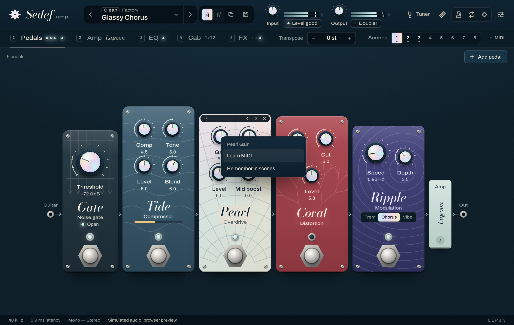
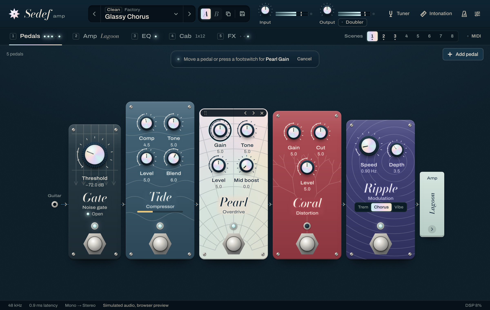
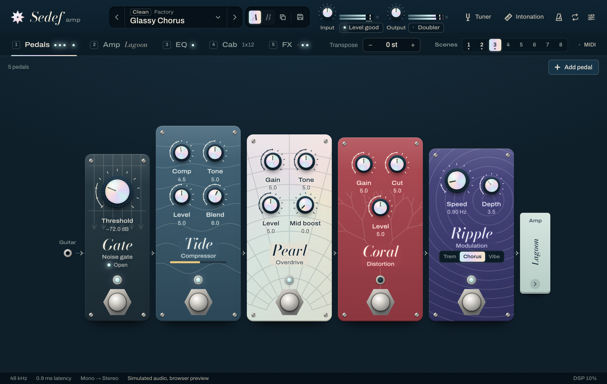
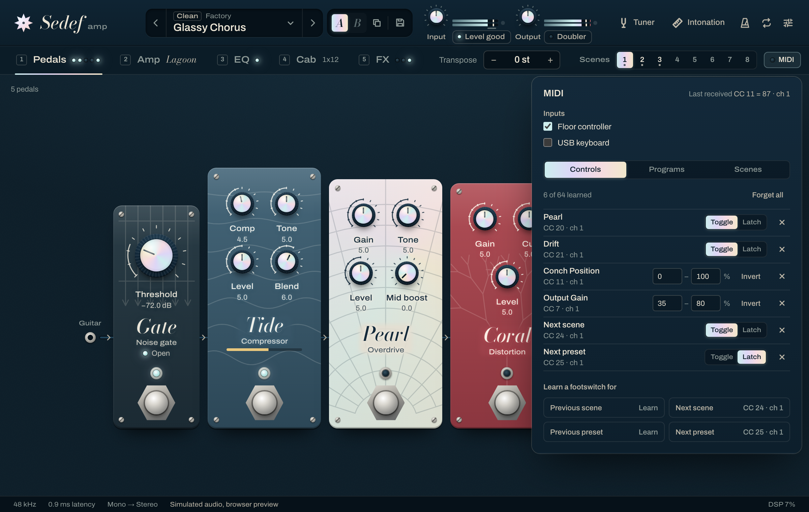

# Playing live: MIDI learn, program changes and scenes

Status: design for 0.10.0, written before the code; the code and its tests follow it. Owners:
core maintainers. Related: [architecture.md](architecture.md) (threads, the pedalboard),
[ADR-0004](adr/0004-single-parameter-schema.md) (parameter ids),
[ADR-0005](adr/0005-real-time-safety.md) (the audio thread).

## 1. What the player gets

- **MIDI learn.** Right-click any control (or press the context-menu key, or Shift+F10, on it)
  and pick *Learn MIDI*, then press a footswitch or move a pedal or knob on the controller. That
  is the whole binding. Switches (pedal on/off, the other on/off switches) follow a footswitch;
  knobs and faders follow an expression pedal or a knob across their range, or a part of it.
- **Program changes load presets.** Program 1 loads the first preset in the browser's list,
  program 2 the second, and so on, unless the player assigned a program to a preset (or to a
  scene) of their choice.
- **Scenes.** Every preset has 8 scenes: which pedals and blocks are on, plus up to 16 values the
  player picks. Switching scenes is instant and gapless: nothing is reloaded, the changes go
  through the same fades and smoothing as turning the controls by hand. A footswitch, a program
  change, the scene bar or host automation (the *Scene* parameter) switch them.

The MIDI panel (the *MIDI* button at the right of the section tabs) lists every binding with its
controller, lets the player change how a switch behaves or limit a knob's range, forget one or
all of them, learn footswitches for the scene and preset steps, assign programs, and shows the
last MIDI message that arrived.

 

 

## 2. How MIDI reaches the plug-in, per format

Sedef Amp is an audio effect. Its identity is frozen: the AU type, subtype and manufacturer
(`aufx` `Sda1` `Sedf`), the VST3 class id, the CLAP id (`io.github.mr-kaynak.sedef-amp`), the
bundle id and the audio buses (mono or stereo in, mono or stereo out) do not change, so hosts
keep finding the plug-in and every saved session opens as before.

MIDI input is switched on with JUCE's `NEEDS_MIDI_INPUT` and `acceptsMidi() == true`. What that
changes in each format, read from JUCE 9.0.4 and clap-juce-extensions at the pinned commit:

| Format | What changes | Identity | What arrives |
|---|---|---|---|
| VST3 | An event input bus (`getBusCount (kEvent, kInput) == 1`). VST3 has no controller events: hosts send controllers as parameter changes through `IMidiMapping`, which JUCE answers with 16 × 130 extra parameters (`JUCE_VST3_EMULATE_MIDI_CC_WITH_PARAMETERS`, on by default with MIDI input) that it turns back into controller messages. They are not automatable and their ids start at JUCE's fixed `paramMidiControllerOffset`, so the ids of Sedef's own parameters stay the same (a test checks that none of them falls in that range). | Class id, category `Fx\|Distortion` and audio buses unchanged. | Controllers. **Not program changes**: VST3 has no program-change event, and JUCE maps only controllers 0–129. VST3 players switch presets and scenes with controller bindings (Next preset, Previous preset, a scene, Next scene). |
| CLAP | A note input port with the MIDI dialect (`notePortsCount (true) == 1`, from `acceptsMidi()`). | Id, features and audio ports unchanged. | Controllers and program changes, in hosts that send MIDI to effects. |
| AU | `AU_MAIN_TYPE` stays `kAudioUnitType_Effect` (set explicitly, so JUCE does not switch it to `aumf`). JUCE builds the component with its music-device factory, which adds the MIDI selectors; Sedef MIDI's `aufx` has shipped that way since 0.6.0 and passes `auval -strict`. | Type, subtype, manufacturer unchanged. | Whatever the host sends with `MusicDeviceMIDIEvent`. **Logic Pro and GarageBand send no MIDI to `aufx` effects**, and making Sedef Amp an `aumf` would make it a different plug-in for every saved session. In Logic, players map their controller to Sedef Amp's parameters in the host; the *Scene* parameter (§6.6) and the existing *Previous preset* / *Next preset* switches make scenes and presets reachable that way. |
| Standalone | Nothing in the package. JUCE's standalone holder already reads every MIDI input that is switched on in its audio device window (Settings > Audio settings…). | — | Controllers and program changes. The MIDI panel lists the inputs and switches them on and off. |

A host that sends no MIDI loses nothing: bindings simply never fire, and every parameter stays
automatable as before.

## 3. Where things are kept

| What | Where | Why |
|---|---|---|
| Bindings (controller → target), program assignments, the program channel | A per-user file, `midi.json`, next to the presets (`Application Support/Sedef` on macOS, the application data folder elsewhere). Every instance and the standalone app read it; once a second an instance compares the file's text with what it last read or wrote and re-reads it when another one changed it (the text, not the modification time, which two quick saves can share). | The controller is the player's hardware. Its switches mean the same thing in every song, session and host; a per-session map would have to be learnt again in every project. Presets are global files too, so a program assignment names something that exists everywhere. |
| Scenes | In the preset (user presets) and in the session, like the pedalboard. | A scene is part of a sound: "the lead scene of this preset". |
| The active scene | In the session and in the preset (the scene it was saved in). | Reopening a session plays what was playing. |

A session therefore never carries bindings. Moving a session to another computer keeps its
scenes; the controller is learnt once per computer.

## 4. Bindings

### 4.1 Sources

A binding listens to one **control change** number (CC) on one MIDI channel, as the controller
sent it during learn. Learn ignores:

- **CC 120–127**: channel mode messages (all notes off, reset), not controls.
- **CC 0 and 32** (bank select): controllers send them in front of a program change.
- **CC 6, 38 and 98–101** (data entry, NRPN, RPN): parts of multi-message sequences whose single
  messages mean nothing alone.

Several targets may share one source (one footswitch switching two pedals); each target has at
most one source, so learning a target again moves it to the new controller.

Messages are 7-bit. 14-bit controllers (a CC from 0–31 paired with the one 32 above it) are not
read as pairs: a full sweep in 128 steps moves the wah's centre by 1/127 of its log range, about a
quarter of a semitone (350 Hz–2.2 kHz is 31.8 semitones), and the parameter smoothing turns each
step into a ramp, so the extra resolution would not be heard.

### 4.2 Targets

| Target | Behaves as |
|---|---|
| An on/off parameter (a pedal, a block, any switch) | a switch (§4.4) |
| Any other parameter (knob, fader, choice, int) | continuous (§4.3) |
| Scene *n* | selects scene *n* (§4.4 decides which messages count as a press) |
| Next scene, Previous scene | moves one scene, wrapping round 8 → 1 and 1 → 8 |
| Next preset, Previous preset | the existing `presetNext` / `presetPrevious` switches |

### 4.3 Continuous mapping

A binding keeps a range `[low, high]` in the parameter's **normalised** space (0–1, the knob's
travel, with the parameter's own skew), so a range means the same part of the knob whatever its
unit. For a controller value `v` (0–127):

```
n = low + (high − low) · v / 127          (clamped to 0..1)
value = fromNormalised (n)                (the parameter's skew; snapped for choices and ints)
```

- `low = 0, high = 1` is the default: the controller's travel is the knob's.
- `low > high` inverts it: heel-down gives the top of the range.
- 0 and 127 land exactly on `low` and `high`, which the tests pin, because a pedal at either end
  must reach the end of the range.

### 4.4 Switches

The MIDI 1.0 specification splits switch controllers at 64: 0–63 is off, 64–127 is on. Two modes
cover the footswitches controllers send:

| Mode | Message handling | For |
|---|---|---|
| **Toggle** | Each message ≥ 64 flips the switch; messages < 64 are ignored. | Momentary footswitches (127 on press, 0 on release) and switches that send the same value on every press. |
| **Latch** | The switch follows the message: on at ≥ 64, off below. | Latching footswitches (127 and 0 on alternate presses); a momentary switch then acts while held. |

For scene and next/previous targets, Toggle reacts to messages ≥ 64 (the press) and Latch to
every message (each press of a latching switch sends the other value).

**Which mode learn picks.** Learn reads the first message and, for a switch target, what the same
controller sends during the next 1.5 s of audio time:

```
first value not 0 or 127      → Latch     (a pedal or a knob: on above half travel)
first value 0                 → Latch     (only a latching switch sends 0 on a press)
first value 127, then a value < 64 within 1.5 s → Toggle   (a momentary switch, released)
first value 127, nothing else within 1.5 s       → Latch    (a latching switch)
```

A press-and-release on a footswitch takes a few hundred milliseconds; 1.5 s leaves room for a
slow, deliberate press while the binding is final before the player tries it. The window is
counted in samples of the audio clock, not wall time, so the decision is deterministic. A switch
that sends 127 on every press and nothing on release reads as Latch; the player picks Toggle in
the MIDI panel. Until the window ends, the learnt controller acts on nothing, so the release of
the learning press never switches anything.

## 5. Program changes

- A program change on the program channel (any channel by default, or one of 1–16) does what its
  assignment says: load a preset, select a scene, or, without an assignment, load the preset at
  that position in the library order (the browser's list, the order Previous/Next step through):
  program 1 (0 on the wire) is the first preset. Programs past the end of the list do nothing.
- Programs are shown as 1–128, as most controllers label them.
- Loading by program change is like a Next/Previous step: it does not add to Recent.
- Bank select is not read; 128 programs cover the factory library (49) and a player's own
  presets, and an assignment can name any preset.
- VST3 receives no program changes (§2).

The library order moves when the player adds a preset ahead of others, so a live set should use
assignments; the panel shows what each program loads.

## 6. Scenes

### 6.1 How many

**8 scenes per preset.** Foot controllers come with 4, 5, 6, 8, 10 or 12 switches; a page of 8
(one row of 8, or two rows of 4) is the largest common block a controller gives to one function,
while 4- and 5-switch units reach the first scenes directly and the rest with Next/Previous. On
screen, 8 buttons of 26 × 24 px (the 24 px target of WCAG 2.5.8) with 2 px gaps take 226 px with
their track; with the *Scenes* label and the MIDI button the bar spans 843–1188 px on the 1200 px
canvas, right of the section tabs, which end at 622 px. So the scene bar is on every page and,
since the canvas scales as a whole, at every window size including the smallest (75 %). More than
8 would need a second row or a menu, which is no longer one press.

### 6.2 What a scene holds

- **The switches**: the on/off parameter of every pedal in the registry (`PedalList.inc`, 16
  today), the three EQ banks, the Doubler, Drift and Fathom: 22 switches. Each goes through its
  module's bypass fade (10 ms) or, for Drift and Fathom, their own spill-over, so switching never
  clicks.
- **Up to 16 values** the player picks (*Remember in scenes* in a control's menu): continuous
  parameters only (kind Float), which every module smooths. Choices, ints and the other switches
  are left out: they jump (an amp model, a voicing lever), and a scene must not click.
- Global parameters (input and output gain, tuner, metronome, latency…) are never in a scene,
  as they are never in a preset.

Everything else is the preset's and the same in every scene. A preset's scenes therefore share
one amp, cab and board, which is what makes switching instant: a scene changes nothing that needs
a reload.

### 6.3 Scenes remember what you change

The values of the scene in use are the live controls. Switching from scene *a* to scene *b*
stores the live values of the scene's parameters in *a* and sets the parameters to *b*'s. So a
change made while a scene plays belongs to that scene, without a Store button to forget.

A scene is **made** the first time it is selected, as a copy of the scene being left, so the
first switch to it changes nothing audible and the player builds it from there ("scene 2 starts
as what I was playing"). Until then it holds nothing. A preset without scenes (every factory
preset, every preset saved before 0.10.0) has only scene 1 made. A player who never switches
scenes therefore never has scenes to keep: tweaking scene 1 leaves the other seven empty, not as
stale copies of the sound at load. *Copy scene N here* (a scene button's menu, or the Scenes tab
of the MIDI panel) puts the sound of the scene in use into another scene and makes it. The scene
bar shows which scenes are made: a brighter number with a dot under it.

Selecting the scene that is already in use does nothing.

### 6.4 Presets: the file format

A preset file gains an optional `"scenes"` object. Each scene stores only the values that differ
from the file's `"parameters"`, and `"parameters"` is always the sound of the active scene:

```json
{
  "format": "sedef-preset", "version": 1, "name": "Two Faces",
  "parameters": { "pearlEnabled": 0, "driftEnabled": 1, "driftMix": 0.2, "...": 0 },
  "board": "gate,pearl,coral",
  "scenes": {
    "active": 0,
    "values": ["driftMix"],
    "list": [
      {},
      { "pearlEnabled": 1, "driftMix": 0.35 },
      { "driftEnabled": 0 }
    ]
  }
}
```

- `active`: the scene the preset was saved in (0–7), whose values are `"parameters"`.
- `values`: the picked values (parameter ids), at most 16, in the order they were picked.
- `list`: up to 8 entries, one per scene from scene 1. An object is a made scene; a parameter it
  does not name has the value in `"parameters"`. `null`, or no entry, is a scene not made yet
  (above, scenes 4–8). The active scene's entry is `{}`.

**Backward compatible:** a file without `"scenes"` loads exactly as before (8 copies of the
preset), and its `"parameters"` play as before, so every factory preset renders byte for byte as
on main. **Forward compatible:** 0.9 ignores keys it doesn't know, so it plays `"parameters"`, the
sound the preset was saved in; it loses the other scenes only if it saves over the file. Unknown
parameter ids in a scene are ignored and out-of-range values are clamped (`ParamSpec::sanitise`),
as for `"parameters"`. A save writes `"scenes"` only when a scene differs from the preset or a
value was picked, so a preset whose scenes were never used is written as before.

**Edited (the dirty dot).** Switching scenes is not an edit. A preset counts as changed when a
made scene's values differ from the loaded file's (the scene in use compared live), when the
picked values changed, or when anything outside the scenes changed as before. A scene the file
doesn't have, made as an untouched copy of the file's own sound, is not a change; one made from a
scene that differs from it is. A scene-held parameter is compared through the scenes, not against
the value it had at load.

Snapshots (the browser's Esc, preset Undo) and A/B carry the scenes and the active scene exactly,
like the pedalboard.

### 6.5 Sessions

The session's `Extra` element gains a `scenes` attribute holding the same JSON object, with
`"parameters"` read as the session's own parameter values. It is left out while only the scene in
use is made and no values are picked, so a session that never used scenes is saved exactly as
before. A session without it has one scene made, the one the *Scene* parameter selects, holding
the session's sound. Hosts restore it with everything else.

The *Scene* parameter is the selection. A host can move it and save before the message thread
has heard of the switch (a validator does, with no event loop running), so the attribute may name
one scene and the parameter another: the parameter wins, and its scene takes the session's sound,
as the scene in use always does. The state then saves again byte for byte as it was loaded.

### 6.6 The Scene parameter

`scene` ("Scene", choices 1–8, automatable, appended to `ParameterList.inc`, ADR-0004) follows the
active scene and switches it: a host automation lane, or a host-side controller assignment (the
only way in Logic, §2), selects scenes through it. It is a global parameter as far as presets go
(not stored in `"parameters"`, not compared for the dirty dot): the scene object carries it.

## 7. Real time

### 7.1 Threads and data

```
message thread                              audio thread (processBlock)
──────────────                              ───────────────────────────
midi.json ─► MidiMap ──── RtMailbox ──────►  bindings, program table
master scene bank ─────── RtMailbox ──────►  its own copy of the bank
                                             MIDI in ─► overrides on the parameter snapshot
APVTS  ◄── per-parameter sync atomics ◄────  value + sequence number per override
       ──► per-parameter acknowledgements ─►  an override ends once acknowledged
bank, presets, learn ◄── SPSC rings ◄──────  scene switched (with the values left behind),
                                             program change, learn messages
```

The audio thread never calls into JUCE's parameters: `setValueNotifyingHost` takes the listener
lock and calls the host, which ADR-0005 rules out. Instead the live layer (`sedef::live`, in the
engine, JUCE-free) works on the parameter snapshot the processor already builds each block:

1. **Acknowledge.** Before the snapshot is read, every override whose sequence number the message
   thread has acknowledged ends (`ack[p] ≥ seq[p]`, acquire).
2. The processor reads the parameters into the snapshot, as before.
3. An acquire fence, then the mailboxes: a new MIDI map; a new scene bank. A bank published for a
   scene switch made on screen carries a new switch count; the audio thread then applies that
   scene's values as overrides.
4. A change of the raw `scene` parameter (host automation) to a scene other than the active one
   switches to it.
5. The block's MIDI messages, in order: bindings set overrides (a switch reads the current value
   with the overrides so far, so two presses in one block cancel out); scene selections store the
   live values in the scene being left and apply the new one's; program changes select a scene at
   once or ask the message thread for a preset.
6. The overrides are written over the snapshot, which goes to `Engine::process`.

Every override gets the next value of one sequence counter and is published per parameter (value
relaxed, then sequence release). The message thread, 50 times a second, writes each published value
to its parameter (one host gesture per change, skipped when the parameter already holds it) and
then acknowledges that sequence number (release). The parameter then holds the value the override
held, so ending the override changes nothing audible.

**Why the order matters.** A scene switch made on screen publishes the bank first and then
writes the parameters. The audio thread reads the parameters, fences, then reads the mailbox: if
it saw any of those writes, it also sees the bank, and the overrides fill in the rest of the
scene, so the switch lands in one block. Reading the acknowledgement before the parameters gives
the same guarantee in the other direction: once an override ends, the parameter read after it
holds the acknowledged value.

All events of a block act at the block's start. The audio thread works per block (the parameter
snapshot is per block), and a block is at most a few milliseconds; the alternative, splitting the
block at each message, would change how the modules' block-rate smoothing runs.

### 7.2 Who owns the scenes

The message thread owns the master bank (names of the parameters in scenes, every scene's values,
the active scene). The audio thread keeps its own copy, which it updates itself when it switches,
so footswitch presses faster than the message thread's tick (1 → 2 → 1 within 20 ms) keep the
values played in scene 2. A switch made on the audio thread is reported with the values it left
behind and the parameters they belong to; the message thread stores them in its bank. Its bank
also counts how many of those reports it has taken in: the audio thread adopts a published bank
only when that count matches the reports it sent (an older bank would undo a switch the message
thread hasn't seen yet), except when the bank carries a new switch count, which it always takes.

The switch count goes up with every switch made on screen and every bank the message thread puts
in place of the old one (a preset load, a snapshot, A/B, a host restore). Each report carries the
count of the bank it was made on; the message thread passes over a report whose count is not its
own, because the change that raised the count already decided where the scenes are.

When the report ring is full (the message thread stalled for seconds), the audio thread does not
switch: a switch that the message thread can never learn about would leave the two banks
disagreeing.

### 7.3 Capacities and their reasons

| Constant | Value | Reason |
|---|---|---|
| Scenes | 8 | §6.1 |
| Picked values per preset | 16 | "A few chosen values" with room to spare; the list fits the panel without scrolling. |
| Parameters in a scene | ≤ 48 | 22 switches + 16 values = 38; the rest is room for new pedals (a static assertion fails the build when the registry outgrows it). |
| Bindings | 64 | A 12-switch controller with two pedals, each switch driving up to four targets, is 56. |
| MIDI messages read per block | 512 | A controller sends at most a few hundred messages a second; more in one block are dropped. |
| Report ring (scene switches, program changes) | 64 | One entry per press; full only if the message thread stalls for seconds. |
| Learn ring | 256 | An expression pedal swept while learning sends ~100 messages a second; learn only needs the first ones. |
| Message-thread tick | 50 Hz | Host and screen see a MIDI change within 20 ms; the sound already changed in its block. |
| Learn window | 1.5 s | §4.4 |

Nothing allocates after construction: the mailboxes and rings are fixed-size, and the event
records are plain structs. The engine test that counts allocations runs the live layer too.

### 7.4 Races, and what happens

- **A footswitch and a click on the scene bar in the same few milliseconds.** Both switches are
  carried out in order of arrival on the message thread; the last one wins and every scene keeps
  values that were playing at some point. No stored scene is lost.
- **A controller moves a parameter while the player drags it.** The last change wins, as with
  host automation.
- **A program change while a controller override is still unacknowledged.** The message thread
  writes pending overrides first, then loads the preset, so the preset's values win; a controller
  message that arrives after the program change wins over the preset, as it came later.
- **The host restores a session.** The restored bank is published before the parameters change,
  so the audio thread never mistakes the restored *Scene* value for a host switch.
- **No audio is running** (a host that stops processing a track). Bindings and program changes
  need audio to arrive anyway. A click on the scene bar works without audio: the message thread
  writes the parameters itself, and the audio thread applies nothing stale when it starts, because
  everything it would apply is already acknowledged.

## 8. Tests

Engine (`engine/tests/live/`):

- Continuous mapping: ends, midpoint, inversion, sub-ranges, skewed and stepped parameters.
- Switches: Toggle and Latch on momentary, latching and repeat-127 controllers; two presses in a
  block; scene, next and previous targets in both modes; the learn classifier on every row of
  §4.4 at 44.1, 48, 88.2 and 96 kHz.
- Scenes: a switch sets exactly the stored values in the block of the message; the values left
  behind are reported and kept in the audio thread's copy; rapid switching keeps every scene;
  stale banks are not adopted; on-screen switches apply; the Scene parameter switches; a full ring
  refuses the switch.
- Overrides end only when acknowledged, and the snapshot then reads the parameter.
- Block-size invariance (1, 7, 64, 333, 4096): the same MIDI stream gives the same state at every
  block end that blocks of each size share.
- Through the engine: a scene switch renders sample for sample like the same parameter change
  made as host automation at that block, at 44.1–96 kHz; the largest step it adds is reported.
- No allocation while learning, switching scenes and following controllers.

Plug-in (`plugin/tests/LiveStateTests.cpp`): bindings round-trip through `midi.json` and
across instances; presets with and without scenes round-trip; a 0.9 file loads; the active scene
and the dirty rules; snapshots and A/B; sessions with and without scenes; program change → preset
in library order and by assignment; MIDI through `processBlock` switches a scene in one block; no
Sedef parameter id falls in JUCE's emulated-controller range.

UI (vitest): the context menu (pointer and Shift+F10) and the learn flow against the mock, the
bindings list (mode, range, invert, forget one and all, where the focus goes after), program
assignments, the scene bar (select, keyboard, copy, made scenes), the format notes and the mock's
scene bookkeeping, which mirrors the plug-in's rules; the arithmetic of `features/live/model.ts`
against the same cases as the engine's.

## 9. Rejected

- **Bindings per session.** Rejected for §3's reason; a per-session override can come later
  without changing the file.
- **Handling MIDI on the message thread.** The simplest code, but a busy message thread (a host
  redrawing, the web view) delays a footswitch by tens of milliseconds or more, and a scene would
  arrive spread over two blocks.
- **Calling `setValueNotifyingHost` from the audio thread.** JUCE takes a lock and calls into the
  host there (ADR-0005).
- **Splitting blocks at each MIDI message.** Sample-exact switching, but it changes the modules'
  block-rate smoothing with the timing of the messages; a block is at most a few milliseconds.
- **Full snapshots as scenes** (every parameter). Amp, cab and voicing changes jump or need a
  reload, so switching could click, against the brief.
- **A Store button.** One more step to forget on stage; scenes remember instead (§6.3).
- **An `aumf` AU so Logic sends MIDI.** A different component type is a different plug-in: every
  saved Logic session would lose Sedef Amp.
