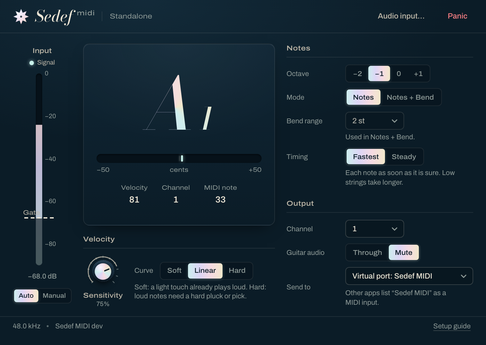

# Sedef MIDI

**Play MIDI instruments from your guitar.** Sedef MIDI listens to your guitar's DI, one note at a
time, and sends MIDI notes in real time: play a bass line on the guitar and hear it on a bass
instrument, record it as MIDI and edit it afterwards.

Sedef MIDI comes with Sedef Amp's installer on macOS, Windows and Linux, from 0.6.0 on
([Install](#install)).

## What you get

- **Sedef MIDI.app**, a standalone app. It opens your audio interface's input and sends its notes
  through its own MIDI port, **Sedef MIDI**, which every program lists as a MIDI input, like a
  keyboard. On macOS it is a CoreMIDI virtual source; on Linux an ALSA sequencer port.
- **Sedef MIDI** as a plug-in (AU, VST3, CLAP) for the guitar's audio track. Its notes are the
  plug-in's MIDI output, for hosts that route a plug-in's MIDI to instrument tracks.
- **Sedef MIDI (Instrument)**, an instrument AU for Logic, which takes the guitar through its side
  chain (see below).
- Both plug-ins can also send their notes to a MIDI output you pick, or to a virtual port of their
  own, "Sedef MIDI (plug-in)". This is off by default.

## Install

Sedef MIDI is part of the Sedef Amp download for your OS and is selected by default:

| OS | Sedef MIDI | To leave it out |
|---|---|---|
| macOS | `Sedef MIDI.app` in `/Applications`; its VST3, CLAP and AU (effect and instrument) in `/Library/Audio/Plug-Ins` | Untick **Sedef MIDI** in the installer's list |
| Windows | `Sedef MIDI.vst3` and `Sedef MIDI.clap` in `Common Files`, `Sedef MIDI.exe` next to Sedef Amp with a Start menu entry | Untick **Sedef MIDI** on *Select Components* |
| Linux | `Sedef MIDI.vst3`, `Sedef MIDI.clap`, the `sedef-midi` app and a menu entry, next to Sedef Amp's | `./install.sh --no-midi` |

Updates from inside Sedef Amp keep Sedef MIDI when it is installed and leave it out when it isn't.
[install.md](install.md) has every path and how to remove Sedef MIDI later.

## The controls

| Control | What it does |
|---|---|
| **Input meter and Gate** | The meter shows your guitar's level, and the gate on the same scale: a pluck or pick under the gate never starts a note. **Auto** (default): the gate follows your input's own noise, so it needs no setting at any input level; the dashed line shows where it is. **Manual**: drag the handle to set it yourself. The **Signal** ring over the meter fills and lights while you're above the gate. |
| **Note** | The note being sent, large enough to read from the guitar, with how far your pitch is from it (±50 cents). The last note stays, unlit, after it ends. |
| **Octave** | −2, −1 (default), 0 or +1. A bass sounds an octave under a guitar, so −1 puts a guitar line in a bass's register. |
| **Mode** | *Notes* (default) sends notes only. *Notes + Bend* also sends vibrato and slight bends as pitch bend. |
| **Bend range** | In Notes + Bend: must match the bend range set in your instrument (2 semitones in most). |
| **Timing** | *Fastest* (default) sends each note as soon as it is sure: low strings take longer. *Steady* sends every note 38 ms after you pluck or pick it, so one track delay of −38 ms puts every recorded note where you played it. |
| **Velocity: Sensitivity, Curve** | How much the strength of each pluck or pick sets the velocity (0 %: every note at 100). The scale follows how hard you play on your input, about your last 16 notes, so the same playing gets the same velocities whether your interface is set high or low, and the dynamics of a phrase come through. *Soft*: a light touch already plays loud; *Hard*: loud notes need a hard one. |
| **Channel** | The MIDI channel, 1-16. |
| **Guitar audio / Side chain** | *Through* lets the guitar's sound pass; *Mute* silences it. The standalone app and the instrument start muted: they are there for the notes. |
| **Send to / Also send to** | The standalone app: its own port, or a MIDI output. The plug-ins: the host only (default), their own virtual port, or a MIDI output such as an IAC bus. |
| **Panic** | Ends every note on all 16 channels. |
| **Audio input…** | Standalone app only: picks the audio interface, input, sample rate and buffer. |

## Setting up

### A standalone instrument app

1. Open Sedef MIDI.app, choose **Audio input…** and pick your guitar's input.
2. In the instrument app, choose **Sedef MIDI** as its MIDI input (on Windows, the output you picked;
   see below).

### Logic: the standalone app (simplest)

1. Run Sedef MIDI.app as above.
2. In Logic, create a software instrument track with your instrument and record-arm it. Logic takes
   MIDI from every input by default; to take only Sedef MIDI, choose it as the track's MIDI input in
   the inspector.

### Logic: the instrument AU with a side chain

Logic records MIDI from other instrument tracks ("MIDI From", described in Logic Pro's guide under
*Route MIDI internally to software instrument tracks*), and only from tracks whose instrument
plug-in sends MIDI. That is why there is an instrument version of Sedef MIDI:

1. Create a software instrument track and load **AU Instruments > Sedef > Sedef MIDI (Instrument)**.
2. In its plug-in window, set **Side Chain** to your guitar track. The guitar goes to Sedef MIDI.
3. Create a second software instrument track with the instrument you want to hear. Set its input
   to **MIDI From** the Sedef MIDI (Instrument) track, and record-arm it.

### Logic: the effect AU on the guitar track

Insert **Audio Units > Sedef > Sedef MIDI** on the guitar's audio track. Logic does not pass an
audio effect's MIDI to other tracks, so use **Also send to** (below) to reach an instrument track.
If your version of Logic offers the guitar track under **MIDI From**, that works too.

### Any AU or host: through an IAC bus

1. Open **Audio MIDI Setup > Window > Show MIDI Studio**, double-click **IAC Driver** and tick
   **Device is online**.
2. In Sedef MIDI, set **Also send to** to the IAC bus.
3. On an instrument track, choose that IAC bus as the MIDI input.

The plug-ins' own virtual port, **Sedef MIDI (plug-in)**, does the same without the IAC bus; some
sandboxed hosts don't allow plug-ins to create ports, and then the IAC bus is the way.

### Other hosts (VST3, CLAP)

Put Sedef MIDI on the guitar track and route its MIDI output to an instrument track the way your
host does it (often: set the instrument track's MIDI input to the guitar track). Notes reach the
host at their exact sample.

### Windows and Linux

- **Linux:** the standalone app's port is an ALSA sequencer port named Sedef MIDI.
- **Windows:** Windows has had no virtual MIDI ports of its own, so Sedef MIDI sends to an output you
  pick: a loopback MIDI port another app listens to, or a hardware port. Windows MIDI Services, now
  rolling out with Windows updates, brings built-in loopback endpoints (made in its MIDI settings
  app): pick one side as Sedef MIDI's output and the other as the receiving app's input. Sedef MIDI
  uses the classic Windows MIDI interface, through which MIDI Services shows its endpoints to older
  apps; this is not tested yet.

## Playing tips

- **One note at a time.** Damp the strings you aren't playing. A string left ringing under the
  next note is usually fine when the new note is clearly louder; two strings at a similar level
  (a chord, or fingerstyle with strings ringing into each other) give short wrong notes between
  the right ones.
- **Play higher with −2.** A bass line played higher on the neck with the octave at −2 is recognised
  faster than the same line on the low strings with −1 (see the latency table).
- **Any input level works.** Sedef MIDI works the same with your interface's peaks anywhere from
  about −40 to −6 dBFS, with every setting at its default: the gate follows your input's own
  noise, and velocity and note-offs follow your own playing, not the input's level. You don't
  need to change your interface's gain.
- **Fingers or a pick.** Nothing in Sedef MIDI waits for a pick's click. A finger touching the
  string just before it plucks it is not a note, and the note is timed from the pluck. Moving the
  fretting hand to the next note before you play it doesn't start a note on a string that has
  died down; a move while the string is still loud can give a short one.
- **The very first note.** Until you have played a note, Sedef MIDI can't tell a finger's touch
  from a soft pluck, so the first note after it starts comes about 60 ms after you play it. Every
  note after that, after a rest or not, comes as quickly as the table below says.
- **Manual gate only for noise that comes and goes.** Auto ignores steady hum and hiss. If the
  **Signal** ring still lights while you're silent (a crackling cable, a buzz that starts and
  stops), switch the gate to Manual and drag it just above that. Too high and soft notes go
  missing.
- **Steady for recording.** Record in Steady with a −38 ms track delay and every note sits where
  you played it. A note played softly over a string still ringing can land a little late, and one
  right after a mute (or a finger touching the still ringing string) a little early; damping the
  previous string a moment sooner keeps them in place. For playing
  live, Fastest feels quicker.
- **Velocity.** A note as strong as your recent average gets about 88 at the default settings;
  softer and harder ones spread around it. Keep the sensitivity high if you play with dynamics;
  lower it, or set the curve to Soft, if quiet notes come out too soft. A long passage played much
  softer than the rest slowly comes up to a usual velocity.

## How fast is it

From the pluck or pick to the note, at 48 kHz, plus your audio buffer (for example 5.3 ms at 256 samples):

| String | E2 | A2 | D3 | G3 and up |
|---|---:|---:|---:|---:|
| Fastest | 28 ms | 22 ms | 17 ms | 16 ms |
| Steady | 38 ms | 38 ms | 38 ms | 38 ms |

A low note needs about two of its periods before its pitch is sure; above A3, Sedef MIDI waits one
period of the low E (16 ms) to rule out a lower note under it. See
[the design](design/guitar-to-midi.md#as-built) for the measurements.

## If something doesn't work

- **No notes, and the meter doesn't move:** the input is wrong. In the app, choose
  **Audio input…** and pick the input your guitar is plugged into; in a host, check that Sedef MIDI
  is on the guitar's track (or, for the instrument AU, that its **Side Chain** is the guitar
  track).
- **The meter moves, the note display doesn't:** play a single note on one string and damp the
  others. If the **Signal** ring stays dark while you play, switch the gate to Manual and drag it
  under your notes.
- **The note display moves, the instrument stays silent:** the MIDI doesn't reach it. Check that
  the instrument app lists "Sedef MIDI" as an input, that its channel matches Sedef MIDI's, or in
  Logic that the instrument track takes **MIDI From** the Sedef MIDI (Instrument) track.
- **Wrong, missing or extra notes:** see the playing tips above. Reports help most with a short
  recording of the dry DI and the MIDI it gave:
  [open an issue](https://github.com/mr-kaynak/sedef-amp/issues).

## Identity

These never change, so sessions, presets and host settings that name Sedef MIDI keep finding it.
New parameters are only appended ([ADR-0004](adr/0004-single-parameter-schema.md)).

| | Sedef MIDI | Sedef MIDI (Instrument), macOS only |
|---|---|---|
| Manufacturer code | `Sedf` | `Sedf` |
| Plug-in code | `Sdm1` | `Sdm2` |
| AU | `aufx` `Sdm1` `Sedf`, "Sedef: Sedef MIDI" | `aumu` `Sdm2` `Sedf`, "Sedef: Sedef MIDI (Instrument)" |
| Bundle ID | `io.github.mr-kaynak.sedef-midi` | `io.github.mr-kaynak.sedef-midi-instrument` |
| VST3 classes | component `ABCDEF019182FAEB5365646653646D31`, controller `ABCDEF011234ABCD5365646653646D31` | |
| CLAP ID | `io.github.mr-kaynak.sedef-midi` | |

**Why the effect is `aufx`, not `aumf`.** A music effect (`aumf`) is an effect that takes MIDI in
as well as audio; Sedef MIDI takes only audio and sends MIDI out, so it is an audio effect that
listens to its input. Every AU host offers `aufx` on an audio track, where the guitar is. And the
type changes nothing for Logic's routing: Logic passes MIDI on only from instrument tracks, which is
what the instrument AU (`aumu`) is for. The type is part of an AU's identity, with its subtype and
manufacturer, so it is fixed now.
