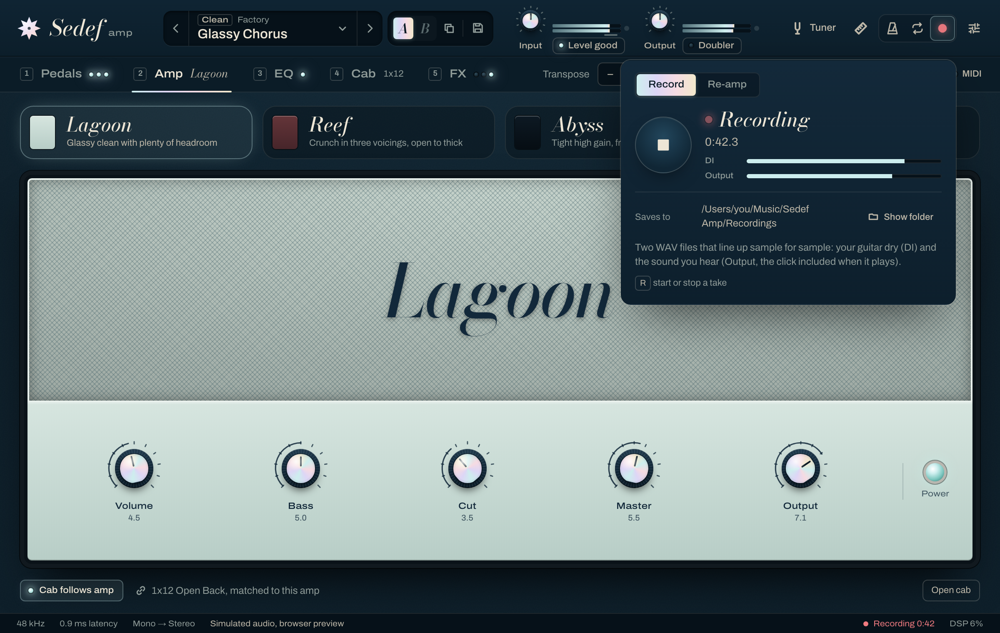
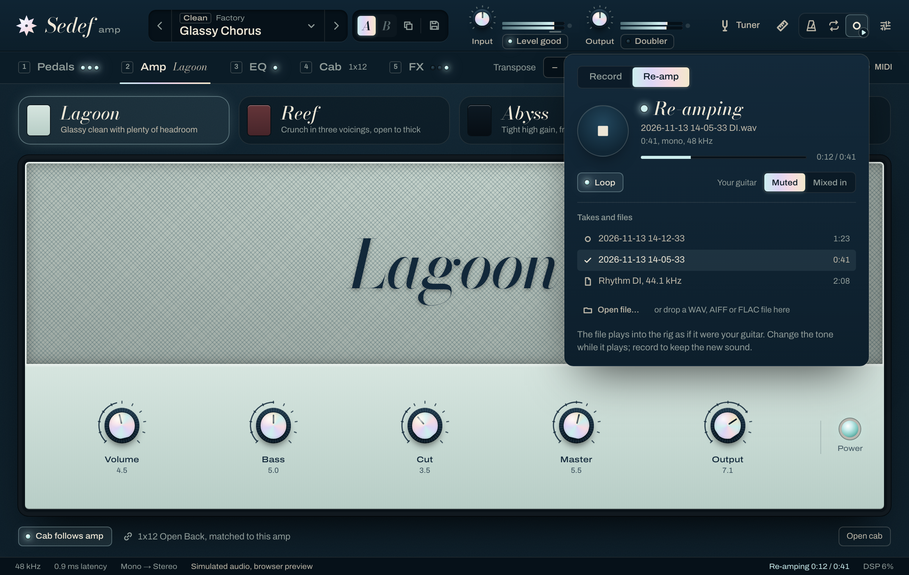

# Recorder and re-amp

Status: design for 0.10.0, implemented in `engine/include/sedef/record/` (the real-time parts,
pure C++), `plugin/src/Recorder.*` and `plugin/src/Reamp.*` (the threads and files) and
`ui/src/features/recorder/` (the panel). Owners: core maintainers.

The standalone app records what you play and plays it back through the rig:

- **Record**: one button records the take as two WAV files in a folder you can open: the dry
  DI (the input, before anything) and the processed output (after everything). While it
  records you see the elapsed time and the level of both, and afterwards where the files went.
- **Re-amp**: pick a recorded DI (or drop any WAV) and play it through the current rig as if it
  were the guitar, once or looping, with your live input muted or mixed in. Change the tone
  while it plays. Record while re-amping and the output file is the new sound.

Neither ever glitches the audio: the audio thread only copies samples into memory reserved
beforehand, and two other threads do the disk work.

## 1. Where it lives

**The standalone app only**, like the metronome and the looper. A DAW records the plug-in's
output and its own input tracks, sample-exact and with the project; a recorder inside a
plug-in would duplicate that and leave its files outside the session. The engine and the
plug-in builds carry the code, but only the standalone app offers it (`isStandalone()`), and
while nothing records or plays the per-block cost is three atomic loads (section 8).

In the header, the standalone app groups the things that keep time or hold your playing in one
**transport** well: Metronome, Looper and Recorder, icon buttons side by side. Each opens its
own panel; the Recorder's panel has two tabs, Record and Re-amp, because re-amping starts from
a recorded take. `R` starts and stops a take from anywhere (outside text fields), like `L` for
the looper, so a player never has to take a hand off the guitar for long.

With the panel closed a take still shows: the Recorder button's dot fills red and breathes
(it holds still under reduced motion), and the status bar keeps the time in sight
("Recording 0:42", or "Re-amping 0:12 / 0:41"). The header has no room for a running clock
beside the level meters, and the status bar is where the app already says what the audio is
doing. To make room for the well, Intonation is an icon button in the standalone app, as it
already is in a narrow plug-in window. A screen reader hears a take start, its first dropout
and how it ended ("Take saved, 1 minute 23 seconds, 2 dropouts") from a polite status region,
with or without the panel open.





## 2. Signal points

```
device in ─► Re-amp (replace or mix) ─► [DI file] ─► Engine (gate … Fathom, looper, click, output gain) ─► [output file] ─► device out
```

- **DI** is the rig's input exactly as the engine receives it: the device input before input
  gain and before anything else, or the re-amped file in its place. Re-amping a DI through an
  unchanged rig reproduces the output file.
- **Output** is exactly what the app sends to the device: after the pedals, amp, cab, post
  effects, the looper, the metronome and the output gain. If the click plays, it is in the
  output file, because that is what you heard; the DI never has it, so a take recorded with
  the click can be re-amped without it.

`record::Deck::process` (engine) is the one place that runs these steps in this order, for the
plug-in and for the tests alike.

## 3. Real time (ADR-0005)

```
audio thread                      writer thread ("Sedef recorder")
  copy DI + output into chunks ─► filled queue ─► write WAV, return chunk ─► free queue ─┐
  take a free chunk ◄────────────────────────────────────────────────────────────────────┘

reader thread ("Sedef re-amp")    audio thread
  decode file ─► frame FIFO ────► replace or mix the input
```

The audio thread never allocates, locks, waits, logs or touches a file. Per block it copies
the DI and the output into preallocated **chunks** and publishes full ones through a wait-free
single-producer, single-consumer queue of chunk indices (`SpscRing<int>`). The writer thread
wakes every 20 ms, writes every full chunk and hands it back through a second queue. Memory is
reserved on the writer thread when a take starts, before the audio thread is told about it,
and is freed only once the audio thread has said the take is over.

### FIFO size

The FIFO has to absorb the longest stall of the disk; it cannot help a disk that is slower
than the stream, and none is: the stream is at most 192 kHz × 4 channels × 4 bytes = 3 MB/s,
and 768 kB/s at 48 kHz.

We size it for a **4 second** stall. Writes to an internal SSD return in microseconds and
stall for at most a few hundred milliseconds when the drive cleans up or the system flushes
other files; 4 s covers ten of those back to back, and the slow cases: a USB stick or a busy
external disk flushing its cache, or a folder that a sync client is holding.

```
chunks per stream = ceil(4 s × rate / 2048) + 2     (one filling, one being written)
memory            = 2 streams × chunks × 2048 frames × 2 channels × 4 bytes
                  = 3.1 MB at 48 kHz, 6.3 MB at 96 kHz, 12.6 MB at 192 kHz
```

A chunk is 2048 frames (43 ms at 48 kHz): short enough that the newest audio reaches the file
within a writer period or two, long enough that the queues hold a few hundred entries rather
than one per block. Chunks always have room for two channels; a mono DI wastes half of its
chunks, which keeps the arithmetic one formula.

### Overflow

When the audio thread needs a fresh chunk and none is free, it **drops** that stream's samples
until one comes back. It never waits. It counts **dropped blocks** (audio blocks that lost any
samples, from either file) and **dropped samples** per file, and keeps counting time, so the
next chunk carries its true position. The writer fills the hole with silence: the take keeps
its length, the two files stay aligned, and the place of a dropout is exact. The panel says
"2 dropouts: 0.09 s of this take is silence" in amber, and both files say so in their metadata
(section 4).

### Stop

Stop ends the DI at the start of the next block. The output keeps recording until it has
caught up (the rig's latency, section 5), then the audio thread publishes its last partial
chunks and says the take is over. The writer writes them, adds the metadata, completes the
headers and closes the files. A take also ends when:

- the audio device restarts (`prepareToPlay`, a new device, rate or buffer size) or stops
  (`releaseResources`): the audio thread no longer runs, so the take is finished from there;
- a file would pass the WAV size limit of 4 GB: 3.1 hours of stereo output at 48 kHz, 46
  minutes at 192 kHz. The panel says why it stopped;
- the disk reports an error (full, removed): the writer keeps what it wrote and says so;
- the app quits.

Changing the Latency setting (oversampling) does not end a take: the engine is prepared again
while the audio callback is held off, and the output is realigned (section 5).

## 4. Files

**Format: WAV, 32-bit float, at the device's sample rate.** Chosen over 24-bit because:

- The engine works in 32-bit float. Float files keep every sample exactly as it was, so a DI
  re-amped later is bit-for-bit the take, which section 7 tests. A 24-bit DI would be rounded,
  and the re-amp would differ from what you played.
- Nothing clips in the file: the output may run over full scale before the converter and the
  file keeps the peaks; a DI is never limited.
- No dither decision to make or to document.
- It costs a third more space than 24-bit: 11.5 MB per minute for a mono DI at 48 kHz, 23 MB
  per minute for the stereo output. Every DAW and editor reads it.

Format details: `WAVE_FORMAT_IEEE_FLOAT` (3), an 18-byte `fmt ` chunk, a `fact` chunk with
the frame count, the samples, then a `LIST`/`INFO` chunk with the software (`ISFT`), date
(`ICRD`), name (`INAM`) and a comment (`ICMT`). The comment states what the file is, the rig's
latency that was removed, and the dropouts:

```
Sedef Amp take, output: the processed signal after everything, 48000 Hz. Shifted 67 samples
earlier (the rig's latency) so it lines up sample for sample with "2026-11-13 14-05-33 DI.wav".
Dropouts: none.
```

The header's sizes are brought up to date every second, so a crash or a power cut leaves files
that open, missing at most the last second.

**Where**: `Music/Sedef Amp/Recordings` in the user's home folder (the OS's Music folder), the
first place a player looks and one the file browser shows. The panel shows the path and a
**Show folder** button, and the last take has its own **Show** and **Re-amp** buttons.

**Names**: the local time at the press, then the part, so a folder sorts by time and the pair
sits together: `2026-11-13 14-05-33 DI.wav` and `2026-11-13 14-05-33 Output.wav`. Two takes in
the same second get ` (2)`. The characters are legal on every OS (no `:`).

**Channels**: the DI has the device's input channels (one, or two with a stereo input), the
output its output channels.

## 5. Alignment

Both files start on the **same sample**: the first sample of the block in which the take
started, and have the **same length**. The rig delays its output by its latency `L`
(`Engine::latencySamples()`: oversampling filters, Transpose, a capture's rate conversion), so
output sample `t` belongs to input sample `t − L`. The recorder removes it: the output file's
sample `k` is the output stream's sample `start + k + L`. Output file sample `k` is therefore
the rig's response to DI file sample `k`: a click in the DI at sample 48 000 comes out at
sample 48 000 in the output, not 48 067.

`L` is read after every block, because Transpose changes it when it is switched on or off or
changes direction (docs/dsp/transpose.md, section 5), and the Latency setting changes it. Each
block's output goes to the position its own latency gives. When `L` grows, the next samples are
written over the previous `ΔL` (the output repeats a moment's audio there anyway); when it
shrinks, the `ΔL` samples skipped are silence. Either way the files stay aligned from then on.

The device's own input and output latency is outside the app and plays no part: both files are
taken inside the same audio callback.

## 6. Re-amp

### Loading

A file comes from the list of recorded DIs in the Recordings folder (newest first), from Open
file…, or dropped on the panel. A dropped file reaches the app as bytes (the page cannot see
paths), so it is copied into `Recordings/Imported` in 1 MB pieces and opened from there, and
it stays in the list. WAV, AIFF and FLAC files with one or two channels play, any bit depth.

### Sample rate: converted, not refused

A file whose rate differs from the device's is **converted once, on loading**, into a
temporary file at the device's rate, with a Kaiser-windowed sinc (32 zero crossings,
β = 10, the cut-off at 0.9 of the lower Nyquist frequency, linear phase so nothing moves in
time). Tones up to 17 kHz come through within −100 dB of the exact result (−101 to −130 dB
measured), and what lies above the new Nyquist frequency stays 110 dB down. The panel shows
the file's own rate and "converted for this device". Why not refuse:

- "Drop any WAV" means files from elsewhere: a DI exported from a DAW session or an online
  pack is 44.1 or 48 kHz, and the device runs at whichever it runs at. Refusing would turn the
  common case into "change your audio settings", which also changes the rig under the player.
- Converting once, before playing, keeps the real-time path a plain copy and the loop exact:
  the loop runs over the converted file. Conversion runs on the reader thread at roughly
  100 times real time; the panel shows its progress.
- Files at the device's rate, which every take recorded in Sedef is, are not touched: they
  play bit-exact (section 7).

The temporary file is deleted when another file loads and when the app quits.

### Playing

The reader thread decodes the file and keeps a FIFO of frames at the device's rate topped up
(4 s, sized like the recorder's: 1.5 MB at 48 kHz stereo). Play waits until the FIFO holds 4 s
or the whole file, then the audio thread starts at its next block. Channels map onto the
rig's input as a device would deliver them: the same count passes through, a mono file feeds
both inputs of a stereo device, and a stereo file on a mono input is folded the way the rig
folds a stereo input (`InputFold`), so a guitar on one side keeps its level.

- **Replace** (default; the panel's "Your guitar: Muted"): the file is the input; the live
  input is muted.
- **Mix** ("Your guitar: Mixed in"): the file is added to the live input, to play along with a
  take.

The live input fades in and out over 10 ms when Replace starts or stops and when the mode
changes. The file itself is never faded when it starts, so it reaches the rig exactly. Stop
fades it out over 10 ms so a ringing chord through a high-gain amp does not pop; a file that
ends by itself just ends.

**Loop**: with Loop on, the reader reads the file again from its first frame after its last.
The seam is sample-exact: frame `N − 1` is followed by frame `0`, nothing added or dropped,
and no crossfade, because a crossfade would change the guitar the rig hears. Turning Loop off
while it plays lets the current pass finish; turning it on before the end continues into the
next pass.

If the disk stalls longer than the FIFO, the input is silent for the missing samples and the
file resumes where it was (it pauses rather than skipping); while it plays, the panel says how
many times it paused, counted from the start of that play.

## 7. Tests (`engine/tests/record/`)

All deterministic: fixed signals from the test helpers, no clock, no sleeping, no threads
unless the test is about threads.

| Test | What it pins |
| ---- | ------------ |
| Take equals the stream | Run `Deck` over an offline engine with block sizes 1 to 4096 and odd ones; the DI file is the input and the output file is the engine's output shifted by `L`, both sample-exact, read back from the WAV bytes |
| Alignment | An impulse in the DI comes out at the same index in the output file, at 44.1, 48, 88.2 and 96 kHz, with each latency mode and Transpose on; the files have equal lengths |
| Latency change | Transpose switched on in the middle of a take: the output stays aligned before and after |
| Overflow | The writer is not called for a set number of blocks (a stalled disk, simulated by the test, never by sleeping): the audio thread never waits, the dropped blocks and samples are counted exactly, the files have silence exactly there and keep their length and alignment, and the metadata says so |
| WAV format | Header fields, `fact`, `LIST`/`INFO`, sizes updated while recording, odd lengths, the 4 GB limit stops the take |
| Re-amp equals live | A file played through the deck equals the same file fed as live input, bit-exact, mono and stereo, at every block size and rate |
| Loop seam | The input stream is the file repeated with nothing added or lost at the seams; Loop off finishes the pass; Loop on before the end continues |
| Replace, mix, fades | Mix adds exactly; Replace mutes the live input over 10 ms; Stop fades the file out over 10 ms |
| Conversion | Sines from 440 Hz to 17 kHz converted between 44.1, 48, 88.2 and 96 kHz stay within −100 dB of the exact sine; a 30 kHz tone taken from 96 to 48 kHz leaves no alias above −100 dB; the lengths; every phase sums to 1; equal rates are the identity |
| No allocation | A counting allocator sees no allocation on the audio thread while recording, overflowing, re-amping and looping |
| Idle | With the recorder idle and nothing re-amped, the deck's output equals the engine's own, byte for byte; factory presets render byte-identical to main |

The plug-in's tests read the recorder's files back with JUCE's WAV reader, the way a DAW
would, and compare them bit-exact.

## 8. Cost

Idle: three atomic loads per block. Recording: copying (DI + output channels) × block samples
into the chunks, and one queue push per 2048 frames. Re-amping: one FIFO read per block and an
add per sample. Both are far below a microsecond per sample.

## 9. Not included

- **Offline render** (a DI through the rig faster than real time): it needs a second engine
  holding the same rig (the board, custom IRs, the capture) and a copy of their state, which
  the plug-in cannot make yet. Recording while re-amping gives the same file in real time.
- A choice of folder, 24-bit files, and trimming or moving the loop points. The files are
  ordinary WAVs, so an editor does all three.
