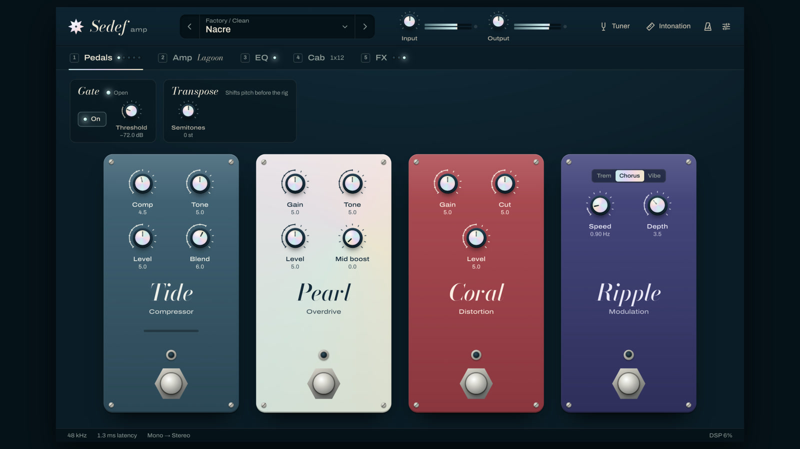

# How the trailer was made

[](media/sedef-trailer.mp4)

[`media/sedef-trailer.mp4`](media/sedef-trailer.mp4) is a 48-second launch film: 1920 × 1080,
30 fps, H.264 and AAC. It is a web page rendered to video with [HyperFrames](https://hyperframes.heygen.com).
Every frame of the product comes from a capture of the real UI. The voice and the music were
generated with ElevenLabs. Everything that made the film is in [`media/trailer/`](../media/trailer/):
the brief (`SPEC.md`), the storylines, the scenes, the tools that made the audio, and the review
(`REVIEW.md`).

## The storyline

Three storylines were written against the same nine voiceover lines
([`STORYLINES.md`](../media/trailer/STORYLINES.md)):

- **A. The inlay** (built). A rosewood fretboard; the name appears as a mother-of-pearl inlay. The
  camera dives into the 12th-fret dot, whose nacre becomes a knob cap. It pulls back to reveal the
  rig, tours pedals, amps, cab mics and time effects, and drops the music for the intonation check.
  It ends back at the 12th fret, with the star mark set into it.
- **B. The sour octave.** Two waveforms beat against each other until Sedef measures the octave.
  Not built: the payoff needs the viewer to hear the beating, which a phone speaker loses.
- **C. Type on the groove.** Module names land as giant type on the drum hits. Not built: cutting
  on every beat leaves no time for the two shots that need it, the mics on the cone and the saddle
  advice.

A won because one material carries the whole film. "Sedef" means mother-of-pearl, and the film
starts with nacre as an inlay in a fretboard and ends at the 12th fret, the note the intonation
tool exists to fix. The same conic nacre opens every world change: the fretboard dot shrinks onto
Pearl's knob cap, Fathom's Decay cap grows into the formats, and the formats close back into the
Output knob.

## The voiceover

ElevenLabs text-to-speech with timestamps (`textToSpeech.convertWithTimestamps`), voice Sarah
(`EXAVITQu4vr4xnSDxMaL`), model `eleven_v4`, `mp3_44100_128`, stability 0.6, similarity 0.75. All
nine lines go in one request, separated by blank lines, so the read stays one take with one tone.
[`tools/vo.mjs`](../media/trailer/tools/vo.mjs) writes `assets/vo.mp3`. It turns the per-character
alignment into words and lines and saves `assets/vo-align.json`: every word with its start and end
in the take.

| # | Line |
|---|---|
| 1 | This is Sedef. It means mother-of-pearl, the shimmer inlaid in fine instruments. |
| 2 | Sedef is a complete guitar rig. Free, and open source. |
| 3 | Four pedals, and three amps, from glassy clean to a singing lead. |
| 4 | Put two microphones on the speaker, exactly where you'd place them in a studio. |
| 5 | Tape echo that drifts and breathes. Reverb as deep as you like. |
| 6 | And one tool most rigs leave out: intonation. |
| 7 | Tune the open string, play the twelfth fret, and Sedef tells you which way to move the saddle, and how far. |
| 8 | VST3, AU, CLAP, or standalone. On Mac, Windows and Linux. |
| 9 | Sedef. Sound beautiful. Play in tune. |

The film plays line 8 (formats) before lines 6 and 7, so "intonation" lands on the music's drop.

## The music

ElevenLabs Music (`music.compose`, model `music_v2_5`) from a composition plan with no lyrics, so
the track is instrumental: [`tools/music.mjs`](../media/trailer/tools/music.mjs). The plan has five
sections, totalling 48 s: Intro 7 s (neo-soul, 84 bpm, clean guitar harmonics, no drums), Groove
18 s (brushed drums, round bass, Rhodes, room for a voice), Breakdown 9.5 s (drums out, one guitar
arpeggio), Return 7 s, Outro 6.5 s (a held major-seventh chord that fades). Each section also lists
styles to avoid: vocals, risers, EDM drops, distorted guitar.

The model treats section lengths as guidance, so the edit is fitted to the track that came back,
measured: sparse intro 0–10.7 s, groove 10.7–33.7 s, sparse 33.7–44.1 s, swell and fade 44.1–48 s.
The full window lands on the drum entry at 10.7 s. "Intonation" is clicked at 33.4 s, as the
drums drop out. The star mark is set at 44.1 s, on the swell.

## Word timings drive the cuts

Each line is cut from the take into its own clip, `assets/vo-N.mp3`, from 0.05 s before its first
word to 0.15 s after its last. [`tools/cut-vo.mjs`](../media/trailer/tools/cut-vo.mjs) does this
with ffmpeg. The clips are placed in `index.html`:

| Line | Starts at | Line | Starts at |
|---|---|---|---|
| 1 | 0.5 s | 8 (formats) | 25.0 s |
| 2 | 7.0 s | 6 | 31.2 s |
| 3 | 11.0 s | 7 | 34.7 s |
| 4 | 15.6 s | 9 | 44.1 s |
| 5 | 20.0 s | | |

A word lands at its clip's start, plus 0.05 s, plus its offset in the line (line 1 has no lead-in).
Each scene's moves are timed to those numbers, so the picture lands on the word that names it:

| Word | Film time | On screen |
|---|---|---|
| "Sedef" | 0.98 s | the name is routed into the wood, letter by letter, and the nacre is pressed in |
| "mother-of-pearl" | 2.58 s | a shimmer runs through the letters |
| "pedals" | 11.29 s | the cursor clicks Pearl's footswitch and its LED lights |
| "amps" | 12.33 s | a whip to the amp page |
| "singing" | 14.49 s | the cursor picks Abyss |
| "exactly" | 17.57 s | the cursor drags Mic A across the cone |
| "Tape" | 20.05 s | the whip lands on Drift |
| "Reverb" | 22.77 s | the camera moves to Fathom |
| "VST3", "AU", "CLAP", "standalone" | 25.05–27.69 s | each format lands on its word |
| "intonation" | 33.49 s | the cursor clicks Intonation |
| "play" | 36.15 s | the workbench moves to the 12th-fret capture |
| "and Sedef tells you" | 37.47 s | the result and the saddle advice |
| "how far" | 40.07 s | a push-in on "1.42 mm" |
| "Sedef" | 44.15 s | the star is set into the 12th fret |

## Screenshots from the real UI

None of the product on screen is drawn for the film. From `ui/`:

```sh
pnpm build && pnpm captures
```

This renders 23 PNGs into `media/trailer/assets/shots/`. Each is the 1200 × 760 design canvas at
3× (3600 × 2280), from `dist/` against the frozen mock backend (see
[`ui.md`](ui.md#trailer-captures-and-brand-assets)). Every capture uses
`?fresh&freeze&demo&grain=0&host=standalone`:

- `fresh` ignores any saved UI state;
- `freeze` stops the simulation, so meters and pitch don't move between frames;
- `demo` exposes `window.__sedefDemo`, which sets the tuner pitch and the intonation workbench's
  state;
- `grain=0` hides the lacquer grain, which is invisible at video size and bloats the PNGs;
- `host=standalone` presents the standalone app.

The state of each shot comes from the other flags: `section=pedals|amp|cab|fx`,
`overlay=intonation`, and `set=` for parameter values. For example,
`set=ampCabLink:0,cabModel:2,micAPosition:0.5` gives the third of the five Mic A positions. Frames
in a sequence differ only in what the sequence animates. The same command writes the brand assets
the film uses: `logo.svg` (the star), `wordmark.svg`, `lockup.svg` and the bundled fonts.

The shots are gitignored (`media/trailer/.gitignore`), so run the command before previewing or
rendering. They are the only product images in the film.

## Scenes and camera

`media/trailer/index.html` holds nine scene hosts, the voice, the music and the effects. Each scene
is one file in `compositions/` with its own paused GSAP timeline:

| Scene | Time | What happens |
|---|---|---|
| `inlay.html` | 0–7 s | Fretboard; the name is inlaid; the camera dives into the 12th-fret dot |
| `rig.html` | 7–10.7 s | The nacre shrinks onto Pearl's knob cap; the camera pulls back to the window |
| `pedals.html` | 10.7–15.4 s | Pearl on; whip to the amps; Lagoon, then Abyss; click the Cab tab |
| `cab.html` | 15.4–19.8 s | Punch-in on the speaker; Mic A dragged through its five states |
| `fx.html` | 19.8–24.8 s | Drift, then Fathom; the Decay cap grows into the next world |
| `formats.html` | 24.8–31 s | VST3, AU, CLAP, Standalone; macOS · Windows · Linux |
| `header.html` | 31–34.4 s | The pale world closes into the Output knob; click Intonation |
| `intonation.html` | 34.4–44 s | Open string, 12th fret, saddle advice, 1.42 mm, summary |
| `mark.html` | 44–48 s | Back at the 12th fret: star mark, wordmark, URL |

The fretboard is drawn in HTML and SVG, because there is no photograph of it. The rosewood is SVG
`feTurbulence` grain over #2a1712–#3d2219. The fret wires are #b8b2a6 with a 1 px highlight, and
one 12% white raking light crosses the board. The nacre is layered CSS conic gradients (rose,
aqua, lilac, gold over #f4efe6), and a `--sheen` angle on the timeline turns them.

A capture sits on a 1200 × 760 element. One helper frames any point of it, as in the Hopla trailer:

```js
const B = 1.6; // zoom 1 = the 1200-px canvas at 1920 px, 1.6x its design size
const F = (p) => ({ x: 960 - p.x * B * p.z, y: 540 - p.y * B * p.z, scale: B * p.z });
tl.to("#cam", { ...F({ x: 417, y: 310, z: 4 }), duration: 0.6, ease: "power2.inOut" }, t);
```

`F({x, y, z})` puts design point (x, y) at the centre of the frame at zoom z. A companion,
`at(q, p)`, gives the on-screen position of a control while the camera frames p, which is where
the cursor goes. Camera moves take 0.6 s on `power2.inOut`, with a 4 px blur peaking mid-move.
Arrivals use `power3.out`, and zooms through a cap use `power3.in`. Most framings are 1.6× to 3.5×
the design size. The push-in on "1.42 mm" is 4.8×, and the knob caps at the world changes reach
6.4×. The full window at 10.7 s is the one framing below 1.6×: at 1.38× the whole window fits.
The cursor is a 64 px macOS arrow, white with a 2 px ink stroke, and each click changes the screen
on the same frame.

The mic drag uses only real pixels. The five `cab-mic-*` captures swap underneath as Mic A passes
each state, so the Position knob reads 1.0 to 9.0. The marker moves continuously over a strip of
the same cone, cut from the two captures that are clean there.

## Sound

- Voice at full level. Music at 0.15, under the voice, with a 0.2 s fade-in and a 0.8 s fade-out.
- Sound effects only where something happens on screen: a click on each cursor click (footswitch,
  amp card, Cab tab, mic grab and release, Intonation), and a whoosh on the two dives into nacre
  (7 s and 24.8 s). Each effect's peak lands one frame after its picture: the click peaks 0.073 s
  into its file and the whoosh 0.162 s, so each starts that much early.

## Review and loudness

- `npx hyperframes check --json`: no errors and no warnings across lint, runtime, layout, motion,
  contrast and craft.
- `npx hyperframes snapshot --review` (each scene, every cut, phone width), plus stills at the
  SPEC's QA times. The notes, the fixes and the changes from the SPEC are in
  [`media/trailer/REVIEW.md`](../media/trailer/REVIEW.md).
- The delivery render measured −15.8 LUFS integrated with ffmpeg `ebur128`, true peak −1.4 dBTP,
  loudness range 4.2 LU. The mix needs no normalising pass. This was measured, not listened to.
- The repo copy is re-encoded to fit under 15 MB at 1080p (13.2 MB, SSIM 0.995 against the render),
  with the audio copied untouched.

## Reproduce it

```sh
# 1. Product stills and brand assets (the shots are gitignored)
cd ui && pnpm install && pnpm build && pnpm captures && cd ..

# 2. Audio. Only if you want a new take or a new bed: both cost ElevenLabs credits, and a new take
#    or bed has new timings, so the clip placements in index.html must be measured and moved again.
cd media/trailer && npm install
ELEVENLABS_ENV=/path/to/.env.local npm run vo      # assets/vo.mp3 + assets/vo-align.json
ELEVENLABS_ENV=/path/to/.env.local npm run music   # assets/music.mp3
npm run cut-vo                                     # assets/vo-1.mp3 … vo-9.mp3 (ffmpeg, no key)

# 3. Look, check, render
npm run dev                      # HyperFrames Studio preview in the browser
npm run check
npm run render                   # renders/sedef-trailer.mp4

# 4. The files in docs/media
ffmpeg -i renders/sedef-trailer.mp4 -c:v libx264 -preset slow -crf 20 -profile:v high \
  -level 4.1 -pix_fmt yuv420p -c:a copy -movflags +faststart ../../docs/media/sedef-trailer.mp4
npx --yes hyperframes@0.8.192 snapshot --at 10.7 --no-end -o /tmp/poster
ffmpeg -i /tmp/poster/frame-00-at-10.7s.png -vf scale=1600:-1:flags=lanczos -q:v 2 \
  ../../docs/media/trailer-poster.jpg
```

The scripts read `ELEVENLABS_API_KEY` from the file `ELEVENLABS_ENV` points to, through Node's
`--env-file`. Keep the key in that file; don't paste it into a command or commit it (`.env*` is
gitignored). The CLI is pinned to `hyperframes@0.8.192` in `package.json`, so a re-render uses the
same version.

## Credits

- Voiceover: ElevenLabs text-to-speech, voice Sarah. Music: ElevenLabs Music. Both were generated
  for this project.
- Sound effects: [Pixabay](https://pixabay.com/sound-effects/), under the
  [Pixabay Content License](https://pixabay.com/service/license-summary/); see
  [`assets/sfx/CREDITS.md`](../media/trailer/assets/sfx/CREDITS.md).
- Fonts: Bodoni Moda, Copyright 2020 The Bodoni Moda Project Authors, and Archivo, Copyright 2020
  The Archivo Project Authors, both under the SIL Open Font License 1.1. The licences are next to
  the files in [`media/trailer/assets/fonts/`](../media/trailer/assets/fonts/).
- Built with HyperFrames and GSAP.
