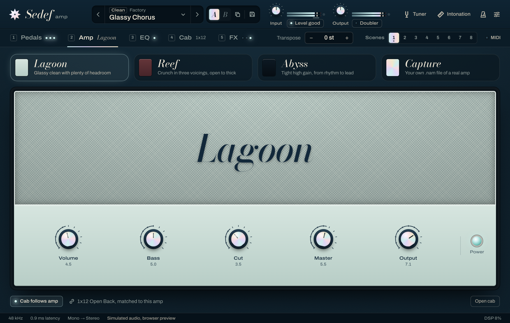
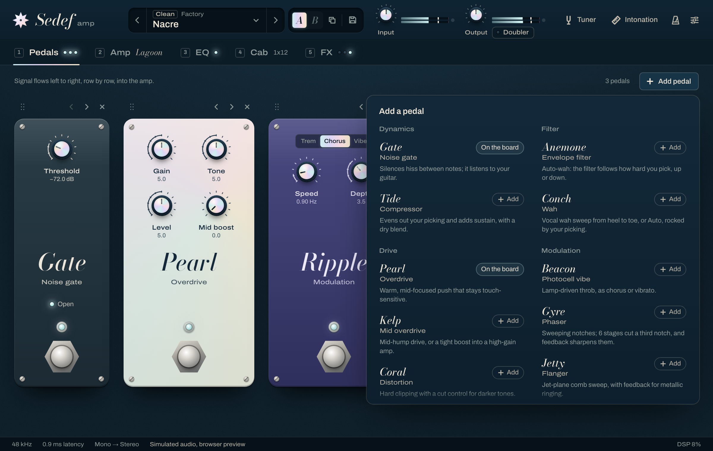

# Sedef Amp — Web UI

The editor is a React + TypeScript app in [`ui/`](../ui). Inside the plugin it runs in JUCE's
`WebBrowserComponent` (ADR-0003); in a normal browser it runs against an in-memory mock backend
with the real parameter schema, so every screen — including the tuner and the intonation
workbench — can be developed and demoed without an audio stack.



## Running it

```sh
cd ui
pnpm install
pnpm dev          # http://localhost:5173, mock backend
pnpm build        # type-checks, then writes dist/ (relative asset paths, no network URLs)
pnpm test         # Vitest + React Testing Library
pnpm lint         # ESLint (flat config), zero warnings allowed
pnpm typecheck    # tsc, strict
pnpm format       # Prettier
pnpm screenshots  # renders docs/images/*.png from dist/ (needs a build first)
pnpm captures     # trailer stills (3x) + brand assets into ../media/trailer/assets
```

`pnpm screenshots` drives headless Chromium through Playwright and fails on any console error or
warning, so it doubles as a smoke test. First run: `pnpm exec playwright install
chromium-headless-shell`.

### URL flags (mock only)

| Flag                                | Effect                                                                                                              |
| ----------------------------------- | ------------------------------------------------------------------------------------------------------------------- |
| `?section=pedals\|amp\|eq\|cab\|fx` | open a section                                                                                                      |
| `?overlay=tuner\|intonation`        | open the tuner or the intonation workbench                                                                          |
| `?preset=soft-focus`                | start from a factory preset (slug; default `nacre`)                                                                 |
| `?set=pearlEnabled:1,pearlGain:0.4` | parameter values applied as part of that preset (no dirty dot)                                                      |
| `?board=gate,pearl,ripple`          | the pedalboard, as part of that preset (empty: no pedals)                                                           |
| `?freeze`                           | no simulation: static meters, pitch only from the demo hook                                                         |
| `?demo`                             | expose `window.__sedefDemo` (`pitch`, `silence`, `intonation`, `set`) for scripted frames                           |
| `?grain=0`                          | hide the lacquer grain (much smaller PNGs)                                                                          |
| `?host=plugin\|standalone`          | present as a plugin (no metronome) or as the standalone app instead of the browser preview                          |
| `?errors=3.6,-2.4,1.1`              | 12th-fret errors in cents that the simulated guitar produces, per string                                            |
| `?fresh`                            | ignore UI state saved by earlier browser sessions                                                                   |
| `?update=available`                 | what the update checker finds: `current`, `available`, `skipped`, `error`, `noinstaller`, `mismatch`, `unsupported`; how the install goes: `declined` (password dialog cancelled), `installfail`, `elsewhere` (Install manually only), `installed` (by another window), `standalone`, `windows`, `scheduled`, `linux` |

### Inside the plugin

Release builds embed `ui/dist` in the binary and serve it by relative path. Development builds
can point the WebView at the Vite dev server with `SEDEF_UI_DEV_URL` (architecture §10), which
gives hot reload inside the host.

## Structure

```
ui/src/
  main.tsx              bootstrap: pick backend, handshake, render
  app/                  shell: Stage (scaling), App, SectionTabs, StatusBar, shortcuts,
                        connect.ts (wiring), persistence.ts (UI state), demo.ts (URL flags)
  bridge/
    protocol.ts         THE contract with plugin/src/bridge (versioned)
    backend.ts          Backend interface
    juceBackend.ts      WebView bridge implementation
    mockBackend.ts      in-memory implementation + mock/ (presets, telemetry, pitch simulation)
  params/               schema, normalisation (JUCE skew), formatting, store, sender, useParam
  state/                app/session, presets, UI, live channels (telemetry, pitch), pitch lease
  controls/             Knob, VSlider, Footswitch, Toggle, Segmented, ChoiceLever, ChoiceSelect,
                        Led, Popover, Icon
  features/
    header/             brand, preset bar with A/B compare, gain + level meters
    presets/            preset browser: library model, list, Save as/Rename, session (audition,
                        Esc, Undo); see ui/presets.md
    pedals/             the pedalboard: registry.ts (the engine's pedal table, generated), catalog.ts
                        (each pedal's panel and picker line), the panels (panels/, *Pedal.tsx),
                        PedalBoard, PedalPicker, useBoardDrag; the board lives in
                        state/boardStore.ts
    amp/ eq/ cab/ fx/
    tuner/              needle + strobe gauge, overlay
    intonation/         math.ts, store, controller, wizard steps, saddle diagram
    metronome/ settings/
    updates/            header pill, Updates panel, release-notes Markdown (docs/updates.md)
  lib/                  music (notes, cents), note values, metronome steps
  styles/               tokens.css, global.css, bundled fonts
```

## The bridge

All values cross the bridge in real units (dB, Hz, ms, 0–1 knobs, choice index, 0/1 switches),
as `protocol.ts` specifies. The UI depends only on this interface:

```ts
interface Backend {
  kind: "juce" | "mock";
  hello(): Promise<HelloResponse>;
  call(name, ...args): Promise<result>; // typed against NativeFunctions
  on(event, fn): () => void; // typed against Events
  simulator?: PitchSimulator; // mock only, see below
}
```

`connect()` chooses `JuceBackend` when `window.__JUCE__.backend` exists (JUCE injects it before
the page loads) and `MockBackend` otherwise. `@juce-framework/webview` (1.0.0, matching JUCE
9.0.4's backend) is imported lazily: at import time it installs a placeholder `window.__JUCE__`
and warns when the global is missing, which must never happen in a browser.

Startup is one round trip: `sedef_hello(PROTOCOL_VERSION)` returns the schema, values, presets,
IR slots, the capture, saved UI state and session facts. A protocol mismatch shows a banner but
keeps going. After that the UI listens to `sedef:params`, `sedef:telemetry`, `sedef:pitch`,
`sedef:presets`, `sedef:ir`, `sedef:capture` and `sedef:board`, and to `sedef:session` for the
session facts that change after startup (sample rate, latency, layout: the latency moves with
Settings > Latency).

### Parameter flow

- `useParam(id)` returns value (real units), spec, normalised value, display text, `set`,
  `setNormalised`, `begin`/`end` (host gestures) and `reset` (double-click).
- Normalisation mirrors JUCE `NormalisableRange`: `norm = ((v − min) / (max − min))^skew`.
- Changes are optimistic: the store updates at once, and `sedef_setParam` calls are coalesced
  per task. `begin`/`end` flush pending values first, so hosts record whole gestures.
- Gestures are reference-counted per parameter (`params/sender.ts`): a wheel burst, a drag and a
  key press on one control can overlap and the host still sees one begin and one end. A drag or
  wheel burst ends the parameter it began on, also when the control unmounts mid-drag, is
  rebound to another parameter or loses pointer capture.
- While the user owns a parameter (mid-gesture or changed in the last 250 ms), host values for
  it are held back, so a control never jumps under the pointer. The plugin sends each change
  only once, so a held value is applied when ownership ends (a preset loaded right after a wheel
  turn still lands), unless the user changed the parameter after it arrived. A value that
  arrives while our own call for that parameter is still unanswered was produced before the host
  applied ours and is dropped.
- The wheel moves by the distance scrolled: 2 % of the range (one step for stepped parameters)
  per 100 px notch, line and page delta modes converted, small trackpad deltas accumulated, and
  the first event of a burst always moves a stepped control. Faders count drag distance in their
  own layout pixels, so the cap follows the pointer at any window scale.
- Components subscribe to one value each (Zustand selectors). An automation burst re-renders only
  the controls whose values changed.

### High-rate data

Telemetry (~30 Hz) and pitch (~60 Hz) never go through React state. They land in `LiveChannel`s;
meters, the tuner needle, the strobe and the compressor's reduction bar draw from them in
`requestAnimationFrame` through refs (`useLiveFrame`). Text that changes rarely — a note name, a
metronome step, the effective Drift time — uses `useLiveSelector`, which re-renders only when the
selected value changes.

Pitch analysis costs CPU in the plugin, so the tuner and the workbench each hold a lease
(`state/pitchLease.ts`); `sedef_tuner_setActive(false)` goes out when the last one is released.

### UI state

Section, window scale, the metronome pattern and the intonation profile with its results are
saved through `sedef_ui_setState` (debounced), so they travel with host sessions. Hydration
validates everything, because state may come from an older build.

## The mock backend

`MockBackend` holds values for all 203 parameters (from `src/generated/parameters.json`), the real
factory presets (`presets/factory/*.sedefpreset`, bundled at build time with `import.meta.glob`)
plus one user preset, IR slots, UI state (in `localStorage` when running in a browser), tap tempo,
and simulators. Preset handling mirrors `plugin/src/PresetManager.cpp`: ids are
`factory:<slug>` with the same slugify, global parameters (gains, transpose, stereo mode, tempo,
tuner, metronome, preset stepping) are never stored, loaded or counted as changes, missing values
fall back to the schema default, and "dirty" compares against the loaded preset with the same
tolerance. The mock starts on Nacre.

- **Telemetry**: a player strumming every couple of seconds, shaped by input/output gain, the gate
  threshold and the compressor; metronome steps at the current tempo and signature; the effective
  Drift time for Free/Host/Tap sync.
- **Presets**: the plugin's snapshots (`browse`, `undo`), A/B slots, Recent, undo of a delete,
  save details and the per-preset `amp`/`cab`/`blocks` summary follow the same rules
  (`mock/describePreset.ts` mirrors `PresetManager::describe`).
- **Pitch**: a virtual player modelled on what the C++ `PitchTracker` reports
  (`docs/dsp/tuner.md`), at the editor's 60 Hz — plucks with an attack glide, a jittery reading,
  and settled detections at 200 per second from 0.25 s after the pluck whose last 0.4 s give
  `stable` (window full, spread under 0.5 cent), `stableHz` (mean), `stableStdCents` (sample
  standard deviation) and `stableCount`. The `display*` fields follow the engine's tuner display
  in outline (a new note shows 50 ms after its first reading, a re-pluck keeps the needle still,
  the reading is followed while the peg turns, the last value holds, settled if it was). With no
  intent it tunes the strings of a guitar one after another. The intonation workbench sets
  intents through the optional `simulator` hook (`tune` an open string, `fret` the 12th fret with
  a configurable error per string), so the whole flow is demoable in a browser.

Tests construct the mock with `autoStart: false` and drive time with `tickTelemetry()` /
`tickPitch()`, so they are deterministic.

## Trailer captures and brand assets

`pnpm build && pnpm captures` renders still frames of real UI states at 3x (3600 × 2280) into
`media/trailer/assets/shots/` (or `--out <dir>`), using `?freeze&demo&grain=0&host=standalone`
so frames in a sequence differ only in what the sequence animates. It also writes, from the same
sources the UI uses, `logo.svg` (the star mark), `wordmark.svg` and `lockup.svg` (outlined with
fontkit from the exact variable-font instances), and `fonts/` (the bundled woff2 files, their OFL
licences and a `fonts.css`). `node scripts/brand-assets.mjs [dir]` regenerates only the assets.

## Screens

Design canvas: 1200 × 760 CSS px, scaled uniformly to the window (`app/Stage.tsx`). The plugin
resizes its window to the canvas times the chosen scale (75–200 %, `sedef_ui_setScale`); in a
browser the canvas fits the window. Everything is vector or text, so it stays crisp at any scale.

| Screen     | Notes                                                                                                                                                                                                                            |
| ---------- | -------------------------------------------------------------------------------------------------------------------------------------------------------------------------------------------------------------------------------- |
| Header     | logo, preset bar (prev/next, category chip, name with dirty dot, A/B with copy, Save), input/output gain with peak meters, clip latches and the Doubler switch, Tuner, Intonation, Metronome (standalone only), Settings         |
| Presets    | browser over the rig ([details](ui/presets.md)): rail, list with tag chips and search, detail pane with the chain by stage; click or arrows audition, Enter keeps, Esc goes back exactly; `[` `]` `P` `A` `B`                    |
| Tabs       | Pedals · Amp · EQ · Cab · FX, keys 1–5 and arrow keys; each tab shows what is switched on inside it                                                                                                                              |
| Pedals     | the pedalboard ([below](#pedalboard)): pedals in signal order, left to right and row by row; drag, arrow keys or move buttons to reorder; Remove with Undo; Add pedal picker by category. Gate (threshold, open/closed lamp); Remora Germanium/Silicon, Breaker Treble/Full, Conch Manual/Auto, Anemone mode and direction, Gyre stages and Beacon Chorus/Vibrato switches; Tide gain reduction, Ripple rate lamp, Beacon lamp and Gyre/Jetty sweep LEDs; playing hints on Trench and Urchin, read with their footswitch |
| Amp        | Lagoon/Reef/Abyss faceplates; Reef voice lever; Abyss bright/shift levers; amp/cab link; Capture: load or drop a .nam file, gear/author/model, trims, through-cab, interface level, recent, missing file                         |
| EQ         | the current amp's bank: 9 faders on a log axis under a live response curve, low/high cut, on/off, flatten                                                                                                                        |
| Cab        | cab picker; Mic A/B markers anywhere over the cone (drag or click to place, wheel or Alt-drag for distance, keys), off-axis stem, other speakers' map; type, position, distance, off-axis, level, pan, phase, room, custom IR    |
| FX         | Drift (heads, Free/Host/Tap sync with tap button, time or note value, effective time, tape controls), Fathom (plate/hall, envelope sketch), Doubler (sketch of the two takes, spread, variation, width, mix)                     |
| Tuner      | needle + strobe, note and octave, cents, Hz, "Tune up" hint, reference 420–460 Hz, mute; in tune within ±1 cent after 0.15 s, with hysteresis; holds the last reading ([tuner.md](dsp/tuner.md#3-display))                       |
| Intonation | instrument → measure each string (tune open, capture 12th fret, result with saddle diagram) → summary with copy as text                                                                                                          |
| Metronome  | play/stop, tempo knob + tap, signature, sound, volume, step grid (off/normal/accent/soft), live beat                                                                                                                             |
| Settings   | window size; Stereo input (sum to mono or two channels); Latency: Low latency or Linear phase, a global setting kept out of presets ([oversampling.md](dsp/oversampling.md)); updates; About with the session's rate and latency, which follow the Latency setting                                                  |
| Updates    | header pill when a newer release is out ("Update available"), while it updates ("Updating…") or once installed ("Restart to update"); panel with versions, last check, Check now, the automatic-check switch, release notes, Update now (download with progress and Cancel, then the OS installer's steps), Restart Sedef in the standalone app, Install manually and the releases page after a failure, Skip this version, Later ([updates.md](updates.md)) |

### Pedalboard



The board is the list of pedal ids in signal order (`state/boardStore.ts`), mirrored from the
plug-in: `hello.board`, `sedef_board_set(pedals)` (answers with the board it kept) and
`sedef:board` for changes made elsewhere (presets, A/B, preset Undo, host restores). Edits
apply at once; only the answer to the latest edit is taken, and a board older than the one held
(by `revision`) is ignored. A plug-in without the board leaves `supported` false: the page then
shows 0.3.0's pedals in their fixed order without the editing controls.

- **Layout**: pedals wrap into rows inside a scroller; the next row peeks under the fold. Each
  pedal has a strip above it: the handle, then Move left, Move right and Remove.
- **Drag**: press the handle and move 4 px. The pedal follows the pointer (canvas pixels, so the
  Stage's scale doesn't matter), the others stay put, and a nacre bar marks the gap it would land
  in. Near the scroller's top or bottom edge the board scrolls. Escape or a cancelled pointer
  puts it back.
- **Keyboard**: on the handle, arrow keys move the pedal one place, Home and End to either end;
  the move buttons do the same. Focus stays on the control used (the handle when that button
  switches off at an end). A polite live region says where it went: "Pearl moved to 4 of 5,
  after Coral."
- **Remove** takes the pedal off at once and shows "Removed Pearl · Undo"; Undo puts it back
  where it was. The notice goes when a preset or A/B brings another board. Focus moves to the
  next pedal's handle, or to Add pedal when the board is empty.
- **Add pedal** opens a picker grouped by category, each pedal with its kind and one line about
  it. A new pedal goes to its default position (its rank in the registry) and is announced;
  a pedal on the board already is marked "On the board", and picking it shows it there.
- **Registry**: `features/pedals/registry.ts` reads `generated/pedals.json`, which
  `sedef-params --pedals` dumps from the engine's `PedalList.inc`, and mirrors `sedef::Board`'s
  rules (add at rank, move, the legacy board for presets saved without one, only the pedals
  switched on for Init). Adding a pedal: [architecture.md](architecture.md#adding-a-pedal).
- **Mock**: the mock backend keeps a board per preset, snapshot and A/B side, counts it towards
  the dirty dot like the plug-in, and takes `?board=`. Factory presets bring the boards in their
  files; Init is the Gate alone, and the mock's user preset, which has no board, gets the legacy
  board.

### EQ curve

`features/eq/response.ts` evaluates the same filters as `sedef::dsp::GraphicEq`: nine RBJ peaking
bands at 65 Hz–16 kHz with Q 1.41, 2nd-order Butterworth high-pass and low-pass (Q 1/√2) that are
bypassed at ≤ 20 Hz and ≥ 20 kHz, at 48 kHz, with the same frequency clamp as `Biquad.cpp`. Keep
the two in sync; the tests pin the known values (band gain at its centre, −3.01 dB at a cut's
corner, 12 dB/oct slopes).

### Intonation workbench

1. **Instrument**: 6-string standard or drop D, 7-string, 4- and 5-string bass, or a custom
   tuning (4–8 strings, any note B0–E5); scale length from 24.75 in to 35 in, or custom mm.
2. **Measure**, per string: tune the open string until it stays within ±1 cent for a second (the
   workbench advances by itself); fret the 12th fret and hold while the progress ring fills. The
   ring needs `PitchEvent.stable` without a break for 0.5 s from one pluck (same `onsetId`, and
   `stableCount` not falling back, which marks a restarted segment); the result is `stableHz`
   averaged over that half second. "Steady to ±x cents" is the larger of the tracker's detection
   scatter (`stableStdCents`) and the reading's movement over the hold. Holds are
   timed with the clock (`performance.now()`), not by counting events, so they do not depend on
   the event rate. Read the result.
3. **Summary** for all strings, re-measure or measure any of them, copy as text. A string picked
   from the summary has a "Back to summary" button, and its Next goes to the next string without
   a result, or back to the summary when every string has one.

The math (`features/intonation/math.ts`): octave error `c = 1200·log2(f12 / 2f0)` using the
measured open frequency, verdict in tune when |c| ≤ 1.5 cents, otherwise move the saddle back
(sharp) or forward (flat) by about `Δs = L·(2^(c/1200) − 1)`. Example: +4 cents on a 648 mm scale
is about +1.50 mm.

## Design

Sedef is Turkish for mother-of-pearl. The UI is deep-sea lacquer with nacre used only where
something is alive.

- **Palette** (`styles/tokens.css`): blue-green lacquer inks (`--ink-0` #061119 to `--ink-4`
  #22465c) that read as colour rather than tinted black; warm bone type (`--bone` #ede6d6, with
  three quieter steps); four pale interference colours for nacre (rose #f6dbe2, aqua #cdeeee,
  lilac #ddd6f6, gold #f2e8cb); amber for "needs attention" and coral for clipping.
- **Type**: Bodoni Moda italic (optical sizes) names every module, like a maker's script on a
  faceplate; Archivo carries the interface, with its width axis widened for engraved panel
  legends. Sentence case throughout. Both are bundled (`@fontsource-variable`), no network.
- **Signature**: the knob caps are nacre shells. The conic sheen turns with the knob while the
  specular highlight stays put, so light appears to travel across the shell as you turn it. The
  same nacre inlays the logo (an eight-pointed star, as in sedef inlay work), the in-tune note,
  active selections, the Abyss badge and the Pearl enclosure. Nothing else glows.
- **Hardware language**: pedals are painted enclosures with screws, chrome-bezel LEDs and hex-nut
  footswitches; amps are heads with grille cloth and an engraved plate (Lagoon is pale sea-glass,
  Reef is oxblood, Abyss is ink with a nacre badge).
- **Accessibility**: every control is reachable by keyboard with a visible focus ring; knobs and
  faders are ARIA sliders with real values and readable `aria-valuetext`; arrows, Page Up/Down,
  Home/End, Delete (reset), shift for fine control. Radio groups have one tab stop and arrow,
  Home and End keys (`controls/useRadioGroup.ts`). The preset browser has a full keyboard path
  (`/` or ⌘/Ctrl+F to search, arrows to audition, Enter, Esc, F for favourite, and `P`, `[`,
  `]`, `A`, `B` anywhere outside text fields; see
  [ui/presets.md](ui/presets.md)); digit keys never switch sections while you type or while it is
  open, and toasts are a polite live region that never takes focus. The tuner announces a settled state ("E 2, in tune") through
  a polite live region once it has held 0.6 s, at most every 2 s, and says nothing while a note is
  starting or has ended (the next note is announced again, even in the same state); the state is
  also written ("In tune", "Tune up"), not only coloured. Text meets WCAG AA (4.5:1):
  `--bone-3` is the quietest text colour (`--bone-4` is for lines and fills only), and the
  enclosure legends' dim tone is strong enough on every paint. With `prefers-reduced-motion`,
  movement turns into a cross-fade rather than a cut: panels, sheets, popovers and toasts fade in
  without sliding, lever bats and switch thumbs jump, buttons don't scale when pressed, and the
  Ripple lamp stops blinking. Colour and opacity changes still fade. The strobe is hidden, and
  the needle keeps its damping because it carries information. Motion is gated where it is
  defined (`@media (prefers-reduced-motion: no-preference)`), never by zeroing durations
  globally.
- **Interaction states**: hover styles apply only on pointers that can hover
  (`@media (hover: hover)`), so a tap on a touchscreen never leaves a control looking selected,
  and a disabled button never lights up. A pressed button scales to 0.96 over 150 ms
  (`controls/Button.module.css`, `.press` for custom buttons, `.static` to opt out). Rows, rail
  items, cards and segments don't scale. A nacre fill fades in on a layer
  (`controls/NacreFill.module.css`), because a gradient cannot transition. Under forced colors
  (Windows High Contrast) shadows and gradients disappear, so every edge that is only a shadow
  ring also has a transparent border or outline, and selected states use `border-color` with a
  `Highlight` fallback.
- **Icons**: one stroke set on a 16-unit grid (`controls/Icon.tsx`). The `stroke` prop is the
  rendered line in CSS px at any size: 1.5px by default, 2px (`ICON_STROKE_LABEL`) beside the
  540–600 weight button labels. Check a dense glyph at its render size before giving it 2px (the
  keyboard stays at 1.5px). Icons are `currentColor`. An infrequent swap (copy to copied, play to
  stop) cross-fades through `controls/IconSwap.tsx`.

## Known gaps

- The window-size setting only resizes inside the plugin; in a browser the canvas always fits.
- Intonation keeps one instrument profile (with its results), not a library of named guitars.
- The mock has no host transport; Drift's Host sync assumes 120 bpm.
- No factory preset sets EQ values yet, so the EQ screenshot shapes its curve with `?set=`.
- Screenshots are full-fidelity PNGs (the lacquer grain does not compress well).
- A switched-off FX unit fades its body to 62 % opacity, which takes its quiet text below 4.5:1.
  Its controls still work, so this is a deliberate exception to the contrast rule above.
