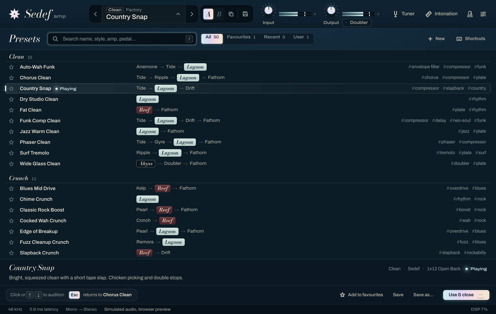

# Presets: browser, audition, A/B and saving

Status: implemented. This note records the patterns we adopted for the preset experience, why,
and the exact interaction spec. Code: `ui/src/features/presets/`, the preset bar in
`ui/src/features/header/PresetBar.tsx`, and `plugin/src/PresetManager.cpp`.

## What we looked at

We studied a few well-liked libraries for interaction patterns only (no code or assets):

- **[TONE3000](https://www.tone3000.com)**, a community library of amp and pedal captures. Its
  in-plugin browser opens on _Trending_, _Recently used_, _Favorites_ and _Created_; gear-type
  filters (amp + cab, amp head, cab, pedal…) narrow the catalogue; tags are, in its own sharing
  guidelines, what search, filtering and discovery run on. Every entry says which gear it is.
  ([plugin guide](https://www.tone3000.com/guides/tone3000-plugin),
  [sharing guidelines](https://www.tone3000.com/guides/tone-sharing-guidelines))
- **GarageBand's Library**: categories on the left, patches on the right, a search field.
  Selecting a patch _auditions_ it: you play through it straight away, before deciding. Save
  and Delete sit at the bottom, and a deleted patch cannot be recovered.
  ([Library](https://support.apple.com/guide/garageband/gbnddf60c8c8/mac),
  [choose a patch](https://support.apple.com/guide/garageband/gbndbd9d9b33/mac))
- Plugin preset browsers in general: star favourites, tag filters, an A/B compare pair in the
  header, and a "back to where I was" when browsing goes nowhere.
- A separate prototype exploration of this UI (built from our own screenshots) contributed the
  hint that teaches auditioning, `#tag` rows, a "playing" lamp on the loaded row, single-key
  shortcuts and Save beside the preset bar. We kept our own palette, type and hardware language.
  Its three-pane layout with a rail and a detail pane shipped until 0.6.0 and was then dropped
  (see "The list" below).

## What we adopted, and why

| Pattern                                                                                                | Why                                                                                                                                                                                    | Where                                   |
| ------------------------------------------------------------------------------------------------------ | -------------------------------------------------------------------------------------------------------------------------------------------------------------------------------------- | --------------------------------------- |
| A large browser over the rig instead of a popover                                                      | Choosing a sound is a mode of its own. A 400 px popover could only show names; the panel shows what each preset _is_. The header stays live (gain, meters, A/B, tuner).                | `PresetBrowser.tsx`, `App.tsx`          |
| Click to audition (GarageBand)                                                                         | Guitarists choose by ear. One click, or ↑/↓, and the preset plays while the list stays put.                                                                                            | `session.ts` `audition`                 |
| Esc returns exactly to where you were                                                                  | Auditioning is only free if the way back is certain, including unsaved tweaks. The action row says so: "Esc returns to Chorus Clean with your edits".                                                | plugin snapshots, `session.ts` `cancel` |
| Undo instead of confirmations                                                                          | A dialog interrupts and trains people to click through. Loads that drop edits and deletions are instant and offer Undo in a toast (also ⌘/Ctrl+Z).                                     | `Toasts.tsx`, `session.ts`              |
| One list grouped by category, with a library switch | A factory library of some fifty presets reads best as one dense list: a category header, then one line per preset. _Whose_ presets (all, favourites, recent, yours) is a four-way switch; _what kind_ is the header you scroll to. A rail, tag chips and a sort control cost a third of the window and answered questions a list this size doesn't raise. | `PresetBrowser`, `PresetList`, `library.ts` |
| One line per preset that says what it is | The name says the sound; then the switched-on chain with the amp badge in the amp's own finish (`Tide → Ripple → Lagoon → Fathom`) and the tags. The note, the author and the cab show in a strip under the list for the row under the pointer, else the highlighted row, so the list never moves. | `PresetList.tsx`, `PresetDetail.tsx` |
| A/B compare in the preset bar                                                                          | Comparing two settings by ear is the most common reason to keep two versions of a sound.                                                                                               | `PresetBar.tsx`, plugin `compareSwitch` |
| Save as with a category, tags and a note                                                               | Your presets should be as findable as the factory ones.                                                                                                                                | `PresetForm.tsx`                        |

Not adopted: ratings, download counts and comments (there is no community behind a local
library), audio previews (the real engine plays the real preset at once, which is better), cards
in a grid (rows scan faster at 1200 × 760), nested folders beyond one level (the plugin
stores one folder per user preset), and, since 0.7.0, the rail, the tag chips, the sort control
and the detail pane: search finds a tag, an amp or a pedal as you type it.

## Interaction spec

### Opening and closing

- Open: click the preset name or press `P`, press `/` or ⌘/Ctrl+F (focus goes to search), or
  ⌘/Ctrl+S on a factory preset (opens straight into Save as). On open the plugin takes a
  **browse snapshot**.
- The panel covers the section tabs and the rig (they are `inert` while it is open). From the
  top:
  - the toolbar: the title, search, the library switch (All, Favourites, Recent, User, each
    with its count), the number of matches while a search is on, New, the preset folder (plugin
    only) and **Shortcuts**, which lists every key;
  - the list (see below); the current preset starts in the middle, highlighted with a nacre edge
    and a lit "Playing" lamp ("· edited" in amber when dirty);
  - the strip: the name in Bodoni italic, the note, and "Category · Author · Cab", for the row
    under the pointer ("Click to audition"), else the highlighted one;
  - the action row: the hint box, "Click or ↑↓ to audition", whose "Esc returns to Chorus
    Clean" part is itself the Back button; the favourite toggle; Save, Save as…, and for your
    own presets Rename and Delete; and **Use & close** (or **Load preset** while the
    highlighted row is not yet the one playing).
- **Keep** (close and keep what plays): Enter, double-click a row, **Use & close**, `P` or a click
  on the preset name, or opening the tuner or intonation workbench.
- **Back** (close and restore the browse snapshot): Esc or the Esc button in the hint. If nothing
  was auditioned, it just closes. A toast confirms "Back to Nacre" (unless an Undo toast is
  showing, which a plain notice never replaces). With the shortcut list open, Esc closes the
  list first.
- If the sound you opened on had unsaved edits and you keep something else, a toast says
  "Loaded Singing Echo Lead" with **Undo**, which restores the browse snapshot, edits included.
- Preset commands go out one at a time, in order, so a restore or snapshot always follows the
  loads before it. Arrowing faster than the plugin answers sends only the newest waiting load,
  and the highlighted row runs ahead of the playing preset meanwhile. Every state the plugin
  sends carries a rising `revision`; the editor drops one older than what it has, so an answer
  that arrives after a newer broadcast can't roll the browser back.

### Auditioning

| Input               | In the search field                                                                 | In the list                           |
| ------------------- | ----------------------------------------------------------------------------------- | ------------------------------------- |
| Click a row         | plays it                                                                            | plays it                              |
| Double-click a row  | plays and keeps it                                                                  | plays and keeps it                    |
| ↑ / ↓               | plays the previous / next visible preset                                            | same                                  |
| Page Up / Page Down | first / last                                                                        | first / last                          |
| Home / End          | caret                                                                               | first / last                          |
| Enter               | keeps the highlighted preset, or the first match if the playing one is filtered out | keeps                                 |
| F                   | types                                                                               | toggles the favourite                 |
| Esc                 | back and close (a form open on top: back to the list)                               | same                                  |
| Digits 1–5          | type                                                                                | do nothing (the sections are covered) |

The search field is a combobox that points at the list (`aria-activedescendant`), so the arrows
work while typing. Every word of the query must match the name, category, tags, note, author,
amp, cab or a block name ("abyss drift" finds high-gain presets with echo).

Outside the browser's search field, ⌘/Ctrl+S, ⌘/Ctrl+F and the single keys do nothing while a
text field has focus; there they keep their editing meaning. A held key does not repeat, except
`[` and `]`, which step through presets.

Prev/next in the preset bar while the browser is open are auditions too (Esc still goes back).
With the browser closed, prev/next on an edited sound keep an **undo snapshot** and show
"Loaded Surf Tremolo · Undo".

### The list

- One line per preset, 26 px tall, so at least 14 rows show at 1200 × 760 (17 with two headers
  in view): the favourite star, the name, the chain (pedals → amp badge → effects; the gate and
  the cab are left out) and the tags.
- Rows sit under a header per category with its count. Headers stick to the top of the list
  while their rows scroll under them. The factory categories come first, from clean to ambient
  (Clean, Crunch, High Gain, Lead, Ambient), then your own folders by name, then presets
  without a category; inside a category the factory presets first, each by name. Previous and
  next in the preset bar step in the same order (`PresetManager::scan`, `comparePresets`).
- Library: All, Favourites, Recent, User. **Recent** has no headers: it lists what you picked,
  newest first, and each row names its category instead.
- Search narrows whatever the library shows, and the headers of categories with no match go.
  Every word must match the name, category, tags, note, author, amp, cab or a pedal or effect
  name, so "funk", "abyss drift" and "fuzz hall" all work; that is what the tag chips and the
  category filter did before.
- **Recent** holds presets you _picked_: kept from the browser, loaded directly or saved. Auditions
  and prev/next steps don't count. It lives next to the favourites in `settings.json` (12 at
  most), so it spans sessions and plugin instances.

### The preset bar

Previous and next, then the preset: a category chip and Factory/User (or "Unsaved") above the
name and its amber dirty dot. Next to it, one inset group holds the A/B slots, the copy button
and **Save** (the floppy icon turns amber while there are unsaved edits; for a factory preset it
opens Save as).

### A/B compare

Two slots next to the preset bar. The active slot is what you hear; the plugin holds the other.

- The first switch to B copies A, so B starts identical; after that each slot keeps its own
  preset, edits and dirty state. An amber dot marks a slot with unsaved edits, and each slot's
  tooltip names its preset.
- The copy button copies the active slot over the other one ("Copy A to B" / "Copy B to A").
- Loading and saving act on the active slot. Switching while the browser is open keeps what the
  browser auditioned first, so Esc never crosses slots.
- A host restoring a session (or a project reload) resets A/B; the slots don't travel with the
  session.

### Saving

- ⌘/Ctrl+S on a user preset saves it in place, keeping its tags and note ("Saved Sunday set").
  On a factory preset or Init it opens Save as. ⌘/Ctrl+Shift+S always opens Save as.
- **Save as** opens as a sheet over the list: name; category (an existing folder, none, or "New
  category…"); tags with suggestions from the tags already in use (Enter or comma adds, Backspace
  removes the last); and an optional one-line note (140 characters), stored as `description`.
  It starts from the playing preset's name, category, tags and note ("… copy" for a user preset).
- Clashes show inline before anything is written: a user preset with that name in that category
  ("“Sunday set” is already in User / Live. Saving replaces it.", and the button becomes
  "Replace “Sunday set”"); a factory preset with the same name (a note only, as yours lives under
  User); a new category without a name disables saving.
- ⌘/Ctrl+S while the browser auditions over unsaved edits saves nothing: it is not clear whether
  you mean the edits or the audition, so a toast asks "Choose first: Enter keeps Singing Echo Lead, Esc
  goes back to Chorus Clean with your edits. Then save."
- After a save, rename or delete inside the browser before anything was auditioned, what plays
  becomes the state Esc returns to. After an audition, Esc still goes back to the sound the
  browser opened on; a rename of that preset carries over to the snapshot.
- **Delete** (user presets) happens at once with an Undo toast; the plugin keeps the file's text
  and writes it back on Undo, so the id, favourite and Recent entry survive.
- **Rename** (user presets) refuses a name another preset in the folder already has, inline.

### What the plugin does

`PresetManager` (message thread) owns the library and three kinds of state for the editor:

- A factory preset's id is `factory:` plus the `id` in its file (its name's slug in a file
  without one), so a preset can be renamed between releases: favourites, Recent and sessions
  that hold the id still find it, and a session that saved the old name shows the new one
  ([presets/README.md](../../presets/README.md)).
- `PresetInfo` per preset, computed when the library is scanned: `amp`, `cab` (the amp's own while
  the amp/cab link is on), `blocks` (switched-on blocks in signal order; the EQ only when the
  amp's bank is on and not flat) and `description`, all with defaults applied.
- **Snapshots** (`browse`, `undo`) and the **A/B** slot: every per-preset parameter, the current
  preset and the values "dirty" compares against. Restoring is exact: an unchanged parameter is
  left alone, a changed one gets the normalised value (searched a few ULPs around the stored one)
  that lands on the stored float, so a session saved after "audition, then Esc" is byte for byte
  the session saved before.
- A host `setStateInformation` (any thread) replaces the values under a lock that preset loads
  and snapshot restores take too, so their values never mix. It leaves the preset the session
  names for the message thread, where every preset call first takes it over (`sync()`) and drops
  the snapshots and A/B slots taken before it. Nothing from an old session is restored over a
  new one, and a load made after the restore is never overwritten by it.
- After every preset call the processor mirrors the current preset into what the host saves, at
  once.
- Preset loads and snapshot restores change each parameter that moves as a gesture of its own,
  so hosts recording automation (touch, latch, write) see them like turns of the controls. Tap
  tempo and the preset footswitches springing back are gestures too.
- Float parameters start from a default the normalised round trip leaves alone (an ULP from the
  schema's at most), so a fresh instance comes back exactly from "audition, then Esc" as well.
  The host smoke test runs the editor check on a restored session and on a fresh instance.
- Favourites and Recent live in `settings.json`; every change reads, edits and writes it under an
  inter-process lock, and a file that is there but doesn't parse is left alone rather than
  written over with empty lists.
- File names: a preset or category name loses the characters file systems refuse and any
  leading or trailing dots and spaces, so ".." can't leave the presets folder; an empty result
  saves as "Untitled". Renaming to the same name in other capitals renames the file on macOS and
  Windows too, and a rename that can't write the new file leaves the old one.

The browser mock (`ui/src/bridge/mockBackend.ts`) implements the same rules, and the host smoke
test drives the real bridge in a real WebView: audition, restore and compare must give back
every value exactly, and the saved state must not change (`plugin/smoke/HostSmoke.cpp`).

### Accessibility

- The browser is a labelled dialog; the library switch is a radio group; the list is a listbox
  whose categories are groups named by their headers and whose options carry the whole row as
  their name ("Chorus Clean, playing. Tide → Ripple → Lagoon 1x12 → Fathom. Glassy, lightly
  squeezed clean… Factory Clean. tags chorus, compressor, plate"), so nothing a sighted player
  gets from the strip is missing. The strip is a labelled complementary region. Rows hold no
  focusable controls; the star is a mouse shortcut for F and for the favourite button.
- A/B is a radio group (arrow keys switch) with the slot's preset and edit state in its name.
- Toasts are a polite live region, never take focus, stay 8 s (4 s without an action) and pause
  while hovered or focused (a toast that replaces a held one starts its own timer). An Undo that
  would put back a snapshot goes as soon as the snapshot stops applying: "browse" when the
  browser opens again, both on an A/B switch or copy. A delete's Undo stays.
- The Save as clash note sits in a status region that is always in the page, so it is announced
  when it appears.
- Focus moves into forms and back to the search field, and to the preset bar when the browser
  closes. `prefers-reduced-motion` turns the panel, sheet and toast animations off.

## Known gaps

- MIDI or host preset switching (the automatable previous/next switches) does not take an undo
  snapshot; edits made before such a switch are not recoverable.
- A/B slots and snapshots live in memory: they survive closing the editor, not a project reload.
- Recent is per machine (it lives with the favourites), not per project.
