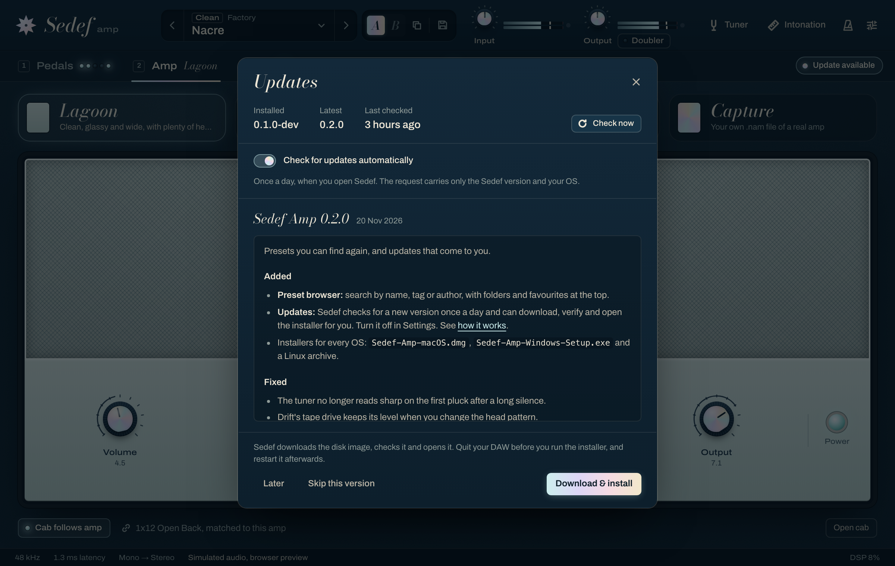

# Updates

Sedef Amp can tell you when a new version is out and fetch its installer for you. It never
replaces its own files: a plug-in's binaries are loaded, and on Windows locked, by your DAW, and
installers write to system plug-in folders. So "update" here means an automatic check plus a
one-click download that is verified and then handed to the installer, which you run after
quitting your DAW.



## What happens

1. **Check.** When you open a Sedef window, and at most once a day, Sedef asks GitHub for the
   project's latest release. Sedef doesn't check while your DAW scans or loads the plug-in, and the
   check never runs on the audio thread or holds up the window. However many instances your session
   holds, one check runs, and a small file (`update.json`, below) keeps other processes and later
   sessions from repeating it. After a failed check Sedef waits an hour before trying again.
2. **Notice.** When the latest stable release is newer than the one you run, a small "Update
   available" pill appears at the right end of the section tabs, under the header's tools. Drafts
   and pre-releases are never offered. The pill opens
   the Updates panel (also in Settings → Updates) with the release notes and three choices:
   **Download & install**, **Skip this version** (no pill for that version again) and **Later**
   (no pill until you next open Sedef).
3. **Download & install.** Sedef downloads `SHA256SUMS.txt` and this OS's installer from the
   same release into your Downloads folder, verifies the installer's SHA-256 against that list,
   and only then opens it:

   | OS | File | What Sedef does |
   | --- | --- | --- |
   | macOS | `Sedef-Amp-macOS.dmg` | opens the disk image (like `open`); run the installer inside |
   | Windows | `Sedef-Amp-Windows-Setup.exe` | starts the setup program |
   | Linux (x86-64) | `Sedef-Amp-Linux-x86_64.tar.gz` | shows the archive in your file manager |

   The installer carries the same "downloaded from the internet" mark a browser gives it, so
   your OS checks it before it runs, as with any download. Until releases are signed
   ([signing status](releasing.md#signing-status)), macOS says it can't open the installer: go to
   **System Settings → Privacy & Security** and click **Open Anyway**. On Windows, SmartScreen
   may say *Windows protected your PC*: click **More info**, then **Run anyway**.

   Quit your DAW before installing, and start it again afterwards so it loads the new version.
   On Windows this matters most: Windows keeps loaded plug-ins locked. Sedef starts the installer
   normally, never with silent switches, so if your DAW still holds the plug-in the installer
   lists it and offers to close it (save your project first), or finishes the update when you
   restart Windows. Both installers ask for an administrator password. If a release has no
   installer for your system (for example on ARM Linux, or v0.1.0, which shipped zips), or
   anything fails, the panel offers the releases page instead.

The bytes go to `<name>.part` first. A failed, cancelled or mismatching download is deleted; a
verified copy already in Downloads is reused; a different file that happens to have the same name
is left alone and the download is saved as `<name> (2)`. Closing the last Sedef window cancels a
download in progress.

## What is sent

One HTTPS request per check, and nothing else:

```
GET https://api.github.com/repos/mr-kaynak/sedef-amp/releases/latest
Accept: application/vnd.github+json
X-GitHub-Api-Version: 2022-11-28
User-Agent: SedefAmp/0.2.0 (macOS)
```

The User-Agent carries the Sedef version and the OS family, nothing more: no identifier, no OS
version, no host or DAW name, no settings. Sedef adds no cookies. On Windows and Linux the
system's HTTP stack keeps none either; on macOS requests go through the system's URL loading,
which shares the host application's cookie store, so a cookie GitHub set for these addresses
would be sent back on later requests (GitHub sets none for them today). Like any web request
the check reaches GitHub from your IP address; [GitHub's privacy statement](https://docs.github.com/site-policy/privacy-policies/github-general-privacy-statement)
covers what GitHub does with it. Sedef keeps no record of you anywhere.

Only when you click **Download & install**, Sedef fetches `SHA256SUMS.txt` and the installer
from `https://github.com/mr-kaynak/sedef-amp/releases/download/<tag>/`, with the same
User-Agent. GitHub redirects these to its download servers. Sedef follows a redirect only over
HTTPS to `github.com`, `objects.githubusercontent.com` or `release-assets.githubusercontent.com`,
or within the server it asked, at most five times.

## Turning it off

- **In Sedef:** Settings → Updates, switch off **Check for updates automatically**. **Check now**
  still works when you ask for it.
- **Per machine or in CI:** set the environment variable `SEDEF_DISABLE_UPDATE_CHECK=1`. Sedef
  then never checks on its own. The editor smoke test (`SEDEF_UI_SMOKE_TEST`) has the same effect.
- **At build time:** configure with `-DSEDEF_UPDATE_CHECK=OFF`. The checker is not compiled in
  at all, and the UI shows nothing about updates. Use this for distribution packages that update
  through the package manager.

On Linux the check uses the system's libcurl (`libcurl.so.4`: `libcurl4` on Debian and Ubuntu,
`libcurl` on Fedora), loaded only when a check runs. Without it Sedef works as usual and the
Updates panel says it couldn't reach GitHub.

## Where things are kept

`update.json` holds the two settings (automatic checks, skipped version), the time of the last
check and the release it found. It is global for your user account and never part of a DAW
project: the plug-in state your DAW saves does not change.

| OS | Folder |
| --- | --- |
| macOS | `~/Library/Application Support/Sedef/` |
| Windows | `%APPDATA%\Sedef\` |
| Linux | `~/.config/Sedef/` |

It is written to a temporary file and renamed into place, under a lock shared between processes.
The window never waits for that lock: if another process holds it when you change a setting, the
setting applies at once and Sedef's update thread writes it. Deleting the file resets the
settings and makes the next window open check again.

Downloads go to `~/Downloads` (on Linux the `XDG_DOWNLOAD_DIR` folder), or to your home folder
when there is none.

## Threat model

**What protects the download.** The request and the downloads use HTTPS with certificate checks by
the system (NSURLSession on macOS, WinINet on Windows, libcurl on Linux). Sedef only downloads from
this repository's release download URLs for the tag it found, and only links to this repository's
releases page, and follows redirects only to GitHub's download hosts (above). The installer must
match the SHA-256 that `SHA256SUMS.txt` of the same release lists, and the size the release lists,
or it is deleted before it is ever opened. A release whose installer lists no size or more than
1 GiB is not downloaded, and a checksum list that names a file twice with different hashes counts
as no checksum. Response sizes are capped (2 MB for the API, 1 MB for the checksum list), the
check and the checksum list time out after 10 s, and a download fails after 60 s without data.

That catches corruption, truncated downloads, a cache or proxy serving the wrong bytes, and files
from a different release.

**What it does not protect against.** Someone who controls the GitHub account, the repository or
a release workflow token can publish a malicious installer together with a matching
`SHA256SUMS.txt`. The checksum comes from the same place as the file, so it proves the file is the
one published, not who published it.

**The next layers.**

- **Code signing and notarization** (Developer ID and notarization on macOS, Authenticode on
  Windows) make the OS check the publisher before the installer runs. The release workflow turns
  them on once signing secrets exist; until then the installers are unsigned. The current state
  is in [docs/releasing.md](releasing.md#signing-status).
- **A signed checksum list**: a signature over `SHA256SUMS.txt`, checked against a public key
  built into Sedef, would make a compromised GitHub account insufficient on its own. Not
  implemented yet.

**Other properties.**

- Nothing runs without a click, and Sedef never writes into plug-in folders itself.
- The installer gets the OS's downloaded-file mark, as a browser download would: the quarantine
  attribute on macOS (Gatekeeper checks it before it opens), the `Zone.Identifier` stream with
  the Internet zone on Windows (SmartScreen and the attachment manager check it). A file that
  already has a mark keeps it. File systems without extended attributes or alternate streams
  (FAT32, some network drives) cannot carry the mark; the SHA-256 check still applies.
- Release notes are untrusted text. The panel renders a small Markdown subset (headings, lists,
  bold, italics, code, links) as plain elements, never as HTML. Only `https` links become links,
  and they open in your browser through the plug-in, never inside its window. The parser does
  linear work per line, and shows lines over 1000 characters as plain text, so hostile notes
  cannot stall the panel.

## For developers

| Where | What |
| --- | --- |
| `plugin/src/update/UpdateLogic.*` | versions, the release model, installer names, checksum lists, the throttle, `update.json`: no network, no threads |
| `plugin/src/update/UpdateClient.*` | the GET and the verified download (blocking, cancellable, redirects checked by hand) |
| `plugin/src/update/DownloadMark.*` | the quarantine attribute (macOS) and `Zone.Identifier` stream (Windows) on downloads |
| `plugin/src/update/UpdateService.*` | the per-process service: worker thread, state, `update.json` locking |
| `plugin/src/update/UpdateBridge.*` | the editor's `sedef_update_*` functions and `sedef:update` events |
| `plugin/tests/` | `sedef_update_tests`: the logic, and the client against a local HTTP server |
| `plugin/tools/sedef_update_check.cpp` | `sedef-update-check`: the same code against the real API |
| `ui/src/features/updates/` | the header pill, the Updates panel, the Markdown renderer |
| `ui/src/bridge/mock/updateSim.ts` | the mock backend's updates (`?update=` in the browser) |

```sh
cmake --build --preset release --target sedef_update_tests sedef-update-check
ctest --test-dir build/release -R update
build/release/plugin/sedef-update-check_artefacts/Release/sedef-update-check --current 0.0.1
build/release/plugin/sedef-update-check_artefacts/Release/sedef-update-check --download /tmp/sedef-dl
```

`--download <folder>` fetches and verifies this OS's installer the way the plug-in does;
`--asset <name>` picks another file that `SHA256SUMS.txt` lists, and `--platform`/`--arm` pretend
to be another system. Each run makes one API request; GitHub allows 60 an hour without a token.

In the browser preview, `?update=available` shows a pending update (also `current`, `skipped`,
`error`, `noinstaller`, `mismatch` and `unsupported`).

The installer names above are a contract with every installed copy of Sedef: renaming an asset in
`.github/workflows/release.yml` breaks one-click updates for everyone who has not updated yet
(they fall back to the releases page).
